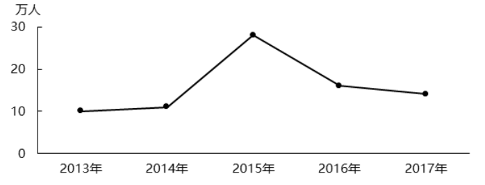
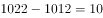
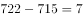
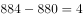
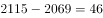

# 增长量比较（同比增量趋势与折线图匹配）

考点：[[20-考点/资料分析/增长/增长量比较（同比增量趋势与折线图匹配）|增长 / 增长量比较（同比增量趋势与折线图匹配）]]
材料：[[15-材料/资料分析/247447 2012—2017年深圳、广州、天津|247447 2012—2017年深圳、广州、天津]]

**问法模型**：题干给折线图问'2013—2017年年末常住人口同比增量的变化趋势'对应哪个城市 → 用相邻两年年末值相减构造逐年增量序列，与折线图逐点比对（首年筛选最快）

## 推理链
1. 第1步：定位表格，提取四个选项城市2012、2013年年末常住人口：武汉1012/1022、长沙715/722、杭州880/884、北京2069/2115（万人）
2. 第2步：同比增量=相邻两年年末值之差，即2013年增量=2013年末−2012年末（材料是年末存量，无增长率）
3. 第3步：代入计算2013年增量：武汉1022−1012=10万人，长沙722−715=7万人，杭州884−880=4万人，北京2115−2069=46万人
4. 第4步：读折线图首年（2013年）数值为10万人，仅武汉一致，排除长沙、杭州、北京，保留A
5. 第5步：复验武汉整条序列：2014年1033−1022=11、2015年1061−1033=28、2016年1077−1061=16、2017年1091−1077=14万人，即10→11→28→16→14，与折线图走势一致，锁定A（武汉）

**最快解法**：⚡ 首点定位法：折线图有具体坐标数值，先只算首年2013年各选项增量（武汉10、长沙7、杭州4、北京46万人），与图首点10万人比对，唯一吻合即选A，无需逐年全算

## 易错点
- ⚠ 把同比增量误算成同比增长率（(现期−基期)/基期），本题只需相邻两年相减
- ⚠ 错用不相邻年份相减或错配年份（如用2017年数据算2016年增量）；2013年增量只能用2013年末−2012年末，材料无2011年数据
- ⚠ 表中混有'10城市总计''全国人口总计'两行合计，问具体城市时合计行不能当作城市参与比较；北京等城市后期出现零增长/负增长（2017年2171较2016年2173下降），勿凭'大城市增量必大'的直觉排除

## 母题抽象
> 🧩 当题干出现'折线图反映×××同比增量的变化趋势'且图上有具体数值时，用首点定位法：先算各选项首年相邻两年差值与图首点比对，唯一吻合者即答案，必要时再用极值年份复验

**同类特征**：折线图、同比增量的变化趋势、2013—2017年、年末常住人口、选项为城市名、相邻两年相减

## 相关题
- [[10-真题/资料分析/增长/2028362 增长量比较（逐年同比增量计算＋折线趋势图匹配）|2028362]]（国考 2017，相关度2）
- [[10-真题/资料分析/增长/16592987 增长量计算与比较（排序+增量趋势判断）|16592987]]（河北 2024，相关度2）
- [[10-真题/资料分析/增长/16069832 同比增量计算与柱状图趋势匹配（增长量比较）|16069832]]（贵州 2026，相关度1）
- [[10-真题/资料分析/增长/15833698 环比增速计算与折线趋势图匹配|15833698]]（黑龙江 2026，相关度1）
- [[10-真题/资料分析/增长/18643768 同比增量（增长量）正负序列与给定柱状图匹配|18643768]]（天津 2026，相关度1）

---

### 题干

以下折线图反映了2013—2017年（    ）年末常住人口同比增量的变化趋势。

### 选项
- A. 武汉　✅
- B. 长沙
- C. 杭州
- D. 北京

### 官方解析

根据题干“······同比增量的变化趋势”，可判定本题为增长量比较问题。由于有坐标轴且有具体数值，因此可先看2013年的增长量。定位表格可得选项各城市2012、2013年人口数据。根据增长量，可得选项城市2013年增量分别为：

武汉：万人，与折线图一致，保留A；

长沙：万人，与折线图不一致，而折线图为10万人，排除；

杭州：万人，与折线图不一致，而折线图为10万人，排除；

北京：万人，与折线图不一致，而折线图为10万人，排除。

故正确答案为A。

### 给定材料

> [!warning] 疑点（官方解析可能有误，待人工复核）
> 官方解析中各城市2013年增量的具体数值留空（如'武汉：___万人'），按表格补全应为武汉10、长沙7、杭州4、北京46万人，与解析'仅武汉与折线图10万人一致'的结论吻合，答案A无误

<!-- CODEX-ANSWER-REVIEW:BEGIN -->
### 本次独立复核

**复核状态：** `confirmed`（独立复算确认答案）

**计分答案：** A（可计分）

**复核解析：**

原表四选项2013年增量依次为武汉10、长沙7、杭州4、北京46万人；折线首点10且后续武汉差值为11、28、16、14，与A图趋势吻合，选A。

**相关信息：**

增量趋势题先由首个点筛选，再用后续点复核。

**题源依据：** [固定版本原题](https://github.com/Mentat-Uran/kaogongzhentizhengliu/blob/84ab93d4b64b61d897bece8a1c0a5bab06b4feb2/10-%E7%9C%9F%E9%A2%98/%E8%B5%84%E6%96%99%E5%88%86%E6%9E%90/%E5%A2%9E%E9%95%BF/2453102%20%E5%A2%9E%E9%95%BF%E9%87%8F%E6%AF%94%E8%BE%83%EF%BC%88%E5%90%8C%E6%AF%94%E5%A2%9E%E9%87%8F%E8%B6%8B%E5%8A%BF%E4%B8%8E%E6%8A%98%E7%BA%BF%E5%9B%BE%E5%8C%B9%E9%85%8D%EF%BC%89.md)；固定内容 commit `84ab93d4b64b61d897bece8a1c0a5bab06b4feb2`，Markdown blob `19a454f0bb42a9efa1000a74231775468b132752`。
<!-- CODEX-ANSWER-REVIEW:END -->
