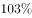

# 多指标逐年同比比较（同比增长年份计数）

考点：[[20-考点/资料分析/增长/多指标逐年同比比较（同比增长年份计数）|增长 / 多指标逐年同比比较（同比增长年份计数）]]
材料：[[15-材料/资料分析/247457 A自治区2012~2016年末城镇与|247457 A自治区2012~2016年末城镇与]]

**问法模型**：题干问'2013～2016各年末六个指标均高于上年的年份有几个' → 对'城乡×人均居住面积/每百户家用汽车/每百户移动电话'共6条序列逐年作差（本年末−上年末），全为正的年份计数

## 推理链
1. 第1步：题干限定统计年份为2013～2016年末（2012年末仅作比较基准），涉及6条序列：城镇/农村牧区的人均居住面积、每百户家用汽车、每百户移动电话；因每百户与户均同比例（同÷100），比较同比大小无需换算。
2. 第2步：读城镇人均居住面积序列29.89→29.60→30.65→31.39→32.20，2013年末29.60<2012年末29.89，2013年被排除（移动电话城镇202.63<206.11、农村牧区194.55<201.65同样印证2013年排除）。
3. 第3步：读农村牧区人均居住面积序列24.90→26.01→25.80→26.07→27.40，2014年末25.80<2013年末26.01，2014年被排除。
4. 第4步：验证剩余两年——家用汽车（城镇23.72→28.71→32.12→38.48；农村牧区15.31→17.12→23.08→27.29）与移动电话（城镇212.13→216.91→222.21；农村牧区206.74→220.58→231.53）2014～2016年逐年上升，未产生新的排除年份。
5. 第5步：2015年末（31.39、26.07、32.12、23.08、216.91、220.58）与2016年末（32.20、27.40、38.48、27.29、222.21、231.53）六个指标均高于上年，共2个年份。
6. 第6步：对照选项，2个年份对应B。

**最快解法**：⚡ 找反例排除法：不必逐年算6个增量，只需扫描每条序列找'下降点'——城镇人均居住面积2013年29.60<29.89、移动电话2013年双双下降（城镇202.63<206.11、农村牧区194.55<201.65）→排除2013年；农村牧区人均居住面积2014年25.80<26.01→排除2014年；再快速确认2015、2016年六条序列全部上升，直接锁定B。

## 易错点
- ⚠ 下降年份看漏：城镇人均居住面积2013年（29.60<29.89）不升反降，移动电话2013年城镇、农村牧区同时下降，农村牧区人均居住面积2014年（25.80<26.01）回落，序列并非单调递增，凭'连年增长'惯性直接数4年会错选D。
- ⚠ 统计年份范围：题问2013～2016年末'高于上年'，2012年末只作基期不计入统计，勿把2012年当比较对象或漏掉2013年与2012年的比较。
- ⚠ '每百户'换算纠结：同比比较大小与'户均'口径同比例，无需÷100；只有求户均绝对值或总量时才需换算，此处换算纯属浪费时间。

## 母题抽象
> 🧩 当题干出现'各年多指标均高于（低于）上年、符合条件的年份有几个'的特征时，用'找反例排除法'：每条序列只需定位一个同比下降点即可排除该年，剩余年份快速验证全升即可，避免逐年计算全部增量。

**同类特征**：均高于上年、年份有几个、多个指标同时比较、城镇与农村牧区双主体、人均居住面积与每百户拥有量、2013～2016逐年判断

## 相关题
- [[10-真题/资料分析/增长/13504272 一般增长率计算与计数比较（同比增速-5%年份计数）|13504272]]（云南 2025，相关度1）
- [[10-真题/资料分析/增长/16070145 同比增长率比较（逐年增速计算并计数年份）|16070145]]（贵州 2026，相关度1）
- [[10-真题/资料分析/增长/2024184 同比增长率比较（超阈值年份计数）|2024184]]（重庆 2016，相关度1）
- [[10-真题/资料分析/比重/2662229 现期比重比较（占比过半判断）|2662229]]（新疆 2020，相关度1）
- [[10-真题/资料分析/倍数/4673147 现期倍数比较（'多N倍'的转化判断）|4673147]]（广东 2022，相关度1）

---

### 题干
2013～2016各年末，A自治区城镇、农村牧区居民人均居住面积、户均家用汽车和移动电话拥有量均高于上年的年份有几个？

### 选项
- A. 1
- B. 2　✅
- C. 3
- D. 4

### 官方解析
定位表格材料可得，2012年末A自治区城镇居民人均居住面积为29.89平方米，2013年末为29.60平方米，2013年末低于上年，则2013年末排除；2013年末农村牧区居民人均居住面积为26.01平方米，2014年末为25.80平方米，2014年末低于上年，则2014年末排除；2015年末、2016年末A自治区城镇、农村牧区居民人均居住面积、户均家用汽车和移动电话拥有量均高于上年，即2015年、2016年这2个年份满足。
故正确答案为B。

### 给定材料

        2016年末，A自治区城镇人口为1542.1万人，城镇化率(城镇人口占总人口比重)为。

        2016年末A自治区城镇人均居住面积达32.20平方米，比1978年末增长了5.5倍；农村牧区人均居住面积达27.40平方米，比1985年末增长。2016年末A自治区城镇居民家庭每百户拥有家用汽车38.48辆、家用电脑62台、移动电话222.21部；农牧民家庭每百户拥有家用汽车27.29辆、家用电脑23台、移动电话231.53部。

