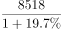
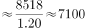
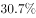

# 基期量计算

考点：[[20-考点/资料分析/增长/基期量计算|增长 / 基期量计算]]
材料：[[15-材料/资料分析/248014 2018年1-11月我国互联网和相关|248014 2018年1-11月我国互联网和相关]]

**问法模型**：题干以上年同期时间点（2017年1-11月）提问'完成业务收入约为多少亿元'，而材料现期为2018年1-11月（8518亿元）→ 套用基期量模型：基期量=现期量/(1+同比增长率)。

## 推理链
1. 第1步：题干求2017年1-11月业务收入，属上年同期（基期）；定位材料第二段：2018年1-11月规模以上互联网企业完成业务收入8518亿元（现期量），同比增速数值在所给文本中空缺（原卷载有具体增速）
2. 第2步：所用公式为基期量=现期量/(1+同比增长率)，即2017年1-11月收入=8518/(1+g)
3. 第3步：由官方答案B=7100亿元反推增速口径：8518/7100-1≈20.0%，按'1+20%=6/5'代入得8518×5/6≈7098亿元
4. 第4步：7098≈7100，与B项吻合（误差不足0.3%）；对照其余选项：A项6900对应增速约23.4%、C项7300对应约16.7%、D项7500对应约13.6%，均与官方答案所依据的增速口径不符，故选B

**最快解法**：⚡ 特殊分数替换+截位直除：将'1+20%'化为6/5，除法转乘法：8518×5/6≈1420×5≈7098≈7100，直接锁定B；或截位85÷1.2≈70.8→7080量级，四舍五入取7100。

## 易错点
- ⚠ 现期/基期方向混淆：材料数据是2018年1-11月（现期），求2017年应除以(1+g)；若误乘(1+g)得约10200、误乘(1-g)得约6810，均会错选量级相近项
- ⚠ 把'增速较1-10月提高1.7个百分点''与去年同期基本持平'误当增速本身代入——1.7个百分点是增速的变化量而非增速值；材料文本中增速数值空缺，须以原卷完整数据为准，不可凭空补数
- ⚠ 时间与指标口径：8518亿元是1-11月累计收入而非11月当月值，且是业务收入总量，勿错用信息服务收入7615亿元等分业务数据作现期量

## 母题抽象
> 🧩 当题干出现'上年同期…约为多少'且材料给出'现期量+同比增长率'时，用基期量=现期量/(1+g)，优先将1+g化为分数（如20%→6/5）乘算，并验证结果落在最接近的选项上。

**同类特征**：2017年1-11月（上年同期）、约为多少亿元、完成业务收入、基期时间早于材料现期、现期总量8518亿元、同比增长率

## 相关题
- [[10-真题/资料分析/增长/20303 基期量计算|20303]]（贵州 2010，相关度2）
- [[10-真题/资料分析/增长/1385893 基期量计算|1385893]]（重庆 2015，相关度2）
- [[10-真题/资料分析/增长/13504658 基期量计算|13504658]]（辽宁 2025，相关度2）
- [[10-真题/资料分析/增长/16593086 基期量计算|16593086]]（新疆 2024，相关度2）
- [[10-真题/资料分析/增长/2033794 基期量计算|2033794]]（江苏 2016，相关度2）

---

### 题干
2017年1-11月，我国互联网企业完成业务收入约为多少亿元？

### 选项
- A. 6900
- B. 7100　✅
- C. 7300
- D. 7500

### 官方解析

由题干“2017年1-11月，我国互联网企业完成业务收入···”，结合材料时间是2018年1-11月，可判定本题为基期量计算问题。定位文字材料第二段，“（2018年）1-11月，我国规模以上互联网和相关服务企业（简称互联网企业）完成业务收入8518亿元，同比增长···”。根据公式：基期量，可计算出2017年1-11月，我国互联网企业完成业务收入约为：亿元。

故正确答案为B。

### 给定材料

        2018年1-11月，我国互联网和相关服务业发展态势良好，业务收入保持较快增长，盈利状况基本稳定。分领域看，网络销售、影音直播等应用深受用户欢迎，市场规模稳步扩大，网络生活服务市场活跃。

一、总体运行情况

        1-11月，我国规模以上互联网和相关服务企业（简称互联网企业）完成业务收入8518亿元，同比增长，增速较1-10月提高1.7个百分点，与去年同期基本持平。主要省份保持良好增长态势，互联网业务收入总量居前三位的广东、上海、北京互联网业务收入分别增长、和。

二、分业务运行情况

（一）信息服务业务

        1-11月，信息服务收入达7615亿元，同比增长，其中，电子商务平台收入3212亿元，同比增长；网络游戏（包括客户端游戏、手机游戏、网页游戏等）业务收入1628亿元，同比增长。

（二）互联网数据中心业务

        1-11月，互联网企业完成互联网数据中心业务收入137亿元，同比增长；截至11月末，部署的服务器数量达138万台，同比增长。

（三）互联网接入业务

        1-11月，互联网企业完成互联网接入业务收入129亿元，同比下降，降幅较上半年和前三季度分别收窄6.9个和5个百分点。

三、移动应用程序（APP）数量情况

        我国市场上移动互联网应用数量小幅增长。截至11月底，我国市场上监测到的移动应用为447万款。11月份，我国第三方应用商店与苹果应用商店中新上架14.3万款移动应用。截至11月底，我国本土第三方应用商店移动应用数量超过266万款，苹果商店（中国区）移动应用数量超过181万款。

        截至11月底，游戏类应用数量为137.6万款。生活服务类应用规模达54万款，排名第二。排名第三和第四的分别是电子商务类应用和主题壁纸类应用，规模分别为42万款和37.1万款。在市场热点类应用当中，以物流企业应用、货运运输服务应用和具有自有物流服务能力的电子商城为代表的智慧物流类应用数量超过2.4万款；而提供二维码扫码、转账等金融支付功能的网络支付类应用数量约为2.5万款。

        截至11月底，第三方应用商店分发累计数量超过1.75万亿次。游戏类、系统工具类、影音播放类、社交通讯类、日常工具类、生活服务类和金融类应用下载量均超过千亿次，分别为3014亿次、2892亿次、2264亿次、1911亿次、1212亿次、1143亿次和1911亿次，其中游戏类、系统工具类和影音播放类应用下载量均突破两千亿次。其余各类应用中，下载总量超过500亿次的应用还有电子商务类（999亿次）、资讯阅读类（931亿次）和主题壁纸类（754亿次）。

> [!warning] 疑点（官方解析可能有误，待人工复核）
> 所给文本中总体同比增速数值空缺（官方解析公式代入处亦留白），无法从所给文字直接复算；按官方答案B（7100）反推，8518/7100-1≈20.0%，即总体增速应为约两成，答案与该口径自洽、无矛盾，但精确作答须以原卷完整增速数值为准。

<!-- CODEX-ANSWER-REVIEW:BEGIN -->
### 本次独立复核

**复核状态：** `confirmed`（独立复算确认答案）

**计分答案：** B（可计分）

**复核解析：**

基期量=8518/1.197≈7116.12元，最接近B项7100元。原解析约7117元是除法末位误差，选项结论不变。

**相关信息：**

基期量=现期量/(1+增长率)。

**题源依据：** [固定版本原题](https://github.com/Mentat-Uran/kaogongzhentizhengliu/blob/84ab93d4b64b61d897bece8a1c0a5bab06b4feb2/10-%E7%9C%9F%E9%A2%98/%E8%B5%84%E6%96%99%E5%88%86%E6%9E%90/%E5%A2%9E%E9%95%BF/2456363%20%E5%9F%BA%E6%9C%9F%E9%87%8F%E8%AE%A1%E7%AE%97.md)；固定内容 commit `84ab93d4b64b61d897bece8a1c0a5bab06b4feb2`，Markdown blob `f378bdba44cbcf0d6b741f1d0ce8887c421cafb3`。
<!-- CODEX-ANSWER-REVIEW:END -->
