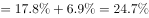

# 降幅的百分点差值推算（收窄-扩大方向判定）

考点：[[20-考点/资料分析/增长/降幅的百分点差值推算（收窄-扩大方向判定）|增长 / 降幅的百分点差值推算（收窄/扩大方向判定）]]
材料：[[15-材料/资料分析/248014 2018年1-11月我国互联网和相关|248014 2018年1-11月我国互联网和相关]]

**问法模型**：题干问'前三季度降幅较上半年收窄/扩大多少个百分点' → 以1-11月降幅为共同锚点，把'较上半年收窄6.9个、较前三季度收窄5个'两个百分点差值作差传递，得两期降幅之差及方向。

## 推理链
1. 第1步：定位接入业务段：2018年1-11月互联网接入业务收入129亿元，同比下降17.8%（原卷数据），降幅较上半年收窄6.9个百分点、较前三季度收窄5个百分点。
2. 第2步：规则：'降幅较参照期收窄n个百分点'即参照期降幅−现期降幅=n，故参照期降幅=17.8%+n（若表述为'扩大'则相减方向相反）。
3. 第3步：上半年降幅=17.8%+6.9=24.7%；前三季度降幅=17.8%+5=22.8%。
4. 第4步：前三季度较上半年：24.7%−22.8%=1.9个百分点，且22.8%＜24.7%，降幅数值变小。
5. 第5步：降幅变小即'收窄'，故前三季度降幅较上半年收窄1.9个百分点，与A选项吻合。

**最快解法**：⚡ 百分点差值传递（口算）：'收窄6.9个'与'收窄5个'均以1-11月降幅17.8%为锚，上半年与前三季度两期降幅之差=6.9−5=1.9个百分点；降幅沿时间轴持续收窄（前三季度22.8%＜上半年24.7%），方向为'收窄'，秒选A，最终差值不依赖17.8%本身也能得出。

## 易错点
- ⚠ 方向判反：把'降幅收窄'误解为下降更多，或看到22.8%＜24.7%仍错标成'扩大'而误选C；收窄=下降幅度变小。
- ⚠ 百分率与百分点混淆：6.9和5是百分点差值而非降幅本身，误将两者相加得11.9个百分点（B、D正是此坑），或误拿降幅17.8%直接参与加减比较。
- ⚠ 参照期错位：材料给的是'1-11月较上半年/前三季度分别收窄'，题目问的是'前三季度较上半年'，须经共同锚点（1-11月降幅）作差传递，不可直接拿129亿元收入或1-11月降幅套问。

## 母题抽象
> 🧩 当题干出现'某指标降幅（或增速）较A期收窄/扩大a个、较B期收窄/扩大b个百分点'时，以共同参照期为锚，A、B两期差值=|a−b|个百分点；方向按时间轴判断：降幅随时间收窄则后一期比前一期'收窄|a−b|个百分点'，验证选项方向与数值即可。

**同类特征**：降幅较上半年、收窄/扩大…个百分点、前三季度、互联网接入业务收入、百分点差值、较上半年和前三季度分别收窄6.9个和5个百分点

## 相关题
（暂无）

---

### 题干
2018年前三季度，互联网企业完成互联网接入业务收入降幅较上半年：

### 选项
- A. 收窄1.9个百分点　✅
- B. 收窄11.9个百分点
- C. 扩大1.9个百分点
- D. 扩大11.9个百分点

### 官方解析

定位文字材料第五段，“（2018年）1-11月，互联网企业完成互联网接入业务收入···，同比下降17.8%，降幅较上半年和前三季度分别收窄6.9个和5个百分点”。可计算出2018年前三季度降幅；上半年降幅。由此可知，2018年前三季度，互联网企业完成互联网接入业务收入降幅较上半年：，即收窄1.9个百分点。 

故正确答案为A。

### 给定材料

        2018年1-11月，我国互联网和相关服务业发展态势良好，业务收入保持较快增长，盈利状况基本稳定。分领域看，网络销售、影音直播等应用深受用户欢迎，市场规模稳步扩大，网络生活服务市场活跃。

一、总体运行情况

        1-11月，我国规模以上互联网和相关服务企业（简称互联网企业）完成业务收入8518亿元，同比增长，增速较1-10月提高1.7个百分点，与去年同期基本持平。主要省份保持良好增长态势，互联网业务收入总量居前三位的广东、上海、北京互联网业务收入分别增长、和。

二、分业务运行情况

（一）信息服务业务

        1-11月，信息服务收入达7615亿元，同比增长，其中，电子商务平台收入3212亿元，同比增长；网络游戏（包括客户端游戏、手机游戏、网页游戏等）业务收入1628亿元，同比增长。

（二）互联网数据中心业务

        1-11月，互联网企业完成互联网数据中心业务收入137亿元，同比增长；截至11月末，部署的服务器数量达138万台，同比增长。

（三）互联网接入业务

        1-11月，互联网企业完成互联网接入业务收入129亿元，同比下降，降幅较上半年和前三季度分别收窄6.9个和5个百分点。

三、移动应用程序（APP）数量情况

        我国市场上移动互联网应用数量小幅增长。截至11月底，我国市场上监测到的移动应用为447万款。11月份，我国第三方应用商店与苹果应用商店中新上架14.3万款移动应用。截至11月底，我国本土第三方应用商店移动应用数量超过266万款，苹果商店（中国区）移动应用数量超过181万款。

        截至11月底，游戏类应用数量为137.6万款。生活服务类应用规模达54万款，排名第二。排名第三和第四的分别是电子商务类应用和主题壁纸类应用，规模分别为42万款和37.1万款。在市场热点类应用当中，以物流企业应用、货运运输服务应用和具有自有物流服务能力的电子商城为代表的智慧物流类应用数量超过2.4万款；而提供二维码扫码、转账等金融支付功能的网络支付类应用数量约为2.5万款。

        截至11月底，第三方应用商店分发累计数量超过1.75万亿次。游戏类、系统工具类、影音播放类、社交通讯类、日常工具类、生活服务类和金融类应用下载量均超过千亿次，分别为3014亿次、2892亿次、2264亿次、1911亿次、1212亿次、1143亿次和1911亿次，其中游戏类、系统工具类和影音播放类应用下载量均突破两千亿次。其余各类应用中，下载总量超过500亿次的应用还有电子商务类（999亿次）、资讯阅读类（931亿次）和主题壁纸类（754亿次）。

> [!warning] 疑点（官方解析可能有误，待人工复核）
> 官方解析引用的'同比下降17.8%'在所给材料文本中为空缺值（系原卷完整数据），但该值仅用于锚定参照期降幅与方向，最终差值6.9−5=1.9个百分点不依赖它，解析结论与答案A一致，无实质矛盾。
