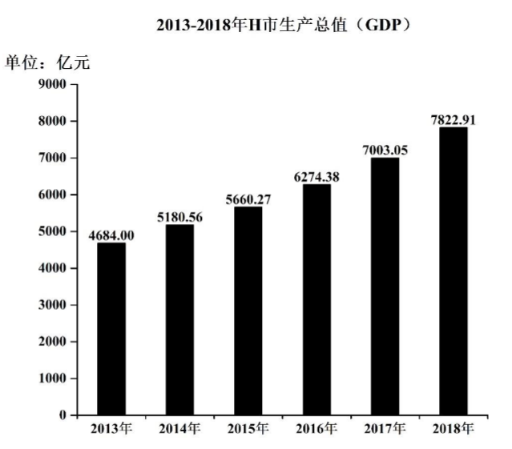
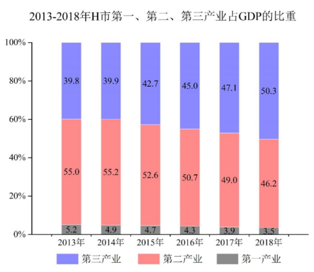

# 增长率比较（两图联立：产值=GDP×比重后比较产业增速）

考点：[[20-考点/资料分析/增长/增长率比较（两图联立：产值=GDP×比重后比较产业增速）|增长 / 增长率比较（两图联立：产值=GDP×比重后比较产业增速）]]
材料：[[15-材料/资料分析/248015 2013-2018年H市生产总值(G|248015 2013-2018年H市生产总值(G]]

**问法模型**：题干出现'产值增长幅度最大与最小'→ 判定为增长率比较问题：先由图1×图2联立得各产业两期产值（产值=GDP×比重），再用增长率=(现期-基期)/基期比较三产业

## 推理链
1. 第1步：从图1提取2018年GDP=7822.91亿元、2017年GDP=7003.05亿元；从图2提取2018年三次产业比重3.5%、46.2%、50.3%，2017年比重3.9%、49.0%、47.1%
2. 第2步：各产业产值=GDP×比重，增长率=(A×a%)/(B×b%)−1=(A/B)×(a/b)−1，其中A/B=7822.91/7003.05≈1.117为三个产业公用的GDP增速因子
3. 第3步：因A/B公用，只需比较比重比a/b：第一产业3.5/3.9≈0.897，第二产业46.2/49.0≈0.943，第三产业50.3/47.1≈1.068
4. 第4步：得增长率排序为第三产业>第二产业>第一产业；具体验证：第一产业产值7822.91×3.5%≈273.8亿元 vs 7003.05×3.9%≈273.1亿元，增幅≈0.2%
5. 第5步：第二产业3614.2 vs 3431.5亿元，增幅≈5.3%；第三产业3934.9 vs 3298.4亿元，增幅≈19.3%
6. 第6步：增长幅度最大为第三产业（≈19.3%），最小为第一产业（≈0.2%），对照选项选D

**最快解法**：⚡ 比重比值法：增长率=(A/B)×(a/b)−1，GDP增速因子A/B≈1.117三产业公用可约去，直接比较比重比a/b——第三产业50.3/47.1>1（增速超GDP的11.7%），第一产业3.5/3.9≈0.90<第二产业46.2/49.0≈0.94，故最大第三产业、最小第一产业，秒选D，无需算出具体产值

## 易错点
- ⚠ 把'增长幅度'误解为绝对增量：若按增量比较，第二产业增量（约183亿元）小于第三产业（约636亿元），且第一产业增量约0.7亿元看似'接近持平'，必须按增长率（除以基期）比较
- ⚠ 只看比重升降误判：第一产业比重3.9%→3.5%下降、第二产业49.0%→46.2%下降更多，易误判二者产值负增长、误选C（以为比重降最多的第二产业降幅最大）——实际GDP总量增长约11.7%，比重比<1的产业产值仍在增长，只是低于GDP增速
- ⚠ 堆叠图陷阱：柱高恒为100%，不能目测柱段长短比较产值大小，必须与图1的GDP总量相乘换算成产值

## 母题抽象
> 🧩 当题干问'某分部产值的增长幅度（率）最大/最小'而材料只给总量图+比重图时，用增长率=(A/B)×(a/b)−1模型，因A/B公用只需比较比重比a/b：比重比>1者增速超总量增速，比重比最小者增速最低，可跳过产值计算直接排序

**同类特征**：增长幅度最大与最小、产业产值（非比重、非增量）、两图联立（GDP总量×比重）、相邻两年同比（2018对2017）、三个主体排序比较、'幅度'指增长率需除以基期

## 相关题
（暂无）

---

### 题干
2018年H市第一、第二、第三产业产值增长幅度最大与最小的产业分别是：

### 选项
- A. 第一产业，第三产业
- B. 第二产业，第一产业
- C. 第三产业，第二产业
- D. 第三产业，第一产业　✅

### 官方解析
根据题干“2018年，……增长幅度最大与最小的产业分别是”，可判定本题为一般增长率的比较问题。定位第二个统计图可知，2018年第一、第二、第三产业占GDP的比重依次是、、，2017年第一、第二、第三产业占GDP的比重依次是、、。设2018年H市GDP为A，2017年H市GDP为B。结合公式：，，可得第一、第二、第三产业产值增长幅度如下：
第一产业：增长幅度；
第二产业：增长幅度；
第三产业：增长幅度；
比较可得，，故增长幅度最大的是第三产业，最小的是第一产业。
故正确答案为D。

### 给定材料

