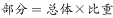
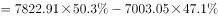
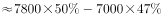
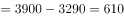

# 增长量计算（GDP总量×产业比重的跨图拼接型产值增长量）

考点：[[20-考点/资料分析/增长/增长量计算（GDP总量×产业比重的跨图拼接型产值增长量）|增长 / 增长量计算（GDP总量×产业比重的跨图拼接型产值增长量）]]
材料：[[15-材料/资料分析/248015 2013-2018年H市生产总值(G|248015 2013-2018年H市生产总值(G]]

**问法模型**：题干问'某年某产业产值增加值约为'→ 判定为增长量（增加额）计算，模型：产值=GDP×比重，增长量=现期产值−基期产值

## 推理链
1. 第1步：从图1提取总量数据——2017年H市GDP=7003.05亿元，2018年GDP=7822.91亿元
2. 第2步：从图2提取比重数据——2017年第三产业占GDP比重47.1%，2018年为50.3%（跨图联立，单图无法得出产值）
3. 第3步：套用公式'产值=GDP×比重'，2017年第三产业产值=7003.05×47.1%≈3298.44亿元
4. 第4步：同法得2018年第三产业产值=7822.91×50.3%≈3934.92亿元
5. 第5步：增长量=现期−基期=3934.92−3298.44≈636.5亿元
6. 第6步：与选项对照，636.5亿元最接近D项637亿元，故选D

**最快解法**：⚡ 

## 易错点
- ⚠ '增加值'歧义陷阱：统计术语中'产业增加值'即产值本身，而本题'第三产业产值增加值'实指'增加额'（增长量），需按官方备注口径理解为两期产值之差
- ⚠ 只看比重不乘总量：误算50.3%−47.1%=3.2（个百分点）或直接用比重当产值，图2只给比重、图1只给总量，必须跨图拼接 GDP×比重
- ⚠ 误用GDP增量替代：把GDP总增量7822.91−7003.05=819.86亿元当作第三产业增量（忽略了比重由47.1%升至50.3%的结构变化，正确答案约637亿元而非820亿元）

## 母题抽象
> 🧩 当题干出现'某产业产值的增加值/增长额'且材料分别给出GDP总量图与产业比重图时，用'产值=GDP×比重'分别求两期产值再相减；速算时将比重拆为'整数百分点+零头'（如50.3%=50%+0.3%）逐项乘后加总

**同类特征**：产值增加值、第三产业、现期2018年对基期2017年、需GDP×比重跨图拼接、'约为'提示估算即可、选项数值间隔较大（百亿级差）

## 相关题
（暂无）

---

### 题干
2018年H市第三产业产值增加值约为：

### 选项
- A. 321亿元
- B. 475亿元
- C. 546亿元
- D. 637亿元　✅

### 官方解析

根据题干“2018年H市第三产业产值的增加值约为”，可判定本题为增长量的计算问题。定位统计图可知，2017年、2018年H市GDP分别为7003.05亿元、7822.91亿元；2017年、2018年第三产业占GDP的比重分别为、。根据公式：；，所求亿元，与D项最接近。

故正确答案为D。

备注：本题问法不严谨，因为“增加值”在统计术语中指的就是产值，但本题题干已有“第三产业产值”，故推测这里的“增加值”指的是“增加额”，进而判断本题为增长量计算问题。

### 给定材料

> [!warning] 疑点（官方解析可能有误，待人工复核）
> 官方解析原文中两处比重数值缺失（'分别为、'处空白），需从图2补全为47.1%与50.3%，补全后计算636.5≈637亿元与答案D一致，结论无误；另官方已自注'增加值'问法不严谨（统计口径中产业增加值即产值），本题实按'增加额'处理
