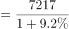
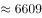
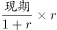
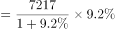

# 增长量计算——每增长1个百分点对应的增量（基期量×1%）

考点：[[20-考点/资料分析/增长/增长量计算——每增长1个百分点对应的增量（基期量×1%）|增长 / 增长量计算——每增长1个百分点对应的增量（基期量×1%）]]
材料：[[15-材料/资料分析/257532 2017年全国及J省海洋经济发展情况|257532 2017年全国及J省海洋经济发展情况]]

**问法模型**：'同比每增长1个百分点约增加多少'→ 用'基期量×1%'模型，即现期量÷(1+增速)×1%，等价于当年增长量÷增速百分点数

## 推理链
1. 第1步：从材料第1段提取：2017年J省海洋生产总值7217亿元，同比增长9.2%（原文百分数留空，须回图片核对，官方解析确认为9.2%）
2. 第2步：每增长1个百分点对应的增量≈基期量×1%，基期量=现期量÷(1+r)=7217÷(1+9.2%)
3. 第3步：代入计算：7217÷1.092≈6611亿元，×1%≈66亿元
4. 第4步：交叉验证（官方方法二）：全年增长量=7217-6611≈606≈600亿元，600÷9.2≈65.2≈66亿元，两种算法一致
5. 第5步：对照选项：A项66亿元最接近（B项72亿元是误用现期7217×1%，D项776亿元是误用全国77611×1%），故选A

**最快解法**：⚡ 截位直除：列式7217÷1.092×1%，先截位直除7217÷1.092≈6611，再缩小百倍（×1%）得≈66亿元，一步锁定A；亦可先算增长量606≈600亿元再除以9.2个百分点

## 易错点
- ⚠ 基期现期混淆：'每增长1个百分点'的增量对应基期（2016年）水平，若直接用现期7217×1%≈72亿元会误选B
- ⚠ 分子主体用错：误用全国海洋生产总值77611亿元×1%≈776亿元会误选D，必须用J省的7217亿元（同名指标'海洋生产总值'有全国与J省两套口径）
- ⚠ 材料文本中增速百分数留空（阅读陷阱），必须回原图核对为9.2%再计算，不得凭空补数；若增速代错数值或方向，基期回推7217÷(1+r)全盘出错

## 母题抽象
> 🧩 当题干出现'每增长1个百分点（或每增长1%）约增加多少'特征时，用'基期量×1%=现期量÷(1+增速)×1%'（等价于当年增长量÷增速百分点数），代入后截位直除，选最接近的选项

**同类特征**：每增长1个百分点、约增加、同比增速已给、现期值+增速回推基期、增长量计算、选项带单位（亿元）

## 相关题
- [[10-真题/资料分析/增长/2144733 增长量计算（增长量=现期×r-(1+r)）|2144733]]（新疆 2017，相关度2）
- [[10-真题/资料分析/增长/7159 增长量计算|7159]]（北京 2009，相关度1）
- [[10-真题/资料分析/增长/3018839 增长量计算（负增长情形：基期减少量）|3018839]]（广东 2021，相关度1）
- [[10-真题/资料分析/增长/10204654 增长量计算（已知现期与同比下降率求下降量）|10204654]]（安徽 2024，相关度1）
- [[10-真题/资料分析/增长/13319362 现期增长量计算（已知现期值与同比增速，用r-(1+r)公式）|13319362]]（江苏 2025，相关度1）

---

### 题干
2017年J省海洋生产总值同比每增长1个百分点，当年其海洋生产总值约增加：

### 选项
- A. 66亿元　✅
- B. 72亿元
- C. 726亿元
- D. 776亿元

### 官方解析

方法一：根据题干“2017年······约增加”，结合选项带单位，可判定本题为增长量计算问题。定位材料第二段，“2017年，J省海洋生产总值为7217亿元，比上年增长”，则2016年J省海洋生产总值亿元。故2017年J省海洋生产总值同比每增长1个百分点，当年其海洋生产总值约增加亿元，与A项最接近。

方法二：2017年J省海洋生产总值的增长量为亿元。即增长9.2个百分点对应的增长量为600亿元，则每增长1个百分点，当年其海洋生产总值约增加亿元，与A项最接近。

故正确答案为A。

### 给定材料

        2017年全国海洋生产总值77611亿元，比上年增长，海洋生产总值占国内生产总值的。

        2017年，J省海洋生产总值为7217亿元，比上年增长，海洋生产总值占地区生产总值的，2017年，全省沿海沿江港口完成货物吞吐量20.4亿吨，同比增长；集装箱吞吐量1698.8万标箱，同比增长。

        2017年，J省造船完工量为1412.4万载重吨，同比下降；新承订单量为1393.4万载重吨，同比增长；手持订单量为3662.3万载重吨，同比下降，分别占全国份额的、和。

        2017年，J省沿海三市接待国内游客10558.01万人次，同比增长；接待入境过夜旅游者27.65万人次，同比增长。

        2017年，J省实现海水养殖产量93.1万吨，同比增长；海洋捕捞产量53万吨，同比下降；远洋渔业产量2.9万吨，同比增长。

        2017年，J省海工装备产值同比增长。全省沿海地区风电装机容量达到589.7万千瓦，同比增长；海上风电装机容量达到162.5万千瓦，同比增长。2017年，全省完成海水淡化产量1.31万吨，同比增长。

