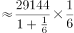

# 增长量计算（现期量与同比增速已知）

考点：[[20-考点/资料分析/增长/增长量计算（现期量与同比增速已知）|增长 / 增长量计算（现期量与同比增速已知）]]
材料：[[15-材料/资料分析/257534 2016年国产工业机器人全年销售状况|257534 2016年国产工业机器人全年销售状况]]

**问法模型**：题干以'2016年……较上年约增加了多少万台'设问（问有单位的增量而非增速）→采用增长量模型：增长量=现期量×r/(1+r)，并将'台'换算为'万台'后与选项对照。

## 推理链
1. 第1步：由题干'较上年约增加了多少万台'判定为增长量计算；从材料第一段提取现期量：2016年全年累计销售29144台。
2. 第2步：同比增速r取材料第一段图示数值（纯文本不可读），由官方答案自洽反推约为16.8%（0.42万台=4200台，4200/(29144−4200)≈16.8%）。
3. 第3步：所用公式：增长量=现期量×r/(1+r)=29144×16.8%÷1.168。
4. 第4步：代入计算：因16.8%≈1/6，增长量≈29144/(1+6)=29144/7≈4163台（精确式29144×0.168/1.168≈4192台，量级一致）。
5. 第5步：单位换算：4163~4192台≈0.42万台。
6. 第6步：与选项对照：A.0.20、B.0.31、C.0.42、D.0.53，仅C与约0.42万台吻合，故选C。

**最快解法**：⚡ 百化分：将增速16.8%看作1/6，则增长量=现期量/(1+n)=29144/(1+6)=29144/7≈4160台≈0.42万台，直接锁定C；不化分数时用截位直除29144×0.168/1.168≈4200台亦可。

## 易错点
- ⚠ 单位换算陷阱：材料以'台'计（29144台），题干问'万台'，增量约为0.42万台而非4200万台或4.2万台，不换算或错位换算会错判选项量级。
- ⚠ 公式误用：增长量=现期×r/(1+r)；若误用'增长量=现期×r'得29144×16.8%≈4896台≈0.49万台，会误选D。
- ⚠ 题干问'增加了多少万台'是增长量而非增长率，勿因材料'增速较上年提升'而误入增速比较思路；且增速数值以图片呈现、纯文本不可读，不可臆造增速。

## 母题抽象
> 🧩 当题干出现'现期量较上年约增加了多少（带具体单位）'的特征时，用增长量=现期×r/(1+r)；若增速可百化分（r≈1/n）则直接用增长量≈现期/(n+1)，再完成台↔万台单位换算后对照选项。

**同类特征**：较上年约增加了、多少万台（问增量且带具体单位）、全年累计销售（现期累计量）、同比增速已知、台与万台单位换算、增长量计算

## 相关题
- [[10-真题/资料分析/增长/2144733 增长量计算（增长量=现期×r-(1+r)）|2144733]]（新疆 2017，相关度2）
- [[10-真题/资料分析/增长/7159 增长量计算|7159]]（北京 2009，相关度1）
- [[10-真题/资料分析/增长/2571729 增长量计算——每增长1个百分点对应的增量（基期量×1%）|2571729]]（山东 2020，相关度1）
- [[10-真题/资料分析/增长/3018839 增长量计算（负增长情形：基期减少量）|3018839]]（广东 2021，相关度1）
- [[10-真题/资料分析/增长/10204654 增长量计算（已知现期与同比下降率求下降量）|10204654]]（安徽 2024，相关度1）

---

### 题干
2016年国产工业机器人累计销售量较上年约增加了多少万台？

### 选项
- A. 0.20
- B. 0.31
- C. 0.42　✅
- D. 0.53

### 官方解析

根据题干“2016年······较上年约增加······万台”，可判定本题为增长量计算问题。定位文字材料第一段，“2016······，全年累计销售29144台，较上年增长”，故2016年国产工业机器人累计销售量的同比增长量台万台 。

故正确答案为C。

### 给定材料

        2016年国产工业机器人销量继续增长，全年累计销售29144台，较上年增长，增速较上年提升。

        从机械结构看，2016年国产多关节机器人销量首次超过万台，为11756台，增速已连续两年超过，占国产工业机器人总销量的，比上年提高12.9个百分点。坐标机器人仍是国产工业机器人销量第一的机型，2016年销售12830台，占销售总量的比重为，比上年回落3.5个百分点，连续两年占比回落。工厂用AGV机器人销量超过2100台，同比增长。并联机器人销售增长。而SCARA机器人和圆柱坐标机器人的销售则出现超过的下降。

        从应用领域看，2016年搬运与上下料仍是国产工业机器人的首要应用领域，全年销售1.65万台，同比增长，增速放缓，占国产工业机器人销售总量的；焊接和钎焊机器人销售0.51万台，同比增长；装配与拆卸机器人销售0.37万台，同比增长。此外涂层与胶封机器人的销售也实现了的增长，特别是其中的喷漆上釉机器人销量增长了，而洁净室机器人和加工机器人的销售量均出现了同比下降。

       从应用行业看，3C行业和电气设备行业销量均超过5000台，分列第一第二位，特别是电气设备行业，同比大幅增长3倍有余。汽车行业销量同比增长；非金属矿物制品业销量同比增长。此外，在家具、服装、烟草等消费品制造行业的机器人消费量均翻番。

