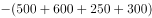
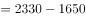

# 增长量计算（环比增长额）

考点：[[20-考点/资料分析/增长/增长量计算（环比增长额）|增长 / 增长量计算（环比增长额）]]
材料：[[15-材料/资料分析/257872 C集团公司甲、乙、丙、丁四个车间1月|257872 C集团公司甲、乙、丙、丁四个车间1月]]

**问法模型**：题干出现'与上个月相比较……2月份的总产值增长额是'且选项带单位（万元）→ 采用环比增长量模型：现期（2月）总产值−基期（1月）总产值

## 推理链
1. 第1步：由题干'与上个月相比较''增长额'判定为环比增长量计算，时间口径为2月对1月，主体为C集团公司总产值（四车间加总）
2. 第2步：定位表二（单位万元），1月各车间产值：甲500、乙600、丙250、丁300；2月各车间产值：甲850、乙880、丙280、丁320
3. 第3步：按图例（砖纹=1月、斜纹=2月）分别加总：2月总产值=850+880+280+320=2330万元，1月总产值=500+600+250+300=1650万元
4. 第4步：代入公式增长额=现期−基期=2330−1650=680万元（亦可逐车间作差：350+280+30+20=680）
5. 第5步：与选项对照，680万元对应选项C，排除A520、B650、D710

**最快解法**：⚡ 逐项作差再求和（分组作差法）：不必分别加总两个大数，直接（850−500）+（880−600）+（280−250）+（320−300）=350+280+30+20=680万元，口算即得，选C

## 易错点
- ⚠ 柱状图读图陷阱：每车间两根柱相邻，须按图例区分砖纹（1月）与斜纹（2月），读反则差值变负或错位
- ⚠ 单位口径：表二为万元、表一为元，本题只用表二无需换算，但若误引表一数据会差1万倍；选项单位统一为万元
- ⚠ 问法口径：'增长额'是现期−基期的差值（本题2月>1月为正），勿与'增长速度/变动率'（需除以基期）或'变动幅度'（取绝对值比较）混淆

## 母题抽象
> 🧩 当题干出现'与上月相比……增长额/增长量是多少（选项带单位）'且对象为多主体合计总量时，用'现期合计−基期合计'，数据分散时可逐项作差再求和，验证差额与选项一致

**同类特征**：与上个月相比较、2月份、总产值、增长额、选项带单位（万元）、四车间数据需加总

## 相关题
- [[10-真题/资料分析/增长/2578512 环比变动幅度（增长率绝对值）比较|2578512]]（湖南 2020，相关度2）
- [[10-真题/资料分析/增长/2578513 环比增长率比较（月平均工资增速最快）|2578513]]（内蒙古 2020，相关度2）
- [[10-真题/资料分析/增长/2402490 增长率比较（同比增速最快）|2402490]]（重庆 2018，相关度1）
- [[10-真题/资料分析/其他/5514921 数列扫描定位（首次突破某值）|5514921]]（广东 2023，相关度1）
- [[10-真题/资料分析/倍数/5514929 现期倍数（间隔年份基期定位）|5514929]]（广东 2023，相关度1）

---

### 题干
与上个月相比较，C集团公司2月份的总产值增长额是：

### 选项
- A. 520万元
- B. 650万元
- C. 680万元　✅
- D. 710万元

### 官方解析

根据题干“与上个月相比较······2月份的总产值增长额是”，结合选项带单位，可判定本题为增长量计算问题。定位材料表二，可得：C集团公司各车间1月份的产值分别为500、600、250、300，2月份的产值分别为850、880、280、320。 故C集团公司2月份总产值的环比增长量万元。 

故正确答案为C。

### 给定材料

> [!warning] 疑点（官方解析可能有误，待人工复核）
> 官方解析中'故C集团公司2月份的总产值环比增长量万元'一句漏排了计算式'2330−1650=680'，属排版缺字；按表二数据计算结果680万元与答案C一致，无实质矛盾

<!-- CODEX-ANSWER-REVIEW:BEGIN -->
### 本次独立复核

**复核状态：** `resolved`（答案与解析已核定）

**计分答案：** C（可计分）

**复核解析：**

2月总产值增量=(850+880+280+320)−(500+600+250+300)=2330−1650=680万元，C。

**相关信息：**

增长量=现期量×增长率/(1+增长率)；同比下降题先明确增长量符号。百分点和百分比需按材料口径区分。

**题源依据：** [固定版本原题](https://github.com/Mentat-Uran/kaogongzhentizhengliu/blob/84ab93d4b64b61d897bece8a1c0a5bab06b4feb2/10-%E7%9C%9F%E9%A2%98/%E8%B5%84%E6%96%99%E5%88%86%E6%9E%90/%E5%A2%9E%E9%95%BF/2578478%20%E5%A2%9E%E9%95%BF%E9%87%8F%E8%AE%A1%E7%AE%97%EF%BC%88%E7%8E%AF%E6%AF%94%E5%A2%9E%E9%95%BF%E9%A2%9D%EF%BC%89.md)；固定内容 commit `84ab93d4b64b61d897bece8a1c0a5bab06b4feb2`，Markdown blob `9fc24b9af447c8c9ce402c2e6bf3d172def0ce44`。
<!-- CODEX-ANSWER-REVIEW:END -->
