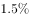
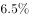

# 降幅比较（负增长率绝对值直读比较）

考点：[[20-考点/资料分析/增长/降幅比较（负增长率绝对值直读比较）|增长 / 降幅比较（负增长率绝对值直读比较）]]
材料：[[15-材料/资料分析/257856 2019年全国及东部、中部、西部、东|257856 2019年全国及东部、中部、西部、东]]

**问法模型**：题干问'同比下降幅度最大的地区'→ 定位表二销售面积'比上年增长(%)'列，先排除正增长项，再对负增速取绝对值比较，绝对值最大者即降幅最大

## 推理链
1. 第1步：从表二提取2019年四个地区商品房销售面积增速：东部-1.5%、中部-1.3%、西部+4.4%、东北-5.3%（全国总计-0.1%不在备选范围）
2. 第2步：规则：'同比下降幅度最大'=增速为负且绝对值最大；西部+4.4%为正增长（上升），不属于'下降'，先行排除
3. 第3步：比较剩余负值绝对值：|-5.3|=5.3 ＞ |-1.5|=1.5 ＞ |-1.3|=1.3，东北地区降幅5.3%最大
4. 第4步：与选项对照：东北地区对应D项，故正确答案为D

**最快解法**：⚡ 直读比较法：先扫一眼排除唯一正增长的西部（+4.4%），再对东-1.5、中-1.3、东北-5.3取绝对值比大小，-5.3%最大直接锁定D，无需任何计算

## 易错点
- ⚠ 方向词陷阱：误把'下降幅度最大'当作数值最大的负增速处理，若直接比数值-1.3＞-1.5＞-5.3会误选中部；正确做法是对负值取绝对值比较
- ⚠ 排除项混淆：西部+4.4%是唯一正增长（上升）地区，与'下降'方向相反，须先排除；同时注意'增长最快'（西部）与'降幅最大'（东北）是两个相反的问法
- ⚠ 列取数陷阱：表二左半是销售面积（万平方米）、右半是销售额（亿元），两组增速不同（如西部面积+4.4%、销售额+10.8%），本题只能取销售面积列；且'地区'不含'全国总计'行

## 母题抽象
> 🧩 当题干出现'下降幅度最大（最小）的地区/指标'特征时，先排除增速为正的项，再对剩余负增速取绝对值排序，绝对值最大（小）者即为答案，全程直读表格无需计算

**同类特征**：同比下降幅度最大、地区（排除全国总计）、商品房销售面积、负增长率绝对值比较、方向词辨析、读表直读比较

## 相关题
- [[10-真题/资料分析/增长/2263126 同比下降幅度比较（负增长率取绝对值比大小）|2263126]]（四川 2016，相关度1）

---

### 题干
2019年全国商品房销售面积同比下降幅度最大的地区是：

### 选项
- A. 东部地区
- B. 中部地区
- C. 西部地区
- D. 东北地区　✅

### 官方解析

定位表二，可知2019年东部地区商品房销售面积同比下降，中部地区商品房销售面积同比下降，西部地区商品房销售面积同比上升，东北地区商品房销售面积同比下降。西部地区商品房销售面积同比上升，可排除；其余三个地区商品房销售面积同比下降幅度最大的是东北地区。

故正确答案为D。

### 给定材料

        2019年全国房地产开发投资132194亿元，比上年增长，增速比上年加快0.4个百分点。其中，住宅投资97071亿元，增长，增速比上年加快0.5个百分点。2019年，全国商品房销售面积171558万平方米，比上年下降。其中，住宅销售面积增长，办公楼销售面积下降，商业营业用房销售面积下降。商品房销售额159725亿元，增长，增速比上年回落5.7个百分点。其中，住宅销售额增长，办公楼销售额下降，商业营业用房销售额下降。

