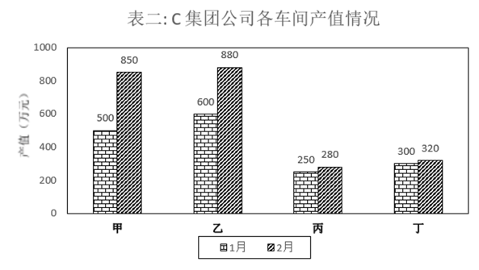

# 环比变动幅度（增长率绝对值）比较

考点：[[20-考点/资料分析/增长/环比变动幅度（增长率绝对值）比较|增长 / 环比变动幅度（增长率绝对值）比较]]
材料：[[15-材料/资料分析/257872 C集团公司甲、乙、丙、丁四个车间1月|257872 C集团公司甲、乙、丙、丁四个车间1月]]

**问法模型**：题干'与上个月相比较，2月份职工人数变动幅度最大'→ 对四车间分别求环比变化率|（2月人数−1月人数）/1月人数|后比大小

## 推理链
1. 第1步：定位表一职工人数列，甲1月500、2月550；乙1月600、2月580；丙1月300、2月320；丁1月200、2月200（基期为1月，现期为2月）
2. 第2步：变动幅度比较即比较增长率的绝对值，公式为|（现期−基期）/基期|=|（2月−1月）/1月|
3. 第3步：代入计算，甲=|550−500|/500=50/500=10%；乙=|580−600|/600=20/600≈3.3%；丙=|320−300|/300=20/300≈6.7%；丁=|200−200|/200=0
4. 第4步：排序10%＞6.7%＞3.3%＞0，甲车间职工人数变动幅度最大，对照选项选A

**最快解法**：⚡ 截位直除+变化率绝对值比较：甲差50、基期500，一眼10%为最大候选；乙丙差值同为20，基期小的变化率大（丙300＜乙600，故丙＞乙）；丁差值为0；10%＞6.7%直接锁定甲（A），无需精算

## 易错点
- ⚠ '变动幅度'按变化绝对值比较，乙车间人数下降应取3.3%而非−3.3%参与比较（本题排名不受符号影响）
- ⚠ 基期是1月（上月），分母须用1月人数，误用2月人数作分母会把甲算成50/550≈9.1%、丙算成20/320≈6.3%，易与近身选项混淆
- ⚠ 丁车间两个月人数均为200，变动幅度为0，不要漏入四项比较；柱状图/表格双月列相邻，勿将1月与2月列读反

## 母题抽象
> 🧩 当题干出现'与上月（上期）相比…变动幅度最大/最快'且指向单一指标时，逐项套|现期−基期|/基期求环比变化率绝对值再排序；可先比分子差值、差值相同比基期大小快速排位

**同类特征**：与上个月相比较、2月份、职工人数、变动幅度最大、环比比较、表一单指标

## 相关题
- [[10-真题/资料分析/增长/2578478 增长量计算（环比增长额）|2578478]]（内蒙古 2020，相关度2）
- [[10-真题/资料分析/增长/2578513 环比增长率比较（月平均工资增速最快）|2578513]]（内蒙古 2020，相关度2）
- [[10-真题/资料分析/增长/2188119 增长率比较（变化幅度取绝对值）|2188119]]（选调 2018，相关度1）

---

### 题干
与上个月相比较，2月份职工人数变动幅度最大的是：

### 选项
- A. 甲车间　✅
- B. 乙车间
- C. 丙车间
- D. 丁车间

### 官方解析
根据题干“······变动幅度最大的是”，可判定本题为一般增长率问题。定位表一，可得甲、乙、丙、丁4个车间1月份的职工人数分别为500、600、300、200，2月份的职工人数分别为550、580、320、200。变动幅度比较大小，比较增长率的绝对值即可。根据增长率=，可得甲、乙、丙、丁4个车间职工人数的环比增速分别为，，，，甲车间职工人数的变动幅度最大。
故正确答案为A。

### 给定材料

