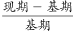
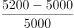
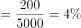
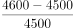
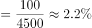
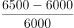

# 环比增长率比较（月平均工资增速最快）

考点：[[20-考点/资料分析/增长/环比增长率比较（月平均工资增速最快）|增长 / 环比增长率比较（月平均工资增速最快）]]
材料：[[15-材料/资料分析/257872 C集团公司甲、乙、丙、丁四个车间1月|257872 C集团公司甲、乙、丙、丁四个车间1月]]

**问法模型**：题干'与上个月相比较，2月份平均工资增长速度最快'→ 对各车间用环比增长率=(2月平均工资-1月平均工资)/1月平均工资逐一计算并比较大小

## 推理链
1. 第1步：定位表一'月平均工资'列（勿误读职工人数列）：甲1月5000元/2月5200元，乙4500/4600元，丙6000/6500元，丁8000/7950元
2. 第2步：环比增长率=（现期2月值-基期1月值）/基期1月值，基期为1月
3. 第3步：甲=(5200-5000)/5000=200/5000=4%；乙=(4600-4500)/4500=100/4500≈2.2%；丙=(6500-6000)/6000=500/6000≈8.3%；丁=(7950-8000)/8000=-50/8000=-0.625%（负增长）
4. 第4步：比较增速：8.3%（丙）＞4%（甲）＞2.2%（乙）＞-0.625%（丁），丙车间增长速度最快
5. 第5步：对照选项，丙车间对应C，与官方答案一致

**最快解法**：⚡ 截位直除+排除法：丁车间7950<8000为负增长直接排除；甲200/5000=4%、丙500/6000≈8.3%口算可得，丙的增长量（500元）最大且基期（6000）不算最大，故丙增速明显最大，选C

## 易错点
- ⚠ 读错列：表一同时含'职工人数'与'月平均工资'两组双月数据，若误用人数计算会得出甲车间增速10%（50/500）最大而误选A
- ⚠ 忽略符号：丁车间工资7950元低于8000元，为负增长，带符号比较时应排除，不可取绝对值参与'增长速度'比较
- ⚠ 基期现期混淆：环比的基期是1月，增长率分母应为1月工资而非2月工资

## 母题抽象
> 🧩 当题干出现'与上月（上期）相比，某指标增长速度/增速最快（比较对象为多个主体）'时，定位双期数据，用（现期-基期）/基期逐一求环比增速再比较，负增长项直接排除，可用'增长量÷基期'截位口算提速

**同类特征**：与上个月相比较、2月份、平均工资、增长速度最快、车间比较、环比增速

## 相关题
- [[10-真题/资料分析/增长/2578478 增长量计算（环比增长额）|2578478]]（内蒙古 2020，相关度2）
- [[10-真题/资料分析/增长/2578512 环比变动幅度（增长率绝对值）比较|2578512]]（湖南 2020，相关度2）
- [[10-真题/资料分析/增长/15833691 环比增速计算与折线趋势匹配（累计值连环相减化当期值）|15833691]]（黑龙江 2026，相关度1）
- [[10-真题/资料分析/增长/827053 增长速度（增长率）大小比较|827053]]（政法干警 2014，相关度1）
- [[10-真题/资料分析/增长/10204609 环比增长率计算与比较（累计值差分求当期值＋折线图走势判定）|10204609]]（辽宁 2024，相关度1）

---

### 题干
与上个月相比较，2月份平均工资增长速度最快的车间是：

### 选项
- A. 甲车间
- B. 乙车间
- C. 丙车间　✅
- D. 丁车间

### 官方解析

根据题干“······增长速度最快的车间是”，可判定本题为一般增长率问题。定位表一，可得甲、乙、丙、丁4个车间1月份的平均工资分别为5000、4500、6000、8000，甲、乙、丙、丁4个车间2月份的平均工资分别为5200、4600、6500、7950。根据增长率=，可得甲、乙、丙、丁4个车间的环比增速分别为，，，，丙车间增长速度最快。

故正确答案为C。

### 给定材料

