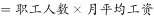
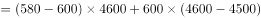
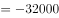
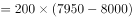
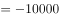

# 增长量比较（隐含派生指标'工资总额'的环比减少量比较）

考点：[[20-考点/资料分析/增长/增长量比较（隐含派生指标'工资总额'的环比减少量比较）|增长 / 增长量比较（隐含派生指标'工资总额'的环比减少量比较）]]
材料：[[15-材料/资料分析/257872 C集团公司甲、乙、丙、丁四个车间1月|257872 C集团公司甲、乙、丙、丁四个车间1月]]

**问法模型**：题干'2月份较上月工资总额减少最多'→先用'职工人数×月平均工资'派生出各车间1月、2月工资总额，再按'增长量=现期-基期'带符号计算，比较负增长量中绝对值最大者

## 推理链
1. 第1步：工资总额是材料未直接给出的隐含派生指标，须由表一相乘得到：工资总额=职工人数×月平均工资
2. 第2步：计算各车间1月工资总额：甲=500×5000=250万元；乙=600×4500=270万元；丙=300×6000=180万元；丁=200×8000=160万元
3. 第3步：计算各车间2月工资总额：甲=550×5200=286万元；乙=580×4600=266.8万元；丙=320×6500=208万元；丁=200×7950=159万元
4. 第4步：环比增长量=2月-1月：甲=+36万元、丙=+28万元，为正增长，排除；乙=266.8-270=-3.2万元；丁=159-160=-1万元
5. 第5步：'减少最多'即负增长量绝对值最大：乙减少3.2万元＞丁减少1万元，故乙车间工资总额减少最多
6. 第6步：对照选项，乙车间对应B，与官方答案一致

**最快解法**：⚡ 观察排除法+乘法拆分：甲（人数+50、工资+200）、丙（人数+20、工资+500）两指标双增，工资总额必增，直接排除A、C；丁人数不变仅工资降50元，减少量=200×50=10000元；乙变化量拆分为580×(4600-4500)+(580-600)×4500=58000-90000=-32000元；比较负值|−32000|＞|−10000|，选B

## 易错点
- ⚠ 工资总额是隐含派生指标，材料未直接给出，且表一合计行平均工资为'—'，不能套用'合计人数×合计平均工资'，只能分车间相乘再比较
- ⚠ 乙车间月平均工资其实是上升的（4500→4600元），但人数由600降到580导致总额减少；若只盯平均工资或只看人数单指标会误判方向、漏掉正确答案
- ⚠ 方向判断：'减少最多'只可能在负增长车间中比较（本题仅乙、丁），甲、丙为正增长须先排除，不能把'变动量小'误当'减少多'

## 母题抽象
> 🧩 当题干出现'现期较基期某总量（两指标乘积派生，如工资总额=人数×平均工资）增长/减少最多'时，先分车间用乘法派生两期总量，再用增长量=现期-基期带符号比较，'减少最多'取负值绝对值最大者，正增长车间直接排除

**同类特征**：减少最多、工资总额、较上月（环比）、隐含派生指标、增长量比较、人数×平均工资

## 相关题
- [[10-真题/资料分析/增长/2144598 增长量比较|2144598]]（选调 2018，相关度1）
- [[10-真题/资料分析/增长/23447 增长量比较（现期量×r-(1+r)）|23447]]（云南 2011，相关度1）
- [[10-真题/资料分析/增长/49789 增长量（变化绝对值）比较|49789]]（云南 2013，相关度1）
- [[10-真题/资料分析/增长/465283 增长量比较|465283]]（江苏 2014，相关度1）
- [[10-真题/资料分析/增长/12881989 增长量比较（部分=整体×比重跨图还原后逐年作差）|12881989]]（广东 2025，相关度1）

---

### 题干
2月份较上月工资总额减少最多的车间是：

### 选项
- A. 甲车间
- B. 乙车间　✅
- C. 丙车间
- D. 丁车间

### 官方解析

根据题干“2月份较上月工资总额减少最多······”，可判定此题为增长量比较问题。根据公式：工资总额，增长量，代入表格数据，各车间工资总额环比增长量分别为：甲车间：，排除；乙车间：元，丙车间，排除；丁车间元。比较乙车间和丁车间，工资总额减少最多的车间是乙车间。

故正确答案为B。

### 给定材料

