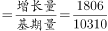
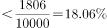

# 同比增长率计算（基期+增量换算现期值+分类定位排序）

考点：[[20-考点/资料分析/增长/同比增长率计算（基期+增量换算现期值+分类定位排序）|增长 / 同比增长率计算（基期+增量换算现期值+分类定位排序）]]
材料：[[15-材料/资料分析/257877 2016年毕业生薪酬排名前十的十所院|257877 2016年毕业生薪酬排名前十的十所院]]

**问法模型**：题干出现'某专业类型院校中2016年薪酬排名第二的院校同比增长约为'→先用分类表定位院校集合，再用'基期+增量'算现期值排序锁定目标，最后套'增长率=增长量÷基期值'直除对照选项

## 推理链
1. 第1步：由表1按专业类型筛选，十所院校中语言类仅有E大学（上海）和G大学（北京）两所
2. 第2步：由图1换算2016年现期值=2015年薪酬+2016年增量：E=10453+2348=12801元，G=10310+1806=12116元，E高G低，故语言类排名第二的院校为G大学
3. 第3步：提取G大学数据：2015年基期值10310元，2016年增量1806元（注意白框数是增量而非现期薪酬）
4. 第4步：套用公式同比增长率=2016年增量÷2015年基期值=1806÷10310
5. 第5步：截位直除1806/10310≈17.5%，对照选项仅A项在此量级，故选A

**最快解法**：⚡ 图表联用+截位直除：表1锁定语言类仅E、G两校→现期值E=12801>G=12116定位G为第二→直除1806/10310（分子分母各截三位：18/103≈17.5%），秒选A

## 易错点
- ⚠ 白框数字是'2016年增量'而非2016年薪酬，若把白框当现期、柱高当基期直接相减会得出负增长的荒谬结果；现期值必须基期+增量自行加和（G=10310+1806=12116元）
- ⚠ 增长率分母必须是2015年基期值10310，若误用2016年现期值12116作分母得1806/12116≈14.9%，即掉入基期现期混淆陷阱选错
- ⚠ 语言类院校集合须图1与表1联用才能确定（表1给类型、图1给数据），且'2016年排名'须用换算后的现期值比较而非柱高（本题E=12801>G=12116，G为第二）

## 母题抽象
> 🧩 当题干出现'某类型院校中排名第N的院校同比增长约为'特征时，先用分类表定位集合院校，再用'基期+增量'求现期值排序锁定目标，最后用'增量÷基期值'截位直除验证选项

**同类特征**：语言类大学（图表联用定位院校集合）、平均薪酬排名第二、同比增长约为、选项为百分数、需基期+增量换算现期值、增长率分母为2015年基期值

## 相关题
- [[10-真题/资料分析/增长/2307735 混合增长率·线段法（由1-7月累计与7月当月增速反推1-6月增速）|2307735]]（辽宁 2018，相关度2）
- [[10-真题/资料分析/增长/9629 一般增长率计算（现期需由增量倒推）|9629]]（安徽 2009，相关度1）
- [[10-真题/资料分析/比重/2604234 现期比重计算|2604234]]（广东 2020，相关度1）
- [[10-真题/资料分析/增长/27835 一般增长率计算（已知现期量与增长量求增长率）|27835]]（河北 2012，相关度1）
- [[10-真题/资料分析/平均数/10204497 平均数增长率（均价=值-量的比值增长率）|10204497]]（海南 2024，相关度1）

---

### 题干
2016年语言类大学平均薪酬排名第二的院校，其毕业生平均薪酬同比增长约为：

### 选项
- A. 

　✅
- B. 

- C. 

- D. 

### 官方解析

根据题干“2016年······同比增长约为”，结合选项为百分数，可判定本题为一般增长率问题。定位表格可得，2016年语言类大学平均薪酬排名第二的院校是G院校。定位柱状图可得，G院校2015年平均薪酬为10310元，2016年增量为1806元，则其毕业生平均薪酬同比增长率，只有A项符合。

故正确答案为A。

### 给定材料

        据调查，全国各院校毕业五年的大学生（以下统称为毕业生）薪酬排名前十的情况如下：

