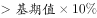
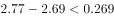
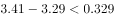
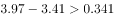

# 环比增长率阈值计数（增长率比较）

考点：[[20-考点/资料分析/增长/环比增长率阈值计数（增长率比较）|增长 / 环比增长率阈值计数（增长率比较）]]
材料：[[15-材料/资料分析/257880 全国移动互联网接入流量：2017年6|257880 全国移动互联网接入流量：2017年6]]

**问法模型**：题干问'户均流量环比增长X%以上的月份有几个'（计数型）→ 取右轴折线逐月求环比 g=(当月−上月)÷上月，与阈值比较后计数；因'增长__以上'数值被截断，依官方结论'仅3月、5月达标'锁定阈值为10%

## 推理链
1. 第1步：从图中折线（右轴，GB/户）提取2018年上半年各月户均流量及跨年基期：2017年12月2.69，2018年1月2.77、2月2.63、3月3.29、4月3.41、5月3.97、6月4.24
2. 第2步：环比增长率公式 g=(当月−上月)÷上月；g＞10% 等价于'当月增量＞上月×10%'，可避免逐月除法
3. 第3步：逐月求增量并与上月×10%比较：1月增0.08＜0.269（增速约3.0%）；2月增−0.14为负增长（约−5.1%）；3月增0.66＞0.263（0.66÷2.63≈25.1%）；4月增0.12＜0.329（约3.6%）；5月增0.56＞0.341（0.56÷3.41≈16.4%）；6月增0.27＜0.397（0.27÷3.97≈6.8%）
4. 第4步：超过阈值的只有3月（≈25.1%）和5月（≈16.4%）两个月，与官方解析'只有3月和5月'一致
5. 第5步：达标月份数为2，对照选项选B

**最快解法**：⚡ 增量阈值法（放缩口算）：增速＞10%⟺当月增量＞上月×10%；先剔负增长（2月2.63＜2.77），再口算各月增量：3月增0.66、5月增0.56明显大于基期十分之一（0.263、0.341），6月增0.27＜0.397、4月增0.12＜0.329、1月增0.08＜0.269，直接数出3、5两月→B，全程无需除法

## 易错点
- ⚠ 双轴串轴：户均流量必须读右轴折线（0—5刻度），误读左轴柱值（0—100刻度，量级差约20倍）会全盘算错
- ⚠ 跨年环比基期：2018年1月的环比基期是2017年12月（2.69），不能因'上半年'剔除1月或误用2017年6月作基期；2月环比为负（2.63＜2.77），不得计入'增长以上'
- ⚠ 口径混淆与阈值缺省：环比只能用图中当月户均值，不能套用文字段266亿GB累计流量；题干'环比增长__以上'阈值数字被截断，须按原题补全（10%）后再判断

## 母题抽象
> 🧩 当题干出现'某指标环比增长X%以上的月份有几个'且材料为柱线双轴逐月图时，锁定与该指标对应的折线逐月求环比，用'当月增量＞上月×X%'的等价判据口算计数，先剔除负增长月，并注意1月的基期是上一年12月

**同类特征**：环比增长…以上、月份有几个（计数型）、户均流量（折线右轴指标）、2018年上半年（1月基期为2017年12月）、双轴柱线复合图逐月配对

## 相关题
- [[10-真题/资料分析/增长/4628167 增长量计算与比较（日均×当月天数换算+超阈值月份计数）|4628167]]（新疆 2021，相关度1）
- [[10-真题/资料分析/综合/2578814 综合分析选非题（混合增长率定性+环比增速+季度加总作差+户均日流量换算）|2578814]]（四川 2020，相关度1）

---

### 题干

2018年上半年，户均移动互联网接入流量环比增长以上的月份有几个？

### 选项
- A. 1
- B. 2　✅
- C. 3
- D. 4

### 官方解析

根据题干“······环比增长以上的月份有······”，可判定本题为一般增长率问题。由增长率公式：增长率，可得，若“”，则增长率超过。定位图形材料：1月：；2月：；3月：；4月：；5月：；6月：，只有3月和5月户均移动互联网接入流量环比增长以上。

故正确答案为B。

### 给定材料

        2018年上半年，全国移动互联网累计流量达266亿GB，同比增长；其中通过手机上网的流量达到262亿GB，同比增长。

> [!warning] 疑点（官方解析可能有误，待人工复核）
> 题干'环比增长__以上'的阈值数字与官方解析中的公式数值均被截断缺失；按官方答案B（仅3月、5月达标）与各月环比增速（3月≈25.1%、5月≈16.4%、6月≈6.8%、1月≈3.0%、4月≈3.6%、2月≈−5.1%），阈值须落在6.8%～16.4%之间，与常用阈值10%一致，官方答案本身无矛盾，做题时需按原题补全阈值为10%

<!-- CODEX-ANSWER-REVIEW:BEGIN -->
### 本次独立复核

**复核状态：** `confirmed`（独立复算确认答案）

**计分答案：** B（可计分）

**复核解析：**

原图户均流量月值为1月2.77、2月2.63、3月3.29、4月3.41、5月3.97、6月4.24GB；原题公式图阈值10%，只有3月约25.1%和5月约16.4%达标，共2个月，选B。

**相关信息：**

环比增速=(本月−上月)/上月，首月与上月跨年比较。

**题源依据：** [固定版本原题](https://github.com/Mentat-Uran/kaogongzhentizhengliu/blob/84ab93d4b64b61d897bece8a1c0a5bab06b4feb2/10-%E7%9C%9F%E9%A2%98/%E8%B5%84%E6%96%99%E5%88%86%E6%9E%90/%E5%A2%9E%E9%95%BF/2578813%20%E7%8E%AF%E6%AF%94%E5%A2%9E%E9%95%BF%E7%8E%87%E9%98%88%E5%80%BC%E8%AE%A1%E6%95%B0%EF%BC%88%E5%A2%9E%E9%95%BF%E7%8E%87%E6%AF%94%E8%BE%83%EF%BC%89.md)；固定内容 commit `84ab93d4b64b61d897bece8a1c0a5bab06b4feb2`，Markdown blob `ec9923440cfacda8a8888dd7be260e8f4d27c6da`。
<!-- CODEX-ANSWER-REVIEW:END -->
