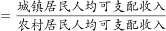
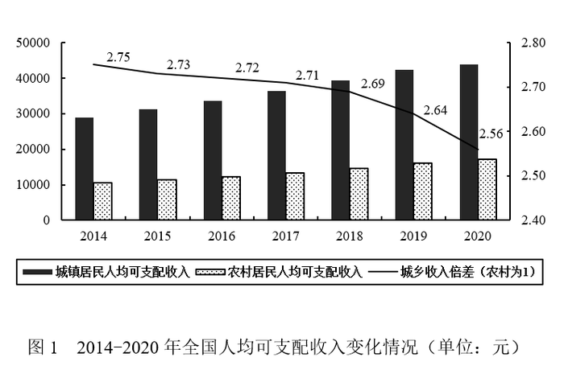
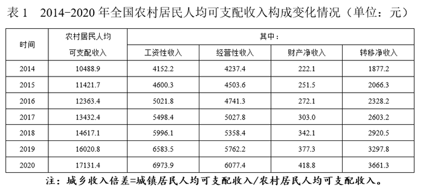

# 增长量计算（城乡收入差额=(倍差-1)×农村的两期作差）

考点：[[20-考点/资料分析/增长/增长量计算（城乡收入差额=(倍差-1)×农村的两期作差）|增长 / 增长量计算（城乡收入差额=(倍差-1)×农村的两期作差）]]
材料：[[15-材料/资料分析/312966 2014-2020年全国城镇与农村居|312966 2014-2020年全国城镇与农村居]]

**问法模型**：'与2019年相比，2020年城乡差额上升/下降多少元'→判定为增长量计算：先用'差额=(倍差-1)×农村'分别求两期差额，再作差，由正负定升降、由数值定选项

## 推理链
1. 第1步：由图1折线读得2019年城乡收入倍差2.64（农村为1），由表1读得2019年农村人均可支配收入16020.8元
2. 第2步：套公式'差额=城镇-农村=(倍差-1)×农村'，2019年差额=1.64×16020.8≈26274.1元
3. 第3步：同法取2020年：倍差2.56、农村17131.4元，差额=1.56×17131.4≈26725.0元，与本篇第1题结论26725元一致，可直接复用
4. 第4步：作差求增长量：26725.0-26274.1=+450.9元，2020年差额大于2019年，判定为'上升'
5. 第5步：对照选项，'上升了450.9元'精确对应A项，排除方向相反的B及数值不符的C、D

**最快解法**：⚡ 公式法+截位直除：差额=(倍差-1)×农村。2020差额复用第1题结果26725元；2019差额1.64×16020.8，截位拆为1.64×16000+1.64×21≈26240+34=26274元；26725-26274≈451元且两期大小已判'上升'，锁定A。也可先由26725>26274排除B、D再对数值

## 易错点
- ⚠ 倍差方向搞反：农村为1，差额=(倍差-1)×农村，勿把2.64/2.56直接当差额，勿颠倒城镇/农村的分子分母
- ⚠ 中间精度误导：官方解析用1.64×16000≈26240得增量485元、与450.9不符，勿因此怀疑答案；精确值26274.1与26725.0作差恰为450.9元
- ⚠ 2020年农村总计读数：表1原值及四项加总均为17131.4元，若误用17341.4元则2020差额≈27053元、增量≈778元，无对应选项

## 母题抽象
> 🧩 当题干出现'两期相比，城乡（或两类群体）差额上升/下降多少'且差额需由倍差换算时，用'差额=(倍差-1)×基数'分别求两期差额再作差，先以差的正负定升降方向，再以截位估算锁定数值选项；组题中前题差额结果直接复用

**同类特征**：与2019年相比，2020年（两期比较求增长量）、城镇与农村……差额、选项为'上升了/下降了+具体数值'结构、'可支配收入'默认人均口径、城镇柱无标签，须经'倍差×农村值'反推、跨图拼数据：图1折线倍差＋表1农村精确值

## 相关题
（暂无）

---

### 题干
与2019年相比，2020年城镇居民与农村居民的可支配收入差额：

### 选项
- A. 上升了450.9元　✅
- B. 下降了450.9元
- C. 上升了610.1元
- D. 下降了610.1元

### 官方解析

根据题干“与2019年相比，2020年······”，结合选项为上升/下降+具体单位，可判定本题为增长量计算问题。定位统计图可得：2019年全国城乡收入倍差为2.64；定位统计表可得：2019年全国农村居民人均可支配收入为16020.8元。根据：城乡收入倍差，可得：城镇居民人均可支配收入=城乡收入倍差×农村居民人均可支配收入，则2019年城乡居民人均可支配收入差额=2.64×16020.8-16020.8=（2.64-1）×16020.8≈1.64×16000=26240元。根据本篇第1题可得：2020年城乡居民人均可支配收入差额为26725元。则与2019年相比，2020年城乡居民人均可支配收入差额上升了26725-26240=485元，与A项最接近。

故正确答案为A。

备注：本题题干“可支配收入”默认为“人均可支配收入”，否则无法计算。

### 给定材料

> [!warning] 疑点（官方解析可能有误，待人工复核）
> 官方解析中间步骤取1.64×16000≈26240元，得增量485元'与A最接近'，数值对不上选项450.9；精确计算2019差额=1.64×16020.8=26274.1元、2020差额=1.56×17131.4=26725.0元，差恰为450.9元，A成立无疑，仅解析估算过粗。另材料导读所记2020年农村总计17341.4元与图表不符，表1原值及四项加总均为17131.4元，应以后者为准

<!-- CODEX-ANSWER-REVIEW:BEGIN -->
### 本次独立复核

**复核状态：** `resolved`（答案与解析已核定）

**计分答案：** A（可计分）

**复核解析：**

按材料图取城乡收入倍差（城镇/农村）及农村收入，城乡收入差额=(倍差−1)×农村收入。2019年为(2.64−1)×16020.8≈26274.1元；2020年为(2.56−1)×17131.4≈26725.0元；差额增加约450.9元，选A。官方解析用16000近似造成485元的中间值与选项不符；精确数据可闭合到450.9元，故疑点由原图复算排除。

**相关信息：**

同比增长率 r 以小数代入时，增长量=现期量×r/(1+r)；同比下降量取正数时用现期量×|r|/(1−|r|)。百分点为两个百分率之差。单位沿用原材料。

**题源依据：** [固定版本原题](https://github.com/Mentat-Uran/kaogongzhentizhengliu/blob/84ab93d4b64b61d897bece8a1c0a5bab06b4feb2/10-%E7%9C%9F%E9%A2%98/%E8%B5%84%E6%96%99%E5%88%86%E6%9E%90/%E5%A2%9E%E9%95%BF/2578840%20%E5%A2%9E%E9%95%BF%E9%87%8F%E8%AE%A1%E7%AE%97%EF%BC%88%E5%9F%8E%E4%B9%A1%E6%94%B6%E5%85%A5%E5%B7%AE%E9%A2%9D%3D(%E5%80%8D%E5%B7%AE-1)%C3%97%E5%86%9C%E6%9D%91%E7%9A%84%E4%B8%A4%E6%9C%9F%E4%BD%9C%E5%B7%AE%EF%BC%89.md)；固定内容 commit `84ab93d4b64b61d897bece8a1c0a5bab06b4feb2`，Markdown blob `a1a3c2b1eac7084e38a3dc7a9194787d8b099fe3`。
<!-- CODEX-ANSWER-REVIEW:END -->
