# 派生指标（工资总额=人数×平均工资）的环比增长率比较

考点：[[20-考点/资料分析/增长/派生指标（工资总额=人数×平均工资）的环比增长率比较|增长 / 派生指标（工资总额=人数×平均工资）的环比增长率比较]]
材料：[[15-材料/资料分析/257872 C集团公司甲、乙、丙、丁四个车间1月|257872 C集团公司甲、乙、丙、丁四个车间1月]]

**问法模型**：题干问'2月份工资总额变动率最大的车间' → 先用'人数×平均工资'派生各车间工资总额，再用（现期-基期）/基期计算变动率并比较大小（带符号）

## 推理链
1. 第1步：表一给出甲/乙/丙/丁四车间1月、2月的职工人数与月平均工资；工资总额为隐含派生指标=职工人数×月平均工资（合计行平均工资为'—'，只能分车间计算）
2. 第2步：公式：变动率=（2月工资总额-1月工资总额）÷1月工资总额；为便于比较统一换算成万元（1万元=10000元）
3. 第3步：甲：1月500×5000=250万元，2月550×5200=286万元，变动率=36/250=14.4%；乙：1月600×4500=270万元，2月580×4600=266.8万元，变动率=-3.2/270≈-1.2%
4. 第4步：丙：1月300×6000=180万元，2月320×6500=208万元，变动率=28/180≈15.6%；丁：1月200×8000=160万元，2月200×7950=159万元，变动率=-1/160=-0.625%
5. 第5步：比较四个变动率：15.6%（丙）＞14.4%（甲）＞-0.625%（丁）＞-1.2%（乙），变动率最大为丙车间，对照选项选C

**最快解法**：⚡ 乘积分解法（增长率同向拆解）：工资总额变动率=(人数比)×(工资比)-1≈a+b+ab。甲=10%+4%+0.4%=14.4%；丙=6.7%+8.3%+0.6%≈15.6%；乙、丁一升一降或持平为负值，直接排除。只需精算甲、丙两个正增长车间：550/500×5200/5000=1.1×1.04=1.144，320/300×6500/6000≈1.1556，丙＞甲，秒选C

## 易错点
- ⚠ 工资总额是派生指标，须逐车间'人数×平均工资'计算；表一合计行平均工资为'—'，不能用合计人数×某平均工资偷懒，也不能误用产值表数据
- ⚠ 单位口径陷阱：工资总额单位为'元'（如甲2月2860000元），换算成万元需÷10000；本题比较变动率时分子分母同单位可约去，但若与产值等跨表混用必须统一量级，否则差1万倍
- ⚠ '变动率'与'变动幅度'口径辨析：变动率带符号（乙约-1.2%、丁-0.625%），本题带符号与取绝对值结论一致（丙15.6%均最大），但甲14.4%与丙15.6%数值接近，乘法口算不准易误选A

## 母题抽象
> 🧩 当题干出现'两指标乘积（如总量=人数×均工资）的变动率/增长率比较'特征时，先用乘积比值法(1+a)(1+b)-1=a+b+ab拆成两个因素增长率之和快速估算，再对最接近的两名精算验证，锁定最大者

**同类特征**：与上月相比较（环比）、工资总额（隐含派生=人数×平均工资）、变动率最大（增长率比较、带符号）、分车间比较主体、表一内部跨指标乘积、四选一比较类

## 相关题
（暂无）

---

### 题干
与上月相比较，2月份工资总额变动率最大的车间是：

### 选项
- A. 甲车间
- B. 乙车间
- C. 丙车间　✅
- D. 丁车间

### 官方解析

根据题干“······2月份工资总额变动率最大”，可判定本题为一般增长率比较问题。根据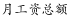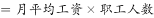，定位材料表格可得：

甲车间2月工资总额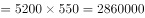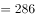万元，1月工资总额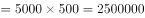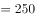万元 ，根据公式：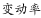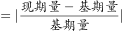可知，甲车间工资总额变动率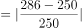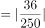；

乙车间2月工资总额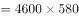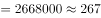万元，1月工资总额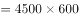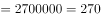万元，乙车间工资总额变动率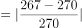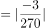；

丙车间2月工资总额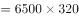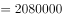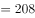万元，1月工资总额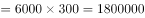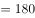万元，丙车间工资总额变动率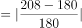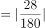；

丁车间2月工资总额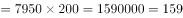万元，1月工资总额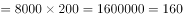万元，丁车间工资总额变动率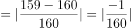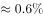。

工资总额变动率最大的是丙车间。

故正确答案为C。

### 给定材料

