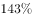
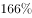
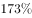
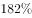

# 一般增长率计算（两期定基比较：现期2018年对基期2011年）

考点：[[20-考点/资料分析/增长/一般增长率计算（两期定基比较：现期2018年对基期2011年）|增长 / 一般增长率计算（两期定基比较：现期2018年对基期2011年）]]
材料：[[15-材料/资料分析/257931 2011-2018年中国保险行业原保|257931 2011-2018年中国保险行业原保]]

**问法模型**：题干'与2011年相比，2018年……约增长了'+选项为百分数 → 用增长率公式 r=(现期−基期)/基期=(3.80−1.43)/1.43 截位直除对照选项

## 推理链
1. 第1步：题干'与2011年相比，2018年……约增长了'且选项均为百分数，判定为一般增长率问题，现期=2018年、基期=2011年，两点相隔7年属定基两期比较而非年均增长
2. 第2步：从图1柱状图读数：2018年原保险保费收入3.80万亿元，2011年为1.43万亿元，两数同图同单位（万亿元），无需涉及文字段的亿元口径换算
3. 第3步：套用一般增长率公式 r=(现期−基期)/基期，代入得 r=(3.80−1.43)/1.43
4. 第4步：分子=2.37万亿元，截位直除 2.37/1.43≈1.66，即约增长166%（约165%）
5. 第5步：与选项对照，仅B项（约165%/166%量级）满足，其余选项量级不符，故选B

**最快解法**：⚡ 截位直除+量级锁定：先算差值 3.80−1.43=2.37（万亿元），再除以基期1.43，首位商1即必超100%；粗验 1.43×2.5≈3.58<3.80<1.43×3=4.29，故增长率必在150%~200%之间（精确值≈166%，约165%），直选B

## 易错点
- ⚠ '约增长了'问的是增长率不是增长量：答案是约166%的百分数，若把差值2.37万亿元当答案或误选带'万亿元'表达的选项即掉坑
- ⚠ 基期分母陷阱：'与2011年相比'分母必须是基期1.43，若误用现期3.80作分母会算成 2.37/3.80≈62%，方向性错误
- ⚠ 单位口径：图1为万亿元、文字段为亿元（10770.08亿元≈1.08万亿元），本题只需图1两个数据不需换算，但跨图混算时两套口径量级差10000倍，极易踩雷
- ⚠ 相隔7年是两期定基比较，不要误用年均增长率公式(3.80/1.43)^(1/7)−1≈7%量级去匹配选项

## 母题抽象
> 🧩 当题干出现'与X年相比，Y年……约增长了'且选项为百分数时，直接取两期数据套 r=(现期−基期)/基期，用截位直除先定首位商、再用基期倍数粗验（1.43×2.5≈3.58<3.80→增长超150%）锁定选项量级

**同类特征**：与2011年相比（明确基期）、2018年（现期）、约增长了、选项为百分数、柱状图两期读数、两期相隔多年的定基增长率

## 相关题
- [[10-真题/资料分析/比重/2374810 现期比重计算（流量占存量比重）|2374810]]（广东 2019，相关度2）
- [[10-真题/资料分析/增长/9629 一般增长率计算（现期需由增量倒推）|9629]]（安徽 2009，相关度1）
- [[10-真题/资料分析/比重/2604234 现期比重计算|2604234]]（广东 2020，相关度1）
- [[10-真题/资料分析/增长/27835 一般增长率计算（已知现期量与增长量求增长率）|27835]]（河北 2012，相关度1）
- [[10-真题/资料分析/平均数/10204497 平均数增长率（均价=值-量的比值增长率）|10204497]]（海南 2024，相关度1）

---

### 题干
与2011年相比，2018年中国保险行业原保险保费收入约增长了：

### 选项
- A. 

- B. 

　✅
- C. 

- D. 

### 官方解析
根据题干“与2011年相比，2018年······约增长了”，结合选项为百分数，可判定本题为一般增长率问题。定位柱状图1可得，2018年我国保险行业原保险保费收入为3.80万亿元，2011年为1.43万亿元。根据公式“”，则所求增长率，B项满足。
故正确答案为B。

### 给定材料

        2018年，从险种来看，财产险业务原保险保费收入10770.08亿元，同比增长；人身险原保险保费收入27246.54亿元，其中寿险业务原保险保费收入20722.86亿元，同比下降；健康险业务原保险保费收入5448.13亿元，同比增长；意外险业务原保险保费收入1075.55亿元，同比增长。从保费收入结构来看，人身险、财产险的保费占比与上年相比趋于稳定。

