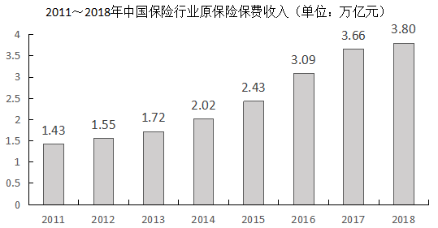
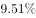
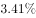
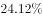
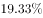
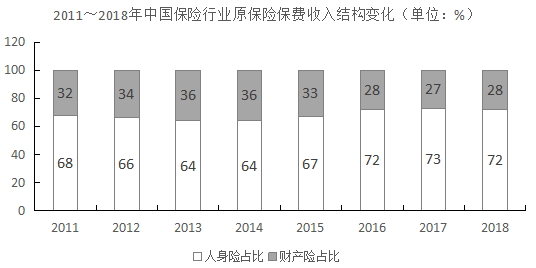

# 增长量比较（同比增长额比较）

考点：[[20-考点/资料分析/增长/增长量比较（同比增长额比较）|增长 / 增长量比较（同比增长额比较）]]
材料：[[15-材料/资料分析/257931 2011-2018年中国保险行业原保|257931 2011-2018年中国保险行业原保]]

**问法模型**：题干出现'同比增长额最大的是'→采用增长量比较模型：先按增速方向排除负增长，再用'现期大且增长率大则增长额大'定性淘汰，最后对剩余候选套增长额=现期×r/(1+r)精算比大小

## 推理链
1. 第1步：从文字材料提取2018年四险种现期保费及增长方向——财产险10770.08亿元（同比增长）、寿险20722.86亿元（同比下降）、健康险5448.13亿元（同比增长）、意外险1075.55亿元（同比增长）
2. 第2步：按方向排除：寿险同比下降、增长额必为负，不可能是最大，排除B
3. 第3步：对同为正增长的意外险与健康险用结论'现期量大且增长率大，则增长额大'：健康险现期5448.13亿元约为意外险1075.55亿元的5.1倍，判定健康险增长额＞意外险，排除C
4. 第4步：剩余候选财产险与健康险，现期量财产险更大（10770.08＞5448.13），定性规则失效，须套公式增长额=现期×r/(1+r)，将两险种各自同比增速分别代入10770.08亿元与5448.13亿元计算（材料文本中增速数值缺失，按官方解析代入原增速）
5. 第5步：图表联动核验财产险增长额量级：2017年财产险≈图1总量3.66万亿元×图2占比27%≈0.99万亿元≈9882亿元，故财产险增长额≈10770.08-9882≈888亿元，不足千亿
6. 第6步：官方解析精算结果显示健康险增长额大于财产险（约888亿元），故同比增长额最大者为健康险业务，对照选项选D

**最快解法**：⚡ 三步排除法+公式法：①看方向，先排同比下降的寿险；②比现期，意外险与健康险同正增长，健康险5448.13亿元≈意外险1075.55亿元的5倍且增速更大，直接排意外险；③对财产险与健康险套增长额=现期×r/(1+r)精算比大小（截位：10770×r₁/(1+r₁) vs 5448×r₂/(1+r₂)），锁定健康险选D

## 易错点
- ⚠ 被现期量迷惑：寿险20722.86亿元、财产险10770.08亿元现期最大，但寿险为负增长、财产险增速偏低，直接选现期最大者必错——增长量比较必须先看增速方向再算现期×r/(1+r)
- ⚠ 只比增速不看现期：意外险增速虽不低，但现期仅1075.55亿元量级不足，'现期大且增长率大'须同时满足才能定性判大
- ⚠ 材料阅读陷阱：原文各险种'同比增长'后的百分数在材料中缺失，切勿脑补具体增速数值；同时注意单位口径，10770.08亿元≈1.08万亿元，勿与图1中3.80万亿元总量混淆量级

## 母题抽象
> 🧩 当题干出现'同比增长额（增长量）最大的是'且各主体有升有降时，用'方向排除→现期定性比较→增长额=现期×r/(1+r)精算'三步法，优先淘汰负增长及现期量级明显偏小的选项，仅剩两名候选时再动公式

**同类特征**：同比增长额最大、增长量比较、现期×r/(1+r)、同比有升有降、险种保费明细定位文字材料、排除法优先于精算

## 相关题
- [[10-真题/资料分析/增长/2280933 增长量比较（同比增量从低到高排序，现期×r-(1+r)）|2280933]]（四川 2018，相关度2）
- [[10-真题/资料分析/增长/3018796 同比增长量计算与排序比较|3018796]]（广东 2021，相关度2）
- [[10-真题/资料分析/增长/2144598 增长量比较|2144598]]（选调 2018，相关度1）
- [[10-真题/资料分析/增长/23447 增长量比较（现期量×r-(1+r)）|23447]]（云南 2011，相关度1）
- [[10-真题/资料分析/增长/49789 增长量（变化绝对值）比较|49789]]（云南 2013，相关度1）

---

### 题干
2018年，下列险种中，原保险保费收入同比增长额最大的是：

### 选项
- A. 财产险业务
- B. 寿险业务
- C. 意外险业务
- D. 健康险业务　✅

### 官方解析
根据题干“······收入同比增长额最大的是”，可判定本题为增长量比较问题。定位文字材料可知，2018年寿险业务原保险保费收入20722.86亿元，同比下降，收入下降，排除B项。
2018年意外险业务原保险保费收入1075.55亿元，同比增长，2018年健康险业务原保险保费收入5448.13亿元，同比增长。根据增长量比较结论“现期量大，增长率大，则增长额大”可得，健康险业务原保险保费收入增长额意外险业务原保险保费收入增长额，排除C项。
根据公式“”，可得2018年财产险业务原保险保费收入增长额亿元；
2018年健康险业务原保险保费收入增长额亿元；
故原保险保费收入增长额最大的为健康险业务，对应D项。
故正确答案为D。

### 给定材料

        2018年，从险种来看，财产险业务原保险保费收入10770.08亿元，同比增长；人身险原保险保费收入27246.54亿元，其中寿险业务原保险保费收入20722.86亿元，同比下降；健康险业务原保险保费收入5448.13亿元，同比增长；意外险业务原保险保费收入1075.55亿元，同比增长。从保费收入结构来看，人身险、财产险的保费占比与上年相比趋于稳定。

> [!warning] 疑点（官方解析可能有误，待人工复核）
> 材料原文中财产险、健康险、意外险'同比增长'后的增速数值均为空白，官方解析中'增长额=现期×r/(1+r)'两步的计算结果亦为空白，导致'健康险增长额＞财产险增长额'这一关键比较无法用所给材料独立复算（财产险增长额可借图1×图2估约888亿元，但健康险2017年基期值无法从材料获得）；此属材料传输缺漏而非解析逻辑错误，官方答案D维持不变，但完整题面应补全各险种增速数值后复核该步比较
