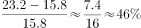
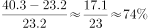
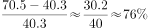
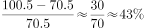

# 同比增速计算与折线趋势判断（柱状图逐年增长率比较）

考点：[[20-考点/资料分析/增长/同比增速计算与折线趋势判断（柱状图逐年增长率比较）|增长 / 同比增速计算与折线趋势判断（柱状图逐年增长率比较）]]
材料：[[15-材料/资料分析/257932 2017年全球清洁能源投资规模及风电|257932 2017年全球清洁能源投资规模及风电]]

**问法模型**：题干问'2009-2012年同比增速的变化趋势'并配折线图选项 → 从柱状图取相邻两年累计值，逐年套增长率公式，按年份排增速高低再比对图形

## 推理链
1. 第1步：题干限定'全球光伏累计装机容量'，从柱状图深色柱读出2008-2012年数值：15.8、23.2、40.3、70.5、100.5（GW）
2. 第2步：所用规则为增长率=（现期-基期）/基期，其中基期为上一年累计值，2009-2012共4个增速点
3. 第3步：代入计算：2009年=7.4/15.8≈46.8%，2010年=17.1/23.2≈73.7%，2011年=30.2/40.3≈74.9%，2012年=30.0/70.5≈42.6%
4. 第4步：增速序列为46.8%→73.7%→74.9%→42.6%，即第二个点（2010）与第三个点（2011）是最高两点，且末点（2012）回落到首点（2009）之下
5. 第5步：与四个折线图选项对照，只有A项呈现'中间两点最高、两端较低'的形态，故选A

**最快解法**：⚡ 截位直除+比较法：不必精算百分比，先比首点与中间两点——7.4/15.8≈47%明显低于17.1/23.2≈74%和30.2/40.3≈75%；再确认2010与2011接近且2011略高（两最高点）；末点30/70.5≈43%低于40%回落；锁定'第2、3点最高'的A即可

## 易错点
- ⚠ 把'累计装机容量'当'新增装机容量'用：图中是存量滚存值，必须相邻两年累计值相减求增速，误用正文的99.1GW等流量数据则全错
- ⚠ 图例混淆：白柱是风电（120.7→238.1）、深色柱才是光伏（15.8→100.5），2008-2011年光伏柱很矮，误读白柱导致增速序列完全不同
- ⚠ 年份错位：2009年增速的基期是2008年，2009-2012共4个点，少算一年或把2012年增速的基期算成2009年会导致点数与图形对不上

## 母题抽象
> 🧩 当题干出现'某区间XX指标同比增速的变化趋势/最符合的折线图'时，从柱状图逐年取相邻两值套（现期-基期）/基期，通常只需精算最高点与最低点并比较首末点高低，即可按形态锁定图形选项

**同类特征**：折线图最符合…变化趋势、同比增速、2009-2012年、光伏累计装机容量、相邻两年累计值作差、图形选项比对

## 相关题
- [[10-真题/资料分析/综合/10297333 综合分析选非题（同比增速逐年比较+年均增长量+比重百分点还原）|10297333]]（浙江 2025，相关度1）
- [[10-真题/资料分析/增长/13504272 一般增长率计算与计数比较（同比增速-5%年份计数）|13504272]]（云南 2025，相关度1）
- [[10-真题/资料分析/增长/19283744 同比增速（增长率）逐年比较|19283744]]（国考 2025，相关度1）
- [[10-真题/资料分析/增长/2388036 同比增长率比较（增速最大年份判定）|2388036]]（河北 2019，相关度1）
- [[10-真题/资料分析/增长/2423335 同比增长率计算与逐年增速趋势比较|2423335]]（甘肃 2019，相关度1）

---

### 题干
以下哪个折线图最符合2009-2012年全球光伏累计装机容量同比增速的变化趋势？

### 选项
- A. 

　✅
- B. 

- C. 

- D. 

### 官方解析

根据题干“同比增速的变化趋势”，可判定本题为一般增长率问题。定位柱状图可得：2008-2012年全球光伏累计装机容量分别为：15.8、23.2、40.3、70.5、100.5。根据增长率，可得2009-2012年全球光伏累计装机容量同比增速分别为：、、、。所以2010年和2011年两年增速对应的第二个点和第三个点是折线图中最高的两个点，只有A项满足，A项当选。

故正确答案为A。

### 给定材料

        2017年，全球对清洁能源的投资为3335亿美元，同比增长，但仍低于2015年的历史峰值3485亿美元。中国的清洁能源投资占全球清洁能源总投资的，占亚太地区清洁能源投资的。

        从主要清洁能源类型看，2017年全球对风能的投资为1070亿美元，风电新增装机容量52.5GW，同比下降；累计装机容量达到539.1GW，同比增长。2017年全球对光伏的投资为1608亿美元，同比增长；光伏新增装机容量99.1GW，同比增长；累计装机容量达到404.5GW。其中，亚太地区新增装机容量73.7GW，累计装机容量221.3GW。（累计装机容量不含报废机器的装机容量）

