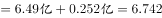
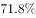
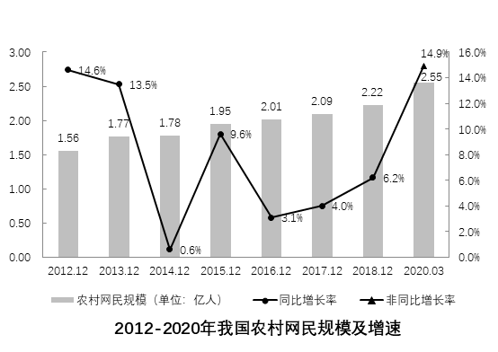

# 月均增长量计算与现期外推

考点：[[20-考点/资料分析/增长/月均增长量计算与现期外推|增长 / 月均增长量计算与现期外推]]
材料：[[15-材料/资料分析/258920 我国农村互联网发展状况：以2020年|258920 我国农村互联网发展状况：以2020年]]

**问法模型**：题干为'按某时段的月均增长量估算，未来某时点约为多少'→先用增长量÷实际月份数求月均，再以现期值+月均×未来月份数外推

## 推理链
1. 第1步：从文字材料提取：截至2020年3月城镇网民规模6.49亿人，较2018年12月增长4200万，换算为0.42亿人
2. 第2步：确定时间跨度：2018年12月至2020年3月间隔15个月（材料两图均跳过2019年12月，不能按12个月计）；2020年3月至2020年12月还需9个月
3. 第3步：求月均增长量：0.42÷15=0.028亿人/月
4. 第4步：代入外推公式：2020年12月城镇网民规模=6.49+0.028×9=6.49+0.252=6.742亿人
5. 第5步：与选项对照：6.742与B项6.74最接近，故选B

**最快解法**：⚡ 公式法+速算：0.42÷15=0.028；9个月增长量可巧算为0.42×(9/15)=0.42×0.6=0.252；6.49+0.252=6.742≈6.74，直接锁定B

## 易错点
- ⚠ 月份数陷阱：两图均缺2019年12月，2018年12月至2020年3月实际间隔15个月，易按同比思维误用12个月求月均
- ⚠ 外推月数陷阱：2020年3月至2020年12月是9个月而非12个月，误用12个月会得6.83，偏离正确答案
- ⚠ 单位换算：'4200万'须先换算为0.42亿再与6.49亿运算，且'月均增长量'是绝对量（亿人/月）而非增速，勿套增长率公式

## 母题抽象
> 🧩 当题干出现'按照××至××的月均增长量估算，××时点约为多少'时，用'月均=总增长量÷实际月份数，未来值=现期+月均×未来月份数'，核心验证两段时间的真实月份数（尤其材料缺月跳点时的间隔）

**同类特征**：月均增长量估算、未来时点外推、城镇网民规模、2018年12月到2020年3月、2020年12月、约为（ ）亿人

## 相关题
（暂无）

---

### 题干
如果按照2018年12月到2020年3月的城镇网民规模月均增长量估算，2020年12月，城镇网民规模约为（    ）亿人。

### 选项
- A. 6.49
- B. 6.74　✅
- C. 6.99
- D. 7.24

### 官方解析

根据题干“如果按照······月均增长量估算，2020年12月······约为（    ）亿人”，可判定本题为现期计算问题。定位文字材料第一段可得，截至2020年3月，我国城镇网民规模为6.49亿人，······较2018年12月增长4200万。2020年3月与2018年12月的月份差为15个月，到2020年12月还有9个月，则所求现期量为亿人，与B项最接近。

故正确答案为B。

### 给定材料

        近年来，我国大力推动农村互联网建设，目前已初步建成融合、泛在、安全、绿色的宽带网络环境，基本实现“城市光纤到楼到户，农村宽带进乡入村”。2019年，我国已建成全球最大规模光纤和移动通信网络，行政村通光纤和4G比例均超过。调查显示，截至2020年3月，我国网民规模为9.04亿人，其中农村网民规模为2.55亿人，较2018年12月增长，城镇网民规模为6.49亿人，占网民整体的，较2018年12月增长4200万。

        我国农村地区互联网普及率为，较2018年12月提升7.8个百分点，其余年份详情如下： 

