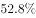
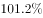
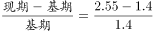
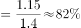

# 隐藏基期逆推+一般增长率计算

考点：[[20-考点/资料分析/增长/隐藏基期逆推+一般增长率计算|增长 / 隐藏基期逆推+一般增长率计算]]
材料：[[15-材料/资料分析/258920 我国农村互联网发展状况：以2020年|258920 我国农村互联网发展状况：以2020年]]

**问法模型**：题干为'与2011年12月相比，2020年3月…增长了约'+选项为百分数 → 先用中间年份数据逆推2011.12基期量，再套增长率=(现期−基期)/基期

## 推理链
1. 第1步：题干要求2020.03相对2011.12的增长率；由图1直接读得现期2020.03农村网民2.55亿人，但2011.12数据未在图中列出，属隐藏基期
2. 第2步：图1给出2012.12农村网民规模1.56亿人、同比增长率14.6%，故2011.12基期量=1.56÷(1+14.6%)=1.56÷1.146
3. 第3步：截位直除得1.56÷1.146≈1.36亿人，即2011.12农村网民约1.36亿
4. 第4步：增长率=(2.55−1.36)÷1.36≈1.19÷1.36≈87.4%（等价于2.55÷1.36≈1.87，再减1）
5. 第5步：与选项对照，结果约87%与C项最接近，故选C

**最快解法**：⚡ 截位直除+百化分：先1.56÷1.146≈1.36（商首位1、次位3）；再把增长率看成2.55/1.36−1，2.55/1.36≈1.87→增长约87%，选项量级差距大可直接锁定C

## 易错点
- ⚠ 隐藏基期陷阱：直接拿图中最近的2012.12的1.56亿当基期，会错算成(2.55−1.56)/1.56≈63.5%，漏掉1.56÷(1+14.6%)的逆推步骤
- ⚠ 双轴图张冠李戴：图1柱状是亿人、折线是%；2020.03的14.9%是相对2018.12的'非同比增长率'，与本题无关，不能把它当同比增速或与1.56亿混算
- ⚠ 表述辨析：'增长了约'接百分数选项为增长率，若误判为增长量（亿人）或'是几倍'口径会选错

## 母题抽象
> 🧩 当题干现期与基期之间隔有中间年份且基期数据未直接给出时，用中间年份规模÷(1+对应同比增速)逆推隐藏基期，再套增长率=(现期−基期)/基期，与选项对照取最接近值

**同类特征**：与2011年12月相比、2020年3月、农村网民规模、增长了约、选项为百分数、基期数据需由同比增速逆推

## 相关题
- [[10-真题/资料分析/增长/9629 一般增长率计算（现期需由增量倒推）|9629]]（安徽 2009，相关度1）
- [[10-真题/资料分析/比重/2604234 现期比重计算|2604234]]（广东 2020，相关度1）
- [[10-真题/资料分析/增长/27835 一般增长率计算（已知现期量与增长量求增长率）|27835]]（河北 2012，相关度1）
- [[10-真题/资料分析/平均数/10204497 平均数增长率（均价=值-量的比值增长率）|10204497]]（海南 2024，相关度1）
- [[10-真题/资料分析/增长/12536395 隔年（间隔）增长率|12536395]]（四川 2024，相关度1）

---

### 题干
与2011年12月相比，2020年3月农村网民规模增长了约（     ）。

### 选项
- A. 

- B. 

- C. 

　✅
- D. 

### 官方解析

根据题干“与2011年12月相比，2020年3月农村网民规模增长了约”，结合选项为百分数，可判定本题为一般增长率计算问题。定位统计图查找可得，2020年3月农村网民规模为2.55亿人，2012年12月农村网民规模为1.56亿人，同比增长。则2011年12月农村网民规模为亿人，与2011年12月相比，2020年3月农村网民规模增长了，与C项最接近。

故正确答案为C。

### 给定材料

        近年来，我国大力推动农村互联网建设，目前已初步建成融合、泛在、安全、绿色的宽带网络环境，基本实现“城市光纤到楼到户，农村宽带进乡入村”。2019年，我国已建成全球最大规模光纤和移动通信网络，行政村通光纤和4G比例均超过。调查显示，截至2020年3月，我国网民规模为9.04亿人，其中农村网民规模为2.55亿人，较2018年12月增长，城镇网民规模为6.49亿人，占网民整体的，较2018年12月增长4200万。

        我国农村地区互联网普及率为，较2018年12月提升7.8个百分点，其余年份详情如下： 

