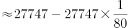
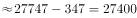
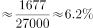

# 多年区间增长率计算（基期量反推）

考点：[[20-考点/资料分析/增长/多年区间增长率计算（基期量反推）|增长 / 多年区间增长率计算（基期量反推）]]
材料：[[15-材料/资料分析/258923 2019年我国农民工监测数据：农民工|258923 2019年我国农民工监测数据：农民工]]

**问法模型**：题干问'2014-2019年…增加了约'且选项为百分数 → 以2014年为基期求增长率：先用2015年量27747÷(1+1.3%)反推2014年基期量，再套(现期−基期)/基期

## 推理链
1. 第1步：题干时间范围是2014-2019年，选项为百分数，判定求增长率；图1柱状图只给2015-2019年数据，2014年总量未直接给出，须反推
2. 第2步：定位图1，2015年农民工规模27747万人、同比增速1.3%（折线右轴），2019年为29077万人
3. 第3步：基期反推公式：2014年总量=2015年量÷(1+2015年增速)=27747÷1.013≈27391万人
4. 第4步：代入增长率公式：(29077−27391)÷27391≈1686÷27391≈6.2%
5. 第5步：与选项对照，约6.2%对应C项，故正确答案为C

**最快解法**：⚡ 增长率合成+截位直除：先算2019年较2015年的增长率 29077÷27747−1≈4.8%（截位直除一步出），再与2015年增速1.3%链式合成：(1+4.8%)×(1+1.3%)−1≈6.2%，直除首位商6锁定约6.2%，选C；若按官方路径则27747÷1.013≈27391再求1686÷27391≈6.2%

## 易错点
- ⚠ 时间范围陷阱：题干是2014-2019年，若漏掉2014年基期、只算2015-2019年，会得(29077−27747)÷27747≈4.8%，误选干扰项
- ⚠ 基期反推方向错误：2014年=27747÷1.013（÷不是×），若误乘成27747×1.013≈28108，会算出约3.4%的错值
- ⚠ 题型与口径误判：选项为百分数是增长率而非增长量'多少万人'；另图1为双轴图、柱左轴27000非零起点，勿用柱高差目测估增量

## 母题抽象
> 🧩 当题干出现'从材料未直接给出的较早年份到现期增加了约（选项为百分数）'时，用相邻已知年份量÷(1+该年同比增速)反推基期，再算(现期−基期)/基期，或用各年增速链式合成，验证结果唯一落在某选项

**同类特征**：2014-2019年（跨度多年的区间问法）、规模增加了约、选项为百分数（增长率）、基期年份2014年数据未直接给出、需用2015年值27747与增速1.3%反推、柱状图+同比增速折线双轴材料

## 相关题
（暂无）

---

### 题干
2014-2019年，我国农民工规模增加了约（    ）。

### 选项
- A. 

- B. 

- C. 

　✅
- D. 

### 官方解析

根据题干“2014-2019年，······增加了约”，结合选项为百分数，可判定本题为增长率计算问题。定位柱状图，2015年我国农民工总量为27747万人，同比增长，2019年为29077万人，则2014年我国农民工总量万人。则2019年相对于2014年的增长率。

故正确答案为C。

### 给定材料

        2019年我国农民工规模继续扩大，总量达到29077万人，同比增长。其中，本地农民工11652万人，比上年增加82万人；外出农民工17425万人，比上年增加159万人。外出农民工中，在省内就业的农民工9917万人，比上年增加245万人；跨省流动农民工7508万人，比上年减少86万人。

        从收入看，农民工集中就业的六大行业月均收入均稳定增长。2019年农民工月均收入约4000元；其中外出农民工月均收入4427元，比上年增加320元；本地农民工月均收入3500元，比上年增加160元。分区域看，在东部地区就业的农民工月均收入4222元，比上年增长；在中部地区就业的农民工月均收入3794元，比上年增长；在西部地区就业的农民工月均收入3723元，比上年增长；在东北地区就业的农民工月均收入3469元，同比增长。

> [!warning] 疑点（官方解析可能有误，待人工复核）
> 官方解析中2014年基期量与增长率的具体数值在文本中缺失（留空），按材料补算为27391万人与约6.2%，与答案C一致；注意若改用图1五年增速连乘合成（1.013×1.015×1.017×1.006×1.008−1≈6.0%），会因各年增速四舍五入偏低约0.1-0.2个百分点，官方口径以直接反推法（≈6.2%）为准，不影响答案C

<!-- CODEX-ANSWER-REVIEW:BEGIN -->
### 本次独立复核

**复核状态：** `resolved`（答案与解析已核定）

**计分答案：** C（可计分）

**复核解析：**

2015年农民工总量27747万人、同比增长1.3%，故2014年约27747/1.013=27390.9万人。2019年为29077万人，相对2014年的累计增幅=(29077/27390.9−1)×100%≈6.16%，约6.2%，对应C。

**相关信息：**

本题比较2014至2019端点的累计增幅；图中各年度已四舍五入的增速连乘会产生小的累积舍入误差。

**题源依据：** [固定版本原题](https://github.com/Mentat-Uran/kaogongzhentizhengliu/blob/84ab93d4b64b61d897bece8a1c0a5bab06b4feb2/10-%E7%9C%9F%E9%A2%98/%E8%B5%84%E6%96%99%E5%88%86%E6%9E%90/%E5%A2%9E%E9%95%BF/2604282%20%E5%A4%9A%E5%B9%B4%E5%8C%BA%E9%97%B4%E5%A2%9E%E9%95%BF%E7%8E%87%E8%AE%A1%E7%AE%97%EF%BC%88%E5%9F%BA%E6%9C%9F%E9%87%8F%E5%8F%8D%E6%8E%A8%EF%BC%89.md)；固定内容 commit `84ab93d4b64b61d897bece8a1c0a5bab06b4feb2`，Markdown blob `a7b0f60188398891c63a1d823aa16ff50da5640f`。
<!-- CODEX-ANSWER-REVIEW:END -->
