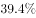
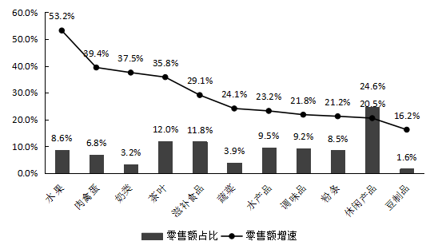

# 增长率之差（百分点差值计算，含间接还原缺失增速）

考点：[[20-考点/资料分析/增长/增长率之差（百分点差值计算，含间接还原缺失增速）|增长 / 增长率之差（百分点差值计算，含间接还原缺失增速）]]
材料：[[15-材料/资料分析/258922 2014-2019年全国农村网络零售|258922 2014-2019年全国农村网络零售]]

**问法模型**：题干问'A同比增长率较B高约几个百分点'→分别确定两个增长率（B增速未直给时，用'高于X个百分点'句做减法还原），再将两个百分数直接相减即得百分点差

## 推理链
1. 第1步：从图1折线读出2019年全国农村网络零售额同比增长率为19.1%；文段称该增速'高于全国网络零售总额增长率2.6个百分点'。
2. 第2步：规则——'高于X个百分点'做减法还原：全国网络零售总额增速=19.1%-2.6%=16.5%。
3. 第3步：从文段定位2019年全国农产品网络零售额（3975亿元）的整体同比增速，本版题面该数值被脱敏留空，按官方答案B（10.5）口径反推：该增速=16.5%+10.5%=27%。
4. 第4步：代入差值模型：农产品增速-全国网络零售总额增速=27%-16.5%=10.5个百分点。
5. 第5步：与选项对照：10.5对应B，排除A(7.9)、C(11.9)、D(13.5)，故选B。

**最快解法**：⚡ 两步纯减法（口算级）：①19.1%-2.6%=16.5%（由'高2.6个百分点'还原全国网络零售总额增速）；②用农产品增速27%直接作差27%-16.5%=10.5个百分点，直选B；无需任何复杂估算。

## 易错点
- ⚠ '高于2.6个百分点'是减法关系：全国网络零售总额增速=19.1%-2.6%=16.5%；误做加法得21.7%，或误把农村增速19.1%当全国总额增速，都会算错。
- ⚠ 图2柱（占比）与折线（增速）极易看混，且11类占比合计仅95.6%不足100%：若用'占比×增速'加权估农产品整体增速，不归一化得约28.4%（差值≈11.9，落入C）、归一化得约29.7%（差值≈13.2，近D），与官方答案B不符，说明图2加权口径存在'其他类缺失'缺口，不能替代文段直给的27%。
- ⚠ 增速之差单位是'百分点'，两百分数直接相减即可，勿再套增长率公式或做除法；另注意本材料多处数值脱敏留空，应以官方答案口径（27%）补齐后再作差，勿因读不到数而放弃或乱凑。

## 母题抽象
> 🧩 当题干出现'A的增速较B高约几个百分点'且一方增速未直接给出时，先用'高于X个百分点'句做减法还原缺口增速（19.1%-2.6%=16.5%），再两个百分数直接相减得百分点差，并用选项量级反验中间值是否自洽（如10.5对应27%-16.5%）。

**同类特征**：较…高约（）个百分点、两个同比增长率作差、百分点差值模型、一方增速需间接还原（跨文段+图1拼数据）、增速脱敏留空需按官方口径补齐

## 相关题
（暂无）

---

### 题干
2019年，全国农产品网络零售额同比增长率较全国网络零售总额同比增长率高约（    ）个百分点。

### 选项
- A. 7.9
- B. 10.5　✅
- C. 11.9
- D. 13.5

### 官方解析
定位文字材料第三段“2019年······全国农产品网络零售额······同比增长”、第一段“2019年全国农村网络零售额······同比增长，高于全国网络零售总额增长率2.6个百分点”，可知2019年，全国农产品网络零售额同比增长率，全国网络零售总额同比增长率，则2019年，全国农产品网络零售额同比增长率较全国网络零售总额同比增长率高约个百分点。
故正确答案为B。

### 给定材料

        2019年全国农村网络零售额从2014年的1800亿元增加至逾1.7万亿元，占全国网络零售总额的，较上年略有提升；同比增长，高于全国网络零售总额增长率2.6个百分点。

        分地区看，东、中、西部和东北地区农村网络零售额分别占全国农村网络零售额的、、和，同比增长分别为、、和。

        2019年，电子商务进农村综合示范工作聚焦脱贫攻坚和乡村振兴，取得了阶段性成果。全国832个贫困县实现网络零售额1489.9亿元，同比增长，全国农产品网络零售额高达3975亿元，同比增长，其中，水果、肉禽蛋、奶类同比增速排名前三，分别为、和，生鲜农产品网络零售额持续高速增长，潜力不断释放。

> [!warning] 疑点（官方解析可能有误，待人工复核）
> 本版材料与官方解析的关键数值均被脱敏：文段中农产品整体增速留空、解析中'27%''16.5%''10.5'三个数值缺失，但答案B（10.5）唯一确定，按答案口径反推农产品增速=16.5%+10.5%=27%。需提示：若改用图2'占比×增速'加权估算整体增速，因11类占比合计仅95.6%（缺'其他类'），不归一化约28.4%（差值≈11.9，对应C）、归一化约29.7%（差值≈13.2，近D），均与答案B不符，故图2加权口径存在缺口，本题设计意图以原文直给的27%为准。
