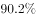
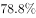
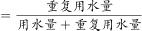
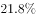
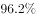

# 增长量计算（无整体增速，分项用同比变化率求增长量后求和）

考点：[[20-考点/资料分析/增长/增长量计算（无整体增速，分项用同比变化率求增长量后求和）|增长 / 增长量计算（无整体增速，分项用同比变化率求增长量后求和）]]
材料：[[15-材料/资料分析/259047 2019年广东省规模以上工业企业的用|259047 2019年广东省规模以上工业企业的用]]

**问法模型**：题干'与2018年相比，2019年广东规模以上工业企业用水量'且选项均带'增加/减少约X亿立方米'→判定为增长量计算；因材料未给全省整体同比增速，须对四地区分别套'增长量=现期×r/(1+r)'再求和。

## 推理链
1. 第1步：题干问2019年相对2018年全省用水量的增减量（带单位亿立方米），而文字只给2019年全省总量39.54亿立方米、无整体同比增速，故必须借助表格各地区数据分别计算。
2. 第2步：从表格提取四地区2019年用水量与同比变化率：珠三角29.85（−0.6%）、粤东2.46（−10.0%）、粤西2.96（−8.2%）、粤北4.27（−2.4%）；自检：29.85+2.46+2.96+4.27=39.54亿立方米，与文字总量核验一致。
3. 第3步：公式：增长量=现期−基期=现期×r/(1+r)（r均为负值）；代入：珠三角29.85×(−0.6%)/(1−0.6%)≈−0.18，粤东2.46×(−10%)/(1−10%)≈−0.27，粤西2.96×(−8.2%)/(1−8.2%)≈−0.27，粤北4.27×(−2.4%)/(1−2.4%)≈−0.10（亿立方米）。
4. 第4步：求和：−0.18−0.27−0.27−0.10≈−0.82亿立方米；等价验证：反推2018年四地区之和29.85/0.994+2.46/0.9+2.96/0.918+4.27/0.976≈30.03+2.73+3.23+4.37≈40.36亿立方米，39.54−40.36≈−0.82亿立方米。
5. 第5步：与选项对照：减少约0.8亿立方米，与A项最接近，故选A。

**最快解法**：⚡ 百化分+增长量公式：各地增长量=现期×r/(1+r)，−10%≈−1/10→2.46×(−1/9)≈−0.27；−8.2%≈−1/12→2.96×(−1/11)≈−0.27；−0.6%≈−1/167→29.85×(−1/166)≈−0.18；−2.4%≈−1/42→4.27×(−1/41)≈−0.10；四项求和≈−0.82，方向减少、量级0.8，直接锁定A。

## 易错点
- ⚠ 方向判断：表格四地区同比变化率全为负，2019年必然比2018年减少，可先排除B、D再比量级，避免被'增加'选项干扰。
- ⚠ 基期反推符号：2018年值=2019年值÷(1−降幅)，如粤东=2.46÷0.9≈2.73，若误写为÷(1+10%)得2.24，增长量方向与数值全错。
- ⚠ 全省39.54亿立方米无同比增速，不能一步求全省增长量，必须分地区计算后求和；且增长量=现期×r/(1+r)分母不能省略，直接用现期×|r|（如粤东2.46×10%=0.25）会偏小。

## 母题抽象
> 🧩 当题干问'与上年相比某总量增加/减少多少（带单位）'而材料只给各分项现期值与同比变化率（无整体增速）时，逐项套'增长量=现期×r/(1+r)'（r为负即减少）再求和，与选项就近匹配。

**同类特征**：与2018年相比、全省/整体用水量（材料未给整体增速）、选项为'增加/减少约X亿立方米'、需用表格各地区同比变化率反推、同比变化率全为负、增长量计算

## 相关题
- [[10-真题/资料分析/增长/7159 增长量计算|7159]]（北京 2009，相关度1）
- [[10-真题/资料分析/增长/2571729 增长量计算——每增长1个百分点对应的增量（基期量×1%）|2571729]]（山东 2020，相关度1）
- [[10-真题/资料分析/增长/3018839 增长量计算（负增长情形：基期减少量）|3018839]]（广东 2021，相关度1）
- [[10-真题/资料分析/增长/10204654 增长量计算（已知现期与同比下降率求下降量）|10204654]]（安徽 2024，相关度1）
- [[10-真题/资料分析/增长/13319362 现期增长量计算（已知现期值与同比增速，用r-(1+r)公式）|13319362]]（江苏 2025，相关度1）

---

### 题干
与2018年相比，2019年广东规模以上工业企业用水量：

### 选项
- A. 减少了约0.8亿立方米　✅
- B. 增加了约1.8亿立方米
- C. 减少了约2.8亿立方米
- D. 增加了约3.8亿立方米

### 官方解析
根据题干“与2018年相比，2019年···”，结合选项中有减少和增加，且带有单位，可判定本题为增长量计算问题。定位表格材料，可得2019年广东各地区用水量和同比变化率。根据公式，增长量，则与2018年相比广东各地区用水量变化情况为：珠三角，粤东，粤西，粤北。因此与2018年相比，2019年广东规模以上工业企业用水量约减少了亿立方米，与A项最接近。
故正确答案为A。

### 给定材料

        2019年，广东规模以上工业企业用水量39.54亿立方米，分水种看，自来水用水量最大，达35.67亿立方米，占全部用水量的；地表淡水用水量2.52亿立方米，地下淡水0.03亿立方米，其他水1.32亿立方米。分地区看，珠三角地区用水量达29.85亿立方米，占比超。

        2019年，广东规模以上工业企业重复用水量为147.10亿立方米，比上年增长，重复用水率提高到（注：重复用水率）。分行业看，重复用水量主要集中在电力、冶金和石油石化行业。其中，电力行业重复用水量为50.72亿立方米，比上年下降，占全省规模以上工业企业全部重复用水量的；冶金行业重复用水量为40.82亿立方米，增长，占全部重复用水量的；石油石化行业重复用水量为32.12亿立方米，增长，占全部重复用水量的。

        整体而言，在全省规模以上工业企业中，重复用水量普及面窄且重复用水率较低的问题值得关注。有重复用水的企业只有3573家，只占全省规模以上工业企业的，说明九成多企业无重复用水。重复用水量超过1000万立方米以上的企业88家，仅占重复用水量的，主要集中在石油化工、电厂和钢铁厂等少数大型企业中，重复用水应用领域明显较窄。

