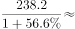

# 基期量计算（图1直接读取）

考点：[[20-考点/资料分析/增长/基期量计算（图1直接读取）|增长 / 基期量计算（图1直接读取）]]
材料：[[15-材料/资料分析/260066 中国人工智能产业：2014—2018|260066 中国人工智能产业：2014—2018]]

**问法模型**：题干以'截至2017年底…约为'求基期量，且2017年在图1横轴直接列出 → 优先直接读图取值，读不到再用'现期/(1+增长率)'反推

## 推理链
1. 第1步：题干求'截至2017年底'的市场规模，即以2018年底238.2亿元为现期、2017年为基期的基期量问题
2. 第2步：图1'2014-2018年中国人工智能市场规模'横轴逐年列示各年当年值，2017年柱顶标注152.1（亿元）
3. 第3步：直接读取图1中2017年柱值152.1亿元，无需任何计算
4. 第4步：与选项对照：B项152.1亿元与读数完全一致，A(141.1)、C(156.1)、D(164.1)均不符，故选B
5. 第5步：备用验证（走文字路径）：2018年增速≈(238.2−152.1)/152.1≈56.6%，基期=238.2/(1+56.6%)≈152.1亿元，同样指向B

**最快解法**：⚡ 直接读图法：题干年份'2017'与图1横轴年份一一对应，秒读2017年柱顶标数152.1，零计算锁定B；只有当图中无该年数据时才退回基期公式'现期/(1+增速)'

## 易错点
- ⚠ 文字材料中2018年同比增长率数值是空格，若只盯文字用'238.2/(1+g)'求基期会因缺g卡壳，必须回图1读取或先自算g≈56.6%
- ⚠ 现期/基期时间混淆：'截至2018年底'的238.2是现期，勿把2018年柱值误当2017年答案；图1各柱为当年值而非累计值
- ⚠ 近似干扰：A(141.1)、C(156.1)与152.1数值接近，须精读柱顶标数而非目测柱高，避免估读偏差误选C

## 母题抽象
> 🧩 当题干问'截至/某年年底某指标约为多少'且该年份在统计图横轴（或表行）直接列出时，先直接读对应柱/行标数；仅当图中缺该年数据时，才用基期公式'现期/(1+增长率)'反推并对照选项

**同类特征**：截至2017年底、市场规模约为、基期量查找、图1逐年数据可直接读取、文字增速数值空缺、选项带单位'亿元'

## 相关题
- [[10-真题/资料分析/增长/2616098 现期预测（等速增长外推）|2616098]]（海南 2020，相关度1）
- [[10-真题/资料分析/增长/2051378 增长量计算（同比、当月口径）|2051378]]（天津 2017，相关度1）

---

### 题干
截至2017年底，中国人工智能市场规模约为：

### 选项
- A. 141.1亿元
- B. 152.1亿元　✅
- C. 156.1亿元
- D. 164.1亿元

### 官方解析

定位柱形图1可得，2017年中国人工智能市场规模约为152.1亿元。

故正确答案为B。

注：若本题没有发现柱形图1的数据，直接看到文字材料，可以按照求解基期量计算。根据文字材料“截至2018年底，中国人工智能市场规模约为238.2亿元，同比增长率达到”，可得2017年中国人工智能市场规模约为亿元，与B项最接近。

### 给定材料

        截至2018年底，中国人工智能市场规模约为238.2亿元，同比增长率达到。从中国人工智能企业地域分布情况来看，北京企业数量最多，企业数量为368家；其次为广东，人工智能企业数量为185家；排名第三的是上海，数量为131家。

