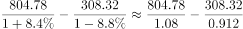
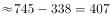

# 基期量计算与基期作差（基期差值）

考点：[[20-考点/资料分析/增长/基期量计算与基期作差（基期差值）|增长 / 基期量计算与基期作差（基期差值）]]
材料：[[15-材料/资料分析/260065 2017年A市现代农业生态服务价值及|260065 2017年A市现代农业生态服务价值及]]

**问法模型**：题干问'2016年（基期）A比B多多少'而材料只给2017年现期值与同比增速 → 采用基期作差模型：基期量=现期/(1+g)，分别换算后相减

## 推理链
1. 第1步：题干时间为2016年（基期），材料数据为2017年（现期），定位表格'年值'列：旅游服务价值年值804.78亿元、同比+8.4%；农林牧渔业总产值年值308.32亿元、同比-8.8%
2. 第2步：基期量公式：基期=现期/(1+g)；农林牧渔业总产值增速为负（g=-8.8%），分母应为1-0.088=0.912
3. 第3步：旅游服务价值2016年值=804.78/1.084≈742.4亿元
4. 第4步：农林牧渔业总产值2016年值=308.32/0.912≈338.1亿元
5. 第5步：基期作差：742.4-338.1≈404.3亿元
6. 第6步：与选项对照，404.3与D项404.35亿元最接近，故选D

**最快解法**：⚡ 截位直除：804.78/1.084→805/1.084≈742；308.32/0.912→308.3/0.912≈338；两数直接相减得约404，锁定D。技巧要点：负增长指标基期分母小于1（0.912），除完比现期308.32还大，先估出'基期值>308'即可避免方向性错误

## 易错点
- ⚠ 基期现期混淆：若直接用现期作差804.78-308.32=496.46，会误选数值最接近的A项494.46；题干问2016年必须换算基期
- ⚠ 负增长分母处理错误：农林牧渔业总产值增速为-8.8%，基期=308.32/(1-0.088)=308.32/0.912≈338.1（基期>现期）；若误写成308.32/1.088≈283.4，差值变为约459，会误选A或B
- ⚠ 口径定位：需取'年值'列下间接经济价值中的旅游服务价值与直接经济价值中的农林牧渔业总产值两行；本题两指标的年值与贴现值数值恰好相同，但仍应养成先圈'年值/贴现值'列再取数的习惯，避免同表其他题看串列

## 母题抽象
> 🧩 当题干出现'基期年份+A比B多（少）多少亿元'且材料只给现期值与同比增速时，用基期作差模型：分别求现期/(1+g)后相减；负增长指标分母为(1-|g|)，其基期量大于现期量，需先定性确认再精算对照选项

**同类特征**：2016年（基期年份）、……比……多、年值口径、基期作差、现期值+同比增速型表格、负增长指标参与基期换算

## 相关题
- [[10-真题/资料分析/增长/2172144 基期量计算（已知现期累计值与累计同比增速）|2172144]]（广州市考 2018，相关度1）
- [[10-真题/资料分析/比重/2616071 基期比重计算|2616071]]（云南 2020，相关度1）

---

### 题干
2016年，A市旅游服务价值年值比农林牧渔业总产值年值多：

### 选项
- A. 494.46亿元
- B. 462.79亿元
- C. 441.85亿元
- D. 404.35亿元　✅

### 官方解析

根据题干“2016年，······比······多”，结合材料时间“2017年”，可判定本题为基期作差问题。定位表格材料可得：“2017年，A市旅游服务价值年值为804.78亿元，同比增长；农林牧渔业总产值年值为308.32亿元，同比增长”。根据：，列式：2016年A市旅游服务价值年值比农林牧渔业总产值年值多 亿元，所求结果与D项最接近。

故正确答案为D。

### 给定材料

 

