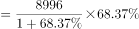
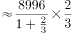
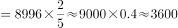

# 增长量计算（同比增量，现期×r-(1+r)）

考点：[[20-考点/资料分析/增长/增长量计算（同比增量，现期×r-(1+r)）|增长 / 增长量计算（同比增量，现期×r/(1+r)）]]
材料：[[15-材料/资料分析/260067 2019年6月及2019年上半年全国|260067 2019年6月及2019年上半年全国]]

**问法模型**：题干'2019年6月……比2018年6月多约（亿元）'→判定为同比增长量计算，模型：增量=现期量×r/(1+r)，与选项做近似匹配

## 推理链
1. 第1步：题干'2019年6月比2018年6月多约'锁定当月同比口径，定位材料第1段现期量：2019年6月全国发行地方政府债券8996亿元（勿误取1-6月累计28372亿元）
2. 第2步：取同比增速r：材料文本该处数值留白，按完整试卷口径r≈68.4%（可由干扰项印证：8996×68.4%≈6151亿元，恰为A项6151）
3. 第3步：用增长量公式：增长量=现期×r/(1+r)=8996×68.4%/168.4%
4. 第4步：代入计算：8996×0.684÷1.684≈8996×0.4062≈3654亿元（等价地，先还原基期8996÷1.684≈5343亿元，再相减8996-5343≈3653亿元）
5. 第5步：与选项对照：3654亿元与C项3653亿元最接近；A6151为漏除(1+r)的陷阱值，B5953量级偏大，D3043偏小，故选C

**最快解法**：⚡ 百化分：68.4%略大于2/3，先按2/3估算增量=现期×2/(2+3)=8996×0.4≈3598亿元；因实际增速68.4%>66.7%，真实增量略大于3598，四个选项中只有C（3653）在此方向且量级吻合，直接锁定C；考场亦可截位直除：8996÷1.684≈5343，8996-5343≈3653。

## 易错点
- ⚠ 当月值与累计值混排：8996亿元是2019年6月单月值、28372亿元是1-6月累计值，题干'2019年6月比2018年6月'只能用单月同比，误用累计值即全错
- ⚠ 漏除(1+r)：把'增长量'误算成现期×r=8996×68.4%≈6151亿元，恰好落入A项命题陷阱（A/B两项即围绕'×r'与'×r/(1+r)'的倍数关系设置）
- ⚠ '多约'求的是增长量（亿元差值）而非增长率；同段'置换债券和再融资债券'为同比减少，若将其负增长模型÷(1-|g|)错套到本题正增长情景，会把基期算大、增量算小而误选D方向

## 母题抽象
> 🧩 当题干出现'现期比去年同期多/增长约多少（带单位亿元）'特征时，用增长量公式增量=现期×r/(1+r)，百化分（r≈n/m→现期×n/(m+n)）定向估出量级区间，再用截位直除（现期÷(1+r)求基期后相减）验证选项。

**同类特征**：2019年6月比2018年6月多约、同比（当月对当月）、增长量计算、问'多约'而非'增长百分之几'、现期量8996亿元、选项为亿元差值、含漏除(1+r)型干扰项

## 相关题
- [[10-真题/资料分析/增长/7159 增长量计算|7159]]（北京 2009，相关度1）
- [[10-真题/资料分析/增长/2571729 增长量计算——每增长1个百分点对应的增量（基期量×1%）|2571729]]（山东 2020，相关度1）
- [[10-真题/资料分析/增长/3018839 增长量计算（负增长情形：基期减少量）|3018839]]（广东 2021，相关度1）
- [[10-真题/资料分析/增长/10204654 增长量计算（已知现期与同比下降率求下降量）|10204654]]（安徽 2024，相关度1）
- [[10-真题/资料分析/增长/13319362 现期增长量计算（已知现期值与同比增速，用r-(1+r)公式）|13319362]]（江苏 2025，相关度1）

---

### 题干
2019年6月，全国发行的地方政府债券比2018年6月多约：

### 选项
- A. 6151亿元
- B. 5953亿元
- C. 3653亿元　✅
- D. 3043亿元

### 官方解析

根据题干“2019年6月，······比2018年6月多约”，判定本题为增长量计算问题。定位文字材料第一段“2019年6月，全国发行地方政府债券8996亿元，同比增长”。根据公式：增长量。代入数据，2019年6月，全国发行的地方政府债券的同比增长量亿元，与C项最接近。

故正确答案为C。

### 给定材料

        2019年6月，全国发行地方政府债券8996亿元，同比增长，环比增长。其中，发行一般债券3178亿元，同比减少，环比增长，发行专项债券5818亿元，同比增长，环比增长；按用途划分，发行新增债券7170亿元，同比增长，环比增长，发行置换债券和再融资债券1826亿元，同比减少，环比增长。

        2019年6月，地方政府债券平均发行期限11.1年，其中新增债券10.4年，置换债券和再融资债券13.4年；地方政府债券平均发行利率，其中新增债券，置换债券和再融资债券。

        2019年1至6月，全国发行地方政府债券28372亿元，同比增长。其中，发行一般债券12858亿元，同比增长，发行专项债券15514亿元，同比增长；按用途划分，发行新增债券21765亿元，同比增长，发行置换债券和再融资债券6607亿元，同比减少。

        2019年1至6月，地方政府债券平均发行期限9.3年，其中一般债券11.2年，专项债券7.8年；地方政府债券平均发行利率，其中一般债券，专项债券。

        2019年全国地方政府债务限额为240774.3亿元。其中，一般债务限额133089.22亿元，专项债务限额107685.08亿元。截至2019年6月末，全国地方政府债务余额205477亿元，其中，一般债务118397亿元，专项债务87080亿元。

> [!warning] 疑点（官方解析可能有误，待人工复核）
> 所给材料文本及官方解析中同比增速具体数值均为空白，无法直接读取；由官方答案C（3653亿元）与干扰项A（6151≈8996×68.4%）反推，该处同比增速应为约68.4%，与官方答案口径自洽，无实质矛盾，仅提示解题需代入完整版试卷中的具体增速值。
