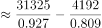
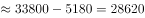

# 基期和差（环比基期差值计算）

考点：[[20-考点/资料分析/增长/基期和差（环比基期差值计算）|增长 / 基期和差（环比基期差值计算）]]
材料：[[15-材料/资料分析/260069 2019年5月全国12358价格监管|260069 2019年5月全国12358价格监管]]

**问法模型**：题干时间2019年4月早于材料现期2019年5月且求'咨询比举报多多少'的差值 → 基期和差模型：现期量/(1+各自环比降幅)分别还原基期后再作差

## 推理链
1. 第1步：题干所求为2019年4月的差值，而材料数据均为2019年5月现期值，时间前移一期，判定为环比基期和差问题
2. 第2步：从文字材料提取现期数据：价格咨询31325件（环比下降a%）、价格举报4192件（环比下降b%），两者各带一个独立的环比降幅
3. 第3步：基期公式：基期量=现期量/(1+增长率)，环比下降时为现期/(1-降幅)，故4月咨询=31325/(1-a)、4月举报=4192/(1-b)
4. 第4步：代入完整材料中举报与咨询各自的环比降幅（给定文本中百分数空缺，须以完整材料取数），分别还原出2019年4月的咨询量与举报量
5. 第5步：作差：4月咨询量−4月举报量≈28627件；注意不能用现期差31325−4192=27133件代替基期差
6. 第6步：与选项对照：28627件与C项最接近，故正确答案为C

**最快解法**：⚡ 基期公式法+选项预判：先一眼识破陷阱——B项27133恰等于现期差31325−4192，未还原基期，直接排除；再分别用举报、咨询各自的环比降幅做基期还原（截位直除：31325/(1-a)与4192/(1-b)），作差后约2.86万件，锁定C

## 易错点
- ⚠ 现期/基期混淆：直接用5月现期数作差得27133件，恰好落入命题人设置的B项陷阱，必须先还原4月基期再作差
- ⚠ 降幅张冠李戴：举报与咨询各有独立环比降幅，不能共用一个降幅合并还原，更不能与总量同比/环比降幅混用（兄弟题中同比口径为2018年5月，勿套本题）
- ⚠ 数据缺失陷阱：给定文本中'环比下降'后百分数空缺，不可凭空补数或因缺数而跳过还原直接选现期差，考场须以完整材料取数

## 母题抽象
> 🧩 当题干出现'上一期（环比基期）时间+两量比多比少（和差）'特征时，用基期和差模型：各现期量/(1+各自环比率)分别还原后再作差；先排除等于现期差的干扰选项，再验证结果与最近选项

**同类特征**：时间前移一期：问2019年4月而材料为2019年5月、'比……约多'求两量差值、环比基期还原（现期/(1-降幅)）、两分类量各带独立环比降幅、选项含现期差27133干扰项、基期和差问题

## 相关题
- [[10-真题/资料分析/增长/12536430 基期量计算与基期和差比较|12536430]]（四川 2024，相关度1）
- [[10-真题/资料分析/增长/2434309 基期量计算（基期和差问题）|2434309]]（新疆 2019，相关度1）
- [[10-真题/资料分析/增长/2376602 基期量计算与基期差值比较（基期和差问题）|2376602]]（黑龙江 2019，相关度1）
- [[10-真题/资料分析/增长/2444743 基期量和差（基期量反推+期间差求单月值）|2444743]]（四川 2019，相关度1）
- [[10-真题/资料分析/增长/2050950 基期量计算——基期和差（2014年玉米与小麦基期差值）|2050950]]（江西 2017，相关度1）

---

### 题干
2019年4月，平台受理的价格咨询比价格举报约多：

### 选项
- A. 26146件
- B. 27133件
- C. 28627件　✅
- D. 29614件

### 官方解析

根据题干“2019年4月······比······多”，结合材料时间为2019年5月，可判定本题为基期和差问题。定位文字材料可得，“2019年5月······价格举报4192件，环比下降······价格咨询31325件，环比下降”，则2019年4月，平台受理的价格咨询比价格举报多件，与C项最接近。

故正确答案为C。

### 给定材料

        2019年5月，全国12358价格监管平台受理价格举报、投诉、咨询共计37576件，同比下降，环比下降。其中，价格举报4192件，环比下降；价格投诉2059件，环比下降；价格咨询31325件，环比下降。平台受理量排名前十的省（市）依次是北京（5786件）、江苏（3528件）、上海（2499件）、重庆（2486件）、河南（2469件）、陕西（2440件）、浙江（2321件）、天津（1571件）、福建（1483件）、广西（1309件）。平台受理量行业分布如下表所示：

> [!warning] 疑点（官方解析可能有误，待人工复核）
> 给定材料文本与官方解析中价格举报、价格咨询各自的环比降幅百分数均显示为空缺（解析公式中代入数值亦未显示），按所给文本无法完整复算出28627件的具体代入过程；此为材料数据缺失问题而非答案错误，正确答案C以官方解析为准，实际解题须以完整材料中的两个独立环比降幅为准

<!-- CODEX-ANSWER-REVIEW:BEGIN -->
### 本次独立复核

**复核状态：** `resolved`（答案与解析已核定）

**计分答案：** C（可计分）

**复核解析：**

原题图给出2019年5月咨询31325件、环比下降7.34%；举报4192件、环比下降19.06%。4月咨询=31325/0.9266≈33808，举报=4192/0.8094≈5180，差≈28628件，最接近28627件，C。

**相关信息：**

复核时直接读取缓存的原题公式图与题目材料，并从现期量、同比增速还原基期量。

**题源依据：** [固定版本原题](https://github.com/Mentat-Uran/kaogongzhentizhengliu/blob/84ab93d4b64b61d897bece8a1c0a5bab06b4feb2/10-%E7%9C%9F%E9%A2%98/%E8%B5%84%E6%96%99%E5%88%86%E6%9E%90/%E5%A2%9E%E9%95%BF/2616168%20%E5%9F%BA%E6%9C%9F%E5%92%8C%E5%B7%AE%EF%BC%88%E7%8E%AF%E6%AF%94%E5%9F%BA%E6%9C%9F%E5%B7%AE%E5%80%BC%E8%AE%A1%E7%AE%97%EF%BC%89.md)；固定内容 commit `84ab93d4b64b61d897bece8a1c0a5bab06b4feb2`，Markdown blob `f7e0e0e79afe2bd36818347e6a6dfbc7447ec189`。
<!-- CODEX-ANSWER-REVIEW:END -->
