# 增长量比较（绝对值排序，'大大则大'+选项排除）

考点：[[20-考点/资料分析/增长/增长量比较（绝对值排序，'大大则大'+选项排除）|增长 / 增长量比较（绝对值排序，'大大则大'+选项排除）]]
材料：[[15-材料/资料分析/260067 2019年6月及2019年上半年全国|260067 2019年6月及2019年上半年全国]]

**问法模型**：题干出现'同比增量绝对值排序正确的是'→ 采用增长量比较模型：正增长项用'大大则大'（现期大且增速大者增量必大），负增长项取|现期×g/(1+g)|，再借选项排除定位

## 推理链
1. 第1步：定位材料第三段（1至6月累计口径）：一般债券12858亿元（同比增长）、专项债券15514亿元（同比增长）、新增债券21765亿元（同比增长）、置换债券和再融资债券6607亿元（同比减少），增速具体数值需代入完整试卷材料
2. 第2步：增长量模型：增量=现期×g/(1+g)；比较时用'大大则大'原则——现期量大的且增速也大的，增长量必大
3. 第3步：三个正增长项：现期 新增21765亿元＞专项15514亿元＞一般12858亿元，且同比增速亦为 新增＞专项＞一般（官方解析给定的大小关系），故同比增量绝对值 新增＞专项＞一般
4. 第4步：置换债券和再融资债券6607亿元为同比减少（负增长），基期=6607/(1-|g|)大于现期，其增量绝对值=6607×|g|/(1-|g|)，单独计入排序
5. 第5步：选项对照——A为 新增＞专项＞置换＞一般，满足第3步锁定的新增＞专项＞一般顺序；B中专项排在一般之后、C中专项排在新增之前、D中新增垫底，均与第3步矛盾
6. 第6步：仅A项与推导顺序完全相容，故选A

**最快解法**：⚡ 选项排除法+'大大则大'：不必精算任何增长量，先用'现期大且增速大→增量大'锁定正增长三项 新增(21765)＞专项(15514)＞一般(12858) 的相对顺序，再逐项排除——B违反专项＞一般、C违反新增＞专项、D违反新增最大，唯一满足的A即为答案

## 易错点
- ⚠ 口径陷阱：必须用第三段'1至6月累计'数据（总量28372亿元系列），误用第一段'6月当月'数据（8996亿元系列）则全部排序错误
- ⚠ '同比减少'即负增长：置换债券和再融资债券的基期大于现期（基期=现期÷(1-|g|)），其增量绝对值=现期×|g|/(1-|g|)，漏取绝对值或误用÷(1+g)都会排错位置
- ⚠ 双重分类维度不可混加：'一般/专项'与'新增/置换再融资'是两套独立划分（各自合计=28372亿元），本题四个券种分属两套维度，只能各自单独计算比较，不能两套数据交叉相加
- ⚠ 本题比较的是'增量绝对值'而非'增量'：正增长项比大小、负增长项比绝对值后插入排序，直接按增量（含负号）排序会得出不同结论

## 母题抽象
> 🧩 当题干出现'多个主体同比增量（绝对值）排序'且材料给出各主体现期量与增速（含同比减少项）时，先用'大大则大'对正增长项排序，再借选项排除锁定答案，仅在必要时才精算 增量=现期×g/(1+g)；负增长项按现期×|g|/(1-|g|)处理

**同类特征**：同比增量绝对值排序、增长量比较、1至6月累计口径、多券种（一般/专项/新增/置换再融资）、同比减少（负增长）项参与排序、只需相对顺序不需精确数值

## 相关题
- [[10-真题/资料分析/增长/2144598 增长量比较|2144598]]（选调 2018，相关度1）
- [[10-真题/资料分析/增长/23447 增长量比较（现期量×r-(1+r)）|23447]]（云南 2011，相关度1）
- [[10-真题/资料分析/增长/49789 增长量（变化绝对值）比较|49789]]（云南 2013，相关度1）
- [[10-真题/资料分析/增长/465283 增长量比较|465283]]（江苏 2014，相关度1）
- [[10-真题/资料分析/增长/12881989 增长量比较（部分=整体×比重跨图还原后逐年作差）|12881989]]（广东 2025，相关度1）

---

### 题干
2019年1至6月，全国发行地方政府债券同比增量绝对值排序正确的是：

### 选项
- A. 
新增债券专项债券置换债券和再融资债券一般债券
　✅
- B. 
新增债券置换债券和再融资债券一般债券专项债券

- C. 
专项债券新增债券置换债券和再融资债券一般债券

- D. 
置换债券和再融资债券专项债券一般债券新增债券

### 官方解析

根据题干“······同比增量绝对值排序正确的是”，可判定本题为增长量的比较问题。定位文字材料第三段可得，2019年1至6月······发行一般债券12858亿元，同比增长，发行专项债券15514亿元，同比增长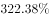；······发行新增债券21765亿元，同比增长，发行置换债券和再融资债券6607亿元，同比减少。

根据增长量比较“大大则大”的原则，新增债券（21765亿元）专项债券（15514亿元）一般债券（12858亿元），新增债券的同比增速（）专项债券的同比增速（）一般债券的同比增速（），且由于三者都是同比增长，则同比增量绝对值的排序为：新增债券专项债券一般债券，只有A项符合。

故正确答案为A。

### 给定材料

        2019年6月，全国发行地方政府债券8996亿元，同比增长，环比增长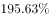。其中，发行一般债券3178亿元，同比减少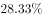，环比增长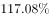，发行专项债券5818亿元，同比增长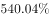，环比增长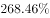；按用途划分，发行新增债券7170亿元，同比增长，环比增长，发行置换债券和再融资债券1826亿元，同比减少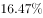，环比增长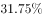。

        2019年6月，地方政府债券平均发行期限11.1年，其中新增债券10.4年，置换债券和再融资债券13.4年；地方政府债券平均发行利率，其中新增债券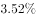，置换债券和再融资债券。

        2019年1至6月，全国发行地方政府债券28372亿元，同比增长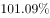。其中，发行一般债券12858亿元，同比增长，发行专项债券15514亿元，同比增长；按用途划分，发行新增债券21765亿元，同比增长，发行置换债券和再融资债券6607亿元，同比减少。

        2019年1至6月，地方政府债券平均发行期限9.3年，其中一般债券11.2年，专项债券7.8年；地方政府债券平均发行利率，其中一般债券，专项债券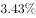。

        2019年全国地方政府债务限额为240774.3亿元。其中，一般债务限额133089.22亿元，专项债务限额107685.08亿元。截至2019年6月末，全国地方政府债务余额205477亿元，其中，一般债务118397亿元，专项债务87080亿元。

> [!warning] 疑点（官方解析可能有误，待人工复核）
> 官方解析仅用'大大则大'确认了新增＞专项＞一般三者的顺序并通过选项唯一性锁定A，未单独计算置换债券和再融资债券的增量绝对值以验证其确位于专项与一般之间；该做法依赖'A是唯一满足已证顺序的选项'这一排除逻辑，结论无误，但若四个选项中出现两个均满足'新增＞专项＞一般'顺序的变体，则需补算负增长项绝对值
