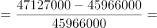
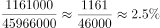
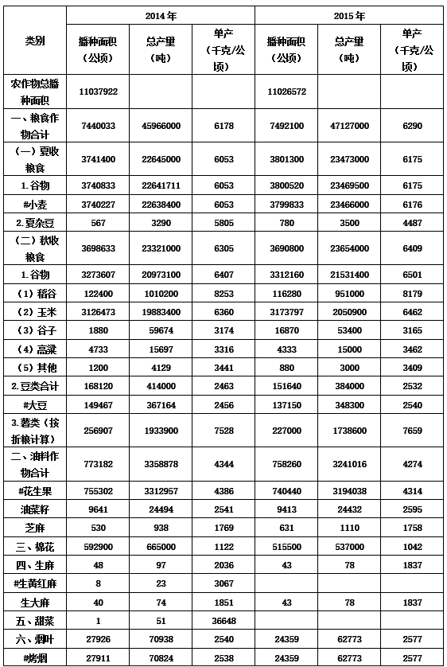
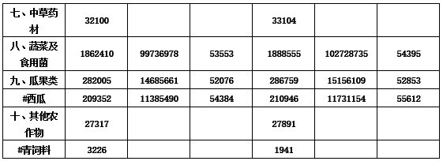

# 增长率计算（已知两期现基期值）

考点：[[20-考点/资料分析/增长/增长率计算（已知两期现基期值）|增长 / 增长率计算（已知两期现基期值）]]
材料：[[15-材料/资料分析/262596 材料主体为图片、文字不可读，仅能据兄|262596 材料主体为图片、文字不可读，仅能据兄]]

**问法模型**：题干问'2015年粮食总产量的增长率是'→ 现期增长率模型：增长率=（现期值−基期值）÷基期值，用2015年与2014年粮食总产量两年数值代入

## 推理链
1. 第1步：定位表格'粮食作物合计'行（非'农作物总播种面积'行），读取2015年粮食总产量47127000吨、2014年粮食总产量45966000吨，单位均为吨
2. 第2步：增长率公式：增长率=（现期值−基期值）÷基期值
3. 第3步：代入计算：（47127000−45966000）÷45966000=1161000÷45966000≈0.0253，即约2.5%
4. 第4步：与选项对照，C选项数值与计算结果一致，故正确答案为C

**最快解法**：⚡ 截位直除：先算增长量47127000−45966000=1161000，再把基期45966000截位为4600万级，1161÷45966≈116÷4600≈2.5%，首两位商'25'直接锁定C

## 易错点
- ⚠ 取数错行：须用'粮食作物合计'行的总产量45966000/47127000，勿误取'农作物总播种面积'行（该行无总产量）或'夏收/秋收粮食'、'谷物'等分项数据
- ⚠ 单位口径：总产量单位为吨（47127000吨即4712.7万吨），与表中'单产（千克/公顷）'单位不同；吨与万吨相差10000倍，估算时注意量级一致
- ⚠ 时间与分子分母颠倒：现期为2015年、基期为2014年，分子应为两期之差1161000，分母为基期45966000，勿用2015年值作分母

## 母题抽象
> 🧩 当题干出现'某指标某年（现期）的增长率是'且材料表格给出相邻两年绝对值时，先同行定位两期数值，用（现期−基期）÷基期，以截位直除快速对照选项

**同类特征**：增长率是、粮食总产量、2015年为现期、材料给出两年绝对值、需先求增长量、表格定位合计行

## 相关题
- [[10-真题/资料分析/其他/2028340 多年份数据加总与区间判断（'十二五'期间界定）|2028340]]（国考 2017，相关度1）

---

### 题干
2015年粮食总产量的增长率是：

### 选项
- A. 

- B. 

- C. 

　✅
- D. 

### 官方解析

根据题干“······的增长率是”，可判定本题为增长率计算问题。定位表格数据可知，2015年、2014年粮食总产量分别为47127000吨、45966000吨。根据公式：增长率，则2015年粮食总产量的增长率。

故正确答案为C。

### 给定材料

根据以下资料，完成第76～80题。

