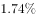
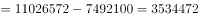
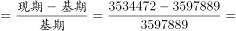
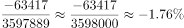

# 增长率（减少率）计算——间接作差求分量

考点：[[20-考点/资料分析/增长/增长率（减少率）计算——间接作差求分量|增长 / 增长率（减少率）计算——间接作差求分量]]
材料：[[15-材料/资料分析/262596 材料主体为图片、文字不可读，仅能据兄|262596 材料主体为图片、文字不可读，仅能据兄]]

**问法模型**：“2015年非粮食作物种植面积减少了（百分数）”→ 先用“总播种面积−粮食作物播种面积”间接求出两年非粮食面积，再套（现期−基期）/基期求减少率

## 推理链
1. 第1步：题干问“2015年……减少了”且选项为百分数，判定为增长率（减少率）计算，现期=2015年、基期=2014年
2. 第2步：表格无“非粮食作物种植面积”直接数据，需间接求：非粮食面积=农作物总播种面积−粮食作物播种面积
3. 第3步：2015年非粮食面积=11026572−7492100=3534472公顷
4. 第4步：2014年非粮食面积=11037922−7440033=3597889公顷（与官方解析引用第79题数值一致）
5. 第5步：代入公式：减少率=（3534472−3597889）/3597889=−63417/3597889
6. 第6步：截位直除：63417/3597889≈634/3598≈1.76%，即2015年非粮食作物种植面积减少了约1.76%
7. 第7步：与选项对照，1.76%对应C项，故正确答案为C

**最快解法**：⚡ 截位直除（配合间接作差）：先作差得两年非粮食面积3534472与3597889，减少量63417≈6.3万，基期≈360万，6.3/360≈1.76%，秒选C

## 易错点
- ⚠ 基期现期混淆：分母必须用2014年（基期）的3597889，误用2015年数值作分母会得约1.80%而错选
- ⚠ 间接求量陷阱：“非粮食作物种植面积”表中无此行，必须用总播种面积减粮食播种面积；且勿把“粮食作物”（7492100）误取为“秋收粮食”（3690800），勿误用产量（吨）或单产数据
- ⚠ 方向与单位：题干“减少了”已含方向，答案取绝对值1.76%匹配选项；面积单位为公顷，与产量（吨）不可混用

## 母题抽象
> 🧩 当题干出现“某年X（材料未直接给出的分量）比上一年减少/增长百分之几”时，先用“总量−已知名义部分”间接求出X的现期与基期值，再套（现期−基期）/基期，负号对应“减少”，选项取绝对值

**同类特征**：2015年、非粮食作物种植面积、减少了、选项为百分数、需间接作差求分量、增长率/减少率计算

## 相关题
- [[10-真题/资料分析/增长/9629 一般增长率计算（现期需由增量倒推）|9629]]（安徽 2009，相关度1）
- [[10-真题/资料分析/比重/2604234 现期比重计算|2604234]]（广东 2020，相关度1）
- [[10-真题/资料分析/增长/27835 一般增长率计算（已知现期量与增长量求增长率）|27835]]（河北 2012，相关度1）
- [[10-真题/资料分析/平均数/10204497 平均数增长率（均价=值-量的比值增长率）|10204497]]（海南 2024，相关度1）
- [[10-真题/资料分析/增长/12536395 隔年（间隔）增长率|12536395]]（四川 2024，相关度1）

---

### 题干
2015年非粮食作物种植面积减少了：

### 选项
- A. 

- B. 

- C. 

　✅
- D. 

### 官方解析

根据题干“2015年······减少了”，结合选项为百分数，可判定本题为一般增长率计算问题。定位表格数据可知，2015年农作物总播种面积、粮食作物播种面积分别为11026572公顷、7492100公顷，则2015年非粮食作物种植面积公顷，从第79题可知，2014年非粮食作物种植面积为3597889公顷。根据公式：增长率，即2015年非粮食作物种植面积减少了1.76%。

故正确答案为C。

### 给定材料

根据以下资料，完成第76～80题。

> [!warning] 疑点（官方解析可能有误，待人工复核）
> 官方解析中“则2015年非粮食作物种植面积公顷”一句疑似排版缺字（缺计算式11026572−7492100=3534472），但结论1.76%经验证无误，不影响答案

<!-- CODEX-ANSWER-REVIEW:BEGIN -->
### 本次独立复核

**复核状态：** `resolved`（答案与解析已核定）

**计分答案：** C（可计分）

**复核解析：**

2015年非粮食作物面积=总播种面积11026572−粮食作物面积7492100=3534472公顷；与2014年非粮食面积相比，降幅约1.76%，对应图示选项C。

**相关信息：**

先用总面积减粮食面积求分项，再与上年分项比较。

**题源依据：** [固定版本原题](https://github.com/Mentat-Uran/kaogongzhentizhengliu/blob/84ab93d4b64b61d897bece8a1c0a5bab06b4feb2/10-%E7%9C%9F%E9%A2%98/%E8%B5%84%E6%96%99%E5%88%86%E6%9E%90/%E5%A2%9E%E9%95%BF/2631510%20%E5%A2%9E%E9%95%BF%E7%8E%87%EF%BC%88%E5%87%8F%E5%B0%91%E7%8E%87%EF%BC%89%E8%AE%A1%E7%AE%97%E2%80%94%E2%80%94%E9%97%B4%E6%8E%A5%E4%BD%9C%E5%B7%AE%E6%B1%82%E5%88%86%E9%87%8F.md)；固定内容 commit `84ab93d4b64b61d897bece8a1c0a5bab06b4feb2`，Markdown blob `c8b94251cf23297edb9645d71e31ea30e07bef55`。
<!-- CODEX-ANSWER-REVIEW:END -->
