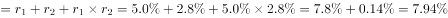
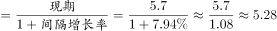
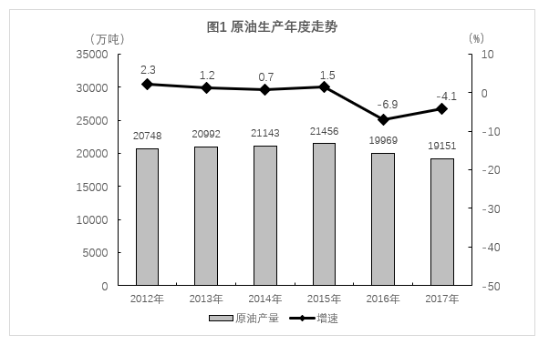
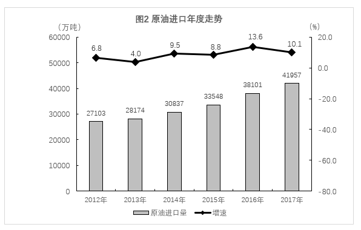
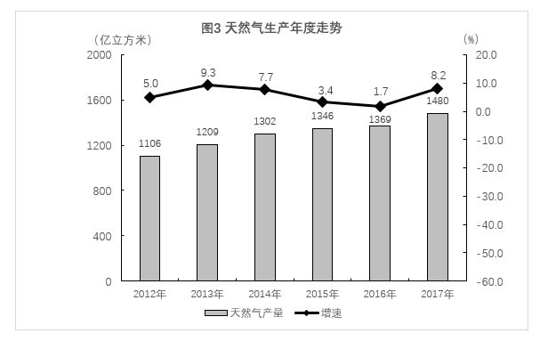
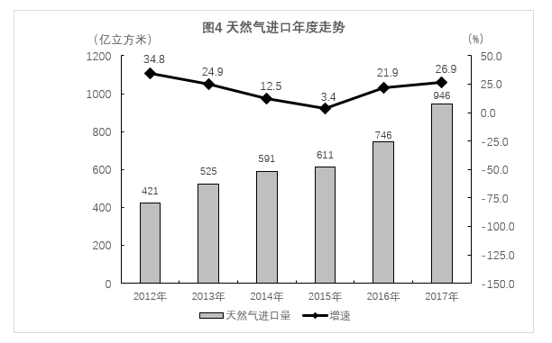

# 间隔基期量计算（隔年基期，需由'增速比上年加快2.2个百分点'还原两年增速）

考点：[[20-考点/资料分析/增长/间隔基期量计算（隔年基期，需由'增速比上年加快2.2个百分点'还原两年增速）|增长 / 间隔基期量计算（隔年基期，需由'增速比上年加快2.2个百分点'还原两年增速）]]
材料：[[15-材料/资料分析/264404 2012—2017年我国原油与天然气|264404 2012—2017年我国原油与天然气]]

**问法模型**：题干问2015年（隔年）的原油加工量、材料只给2017年现期值5.7亿吨与'增速比上年加快2.2个百分点'的差值关系 → 间隔基期模型：先还原两年增速，再用基期=现期÷[(1+r2017)×(1+r2016)]连除倒推。

## 推理链
1. 第1步：题干要求2015年原油加工量；文字材料给出2017年原油加工量5.7亿吨（=57000万吨），并注明'比上年增长[原卷数值，约5.0%]，增速比上年加快2.2个百分点'，即r2017−r2016=2.2个百分点
2. 第2步：2017年加工量增速无任何图表可查（四张图只有原油产量/进口量、天然气产量/进口量），依原卷文字取r2017≈5.0%（可由官方答案D=5.28亿吨反推校准），则r2016=5.0%−2.2%=2.8%
3. 第3步：间隔基期公式：2015年值=2017年值÷[(1+r2017)×(1+r2016)]，间隔增长率r间=r2017+r2016+r2017×r2016
4. 第4步：代入：r间=5.0%+2.8%+5.0%×2.8%≈7.8%+0.14%≈7.9%
5. 第5步：2015年原油加工量≈5.7÷1.079≈5.28亿吨（按5.7÷1.08≈5.28估算同结果）
6. 第6步：对照选项：A5.58、B5.54、C5.43、D5.28，仅D吻合，故选D

**最快解法**：⚡ 间隔基期公式法+百化分估算：r间≈5.0%+2.8%≈7.8%（乘积项0.14%可忽略），5.7÷1.08≈5.28，直选D；考场反向验证更稳：5.28×1.08≈5.70与现期5.7亿吨吻合。选项陷阱设计对应：只除2017年增速→C（5.7÷1.05≈5.43），只除2016年增速→B（5.7÷1.028≈5.54），把'加快2.2个百分点'误当增速→A（5.7÷1.022≈5.58）。

## 易错点
- ⚠ 隔年基期必须连除两年增速：只除2017年增速得5.7/1.05≈5.43（误选C），只除2016年增速得5.7/1.028≈5.54（误选B）
- ⚠ '增速比上年加快2.2个百分点'是两年增速的差值（r2017−r2016=2.2pp），不是任一年增速本身，方向为2017年更高（r2016=r2017−2.2pp）；误把2.2%当增速去除会得5.58（误选A）
- ⚠ 2017年原油加工量增速在给定文本中留白且无图可查，切勿误用原油产量增速−4.1%或天然气产量增速8.2%替代；本题须以原卷文字数值（约5.0%，经官方答案D反推校准）代入

## 母题抽象
> 🧩 当题干出现'隔年年份（早于现期两年）+某量大约是多少'，且材料只给现期值和'增速比上年加快/回落X个百分点'时，先由差值关系还原两年增速，再用基期=现期÷[(1+r1)(1+r2)]，速算取r间≈r1+r2、忽略乘积项即可锁定选项。

**同类特征**：问2015年（早于现期2017年的隔年年份）、指标为'原油加工量'（仅文字材料出现，四张图中均无）、'大约是'提示估算即可、现期值+两年增速差值关系（'增速比上年加快2.2个百分点'）、间隔基期/隔年基期计算、单位为亿吨，与选项一致无需换算

## 相关题
（暂无）

---

### 题干
2015年，我国的原油加工量大约是：

### 选项
- A. 5.58亿吨
- B. 5.54亿吨
- C. 5.43亿吨
- D. 5.28亿吨　✅

### 官方解析

根据题干“2015年，我国的原油加工量大约是”，结合材料给出2017年加工量，可判定本题为间隔基期计算问题。定位文字材料第四段可得，2017年原油加工量5.7亿吨，比上年增长，增速比上年加快2.2个百分点。可知2016年原油加工量同比增速为，则2017年相对于2015年的间隔增长率，2015年原油加工量亿吨。

故正确答案为D。

### 给定材料

        2017年，原油和天然气生产一降一升。受国际原油市场和国内石油生产开采条件变化等多种因素影响，国内原油产量下降。在相关环保政策和“煤改气”工程的拉动下，天然气需求旺盛；加之非居民用天然气价格下调，企业用气积极性提高，天然气生产持续快速增长。

1.原油生产下降，进口保持较快增长

        2017年，我国原油产量19151万吨，比上年下降，降幅较上年收窄2.8个百分点。2012年以来，原油生产基本稳定，近两年虽略有减产，但仍保持在1.9亿吨以上。

        2017年在国内原油减产、原油加工能力增加等因素推动下，原油进口量突破4亿吨。原油进口量与国内产量之比持续扩大，由2012年的1.3：1扩大到2.2：1。

        原油加工量稳步增长。随着国内新增炼厂相继投产，地方炼厂原油进口量增加，2017年原油加工量及成品油生产稳步增长。2017年原油加工量5.7亿吨，比上年增长，增速比上年加快2.2个百分点。成品油生产方面，汽油、煤油和柴油分别比上年增长、和。

        自2015年开始，获得原油进口权和进口原油使用权的地方炼厂连续两年增加，地方炼厂占原油加工份额不提高。2017年，非国有控股企业原油加工量占全部的比重为，比上年提高了1.8个百分点。

2.天然气生产和进口快速增长 

        受《加快推进天然气利用的意见》《京津冀及周边地区2017年大气污染防治工作方案》等相关政策以及煤炭消费减量替代工作、工业和民用“煤改气”工程全力推进影响，国内天然气消费需求旺盛，拉动天然气产量快速增长。2017年，天然气产量1480.3亿立方米，比上年增长，增速较上年加快6.5个百分点；与2012年相比，产量增加374.3亿立方米，年均增长。

        天然气进口持续快速增长。2017年，天然气进口946.3亿立方米，比上年增长；进口量与国内产量之比由2012年的0.4：1扩大到0.6：1。

