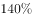

# 同比增速比较（'增长N倍'与百分数增速的换算比大小）

考点：[[20-考点/资料分析/增长/同比增速比较（'增长N倍'与百分数增速的换算比大小）|增长 / 同比增速比较（'增长N倍'与百分数增速的换算比大小）]]
材料：[[15-材料/资料分析/264432 2018年M省进出口总值1034.4|264432 2018年M省进出口总值1034.4]]

**问法模型**：题干问'同比增速最快'并给出四个国家选项 → 将以'倍'表述的增速换算为百分数（增长1.4倍=140%），再与各国增速百分数直接比大小

## 推理链
1. 第1步：从材料第一段提取条件——'对蒙古国、越南、德国、荷兰进出口分别比上年增长…、1.4倍、…和…'，四国中仅越南的增速以'1.4倍'的倍数形式给出（其余三国增速数值在所给文本中显示空缺，以原卷完整数据为准）
2. 第2步：套用表述换算规则——'增长X倍'＝同比增速为X00%，即现期＝基期的(1+X)倍；故越南'增长1.4倍'＝同比增速140%，对应现期是基期的2.4倍
3. 第3步：将越南换算后的增速140%与蒙古国、德国、荷兰的增速（原卷中以常规百分数表述）逐一比较大小
4. 第4步：140%远高于其余三国的常规百分数增速，为四国最高，故与M省贸易额同比增速最快的是越南，对照选项选D

**最快解法**：⚡ 表述直判法：见'增长1.4倍'一步口算换算成增速140%，远超常规两位数百分数增速，无需任何精算即锁定越南(D)；全程只需一次'倍→%'口径换算，约10秒作答

## 易错点
- ⚠ 把'增长1.4倍'误读为'现期是去年的1.4倍'（即增速仅40%），一旦错读40%，就可能被原卷中增速高于40%的其他国家反超而错选；必须区分'增长了1.4倍'（增速140%）与'是1.4倍'（增速40%）
- ⚠ 混淆'增速最快'与'贸易额最大'：材料中蒙古国贸易额327.7亿元为沿线国家最高，若被大额绝对数带偏、只看体量不看增速，会错选A
- ⚠ 问的是增长率（相对量）而非增长量：即使越南贸易额基数小，增速140%仍是最快；切勿用'增长量=现期×增速/(1+增速)'思路比较绝对增量

## 母题抽象
> 🧩 当题干出现'增速最快/增幅最大'且材料将'增长X倍'与'增长X%'混合表述时，先把'增长X倍'统一换算为增速X00%再比大小，并警惕'增长1.4倍'（增速140%）与'是去年的1.4倍'（增速40%）两种表述的陷阱

**同类特征**：'同比增速最快'的极值比较问法、'一带一路'沿线国家限定范围、材料以'增长1.4倍'倍数表述增速、四国并列选项（蒙古国/越南/德国/荷兰）、比较增长率而非贸易额或增长量

## 相关题
（暂无）

---

### 题干
2018年下列“一带一路”沿线国家中，与M省贸易额同比增速最快的是：

### 选项
- A. 蒙古国
- B. 荷兰
- C. 德国
- D. 越南　✅

### 官方解析

定位文字材料第一段：与“一带一路”沿线国家贸易保持快速增长，其中对蒙古国、越南、德国、荷兰进出口分别比上年增长、1.4倍、和。可知对越南贸易增长1.4倍，即增长率为，是四国中增速最快的国家。

故正确答案为D。

### 给定材料

        2018年，M省进出口总值达到1034.4亿元，比上年增长。其中，出口378.6亿元，增长；M省加工贸易进出口总值比上年增长。与“一带一路”沿线国家贸易保持快速增长，其中对蒙古国、越南、德国、荷兰进出口分别比上年增长、1.4倍、和。全省实际利用外资31.6亿美元，比上年增长。

        煤、锯材、铜矿砂为进口值前三的商品，三者合计占同期进口总值的；钢材、机电产品、农产品为出口值前三的商品，三者合计占同期出口总值的。2018年M省对“一带一路”沿线国家外贸进出口699.3亿元，增长，占同期外贸进出口总值的。其中对蒙古国外贸进出口327.7亿元，增长。

