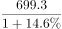
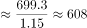
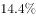
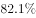
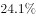
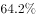
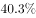
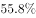
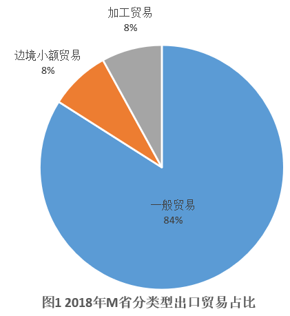
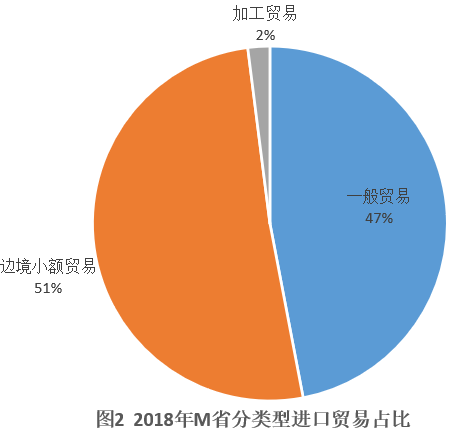

# 基期量计算（已知现期值与同比增速求基期值）

考点：[[20-考点/资料分析/增长/基期量计算（已知现期值与同比增速求基期值）|增长 / 基期量计算（已知现期值与同比增速求基期值）]]
材料：[[15-材料/资料分析/264432 2018年M省进出口总值1034.4|264432 2018年M省进出口总值1034.4]]

**问法模型**：题干问'2017年……为多少亿元'而材料只给2018年现期值699.3亿元及同比增速 → 用基期量=现期量/(1+增速)做除法。

## 推理链
1. 第1步：审时间——材料所给均为2018年数据（现期），题干问2017年，判定为基期计算问题，不能直接选材料中的数。
2. 第2步：定位文字段③：2018年M省对'一带一路'沿线国家外贸进出口699.3亿元，同比增长（提供文本中该百分数空缺，按官方答案B反推增速≈699.3/610.2−1≈14.6%）。
3. 第3步：套公式：基期量=现期量/(1+增速)=699.3/(1+14.6%)。
4. 第4步：速算：699.3/1.146≈610.2；或百化分14.6%≈1/7，基期≈699.3×7/8≈612，两者均指向610上下。
5. 第5步：与选项对照：A.509.2、B.610.2、C.699.3、D.819.3，B.610.2与计算结果精确吻合，故选B。

**最快解法**：⚡ 百化分＋截位直除：增速约14.6%≈1/7，基期=现期/(1+1/7)=699.3×7/8≈612（或直除699.3/1.146≈610），秒锁B；同时用'选项C恰为现期值699.3'直接排除时间陷阱项。

## 易错点
- ⚠ 时间陷阱：选项C的699.3正是2018年现期值，题干问2017年基期却照抄现期数，是本题最高频错误。
- ⚠ 公式方向搞反：基期应做除法699.3/(1+增速)，若误做乘法699.3×(1+增速)≈801，结果偏大易滑向D项。
- ⚠ 主体口径错位：必须用'对沿线国家外贸进出口699.3亿元'作现期值，不能误用'对蒙古国327.7亿元'或全省进出口总值1034.4亿元代入公式。

## 母题抽象
> 🧩 当题干出现'上年（过去年份）……是多少'而材料仅给'本年现期值＋同比增速'时，用基期=现期/(1+增速)做除法，并在选项中先排除把现期值原样充当答案的干扰项。

**同类特征**：问过去年份（2017年）的量、'为多少亿元'求具体数值、材料只给现期值699.3亿元＋同比增速、主体为对'一带一路'沿线国家外贸进出口、选项中混入现期值作干扰、判定用基期=现期/(1+增速)

## 相关题
（暂无）

---

### 题干
2017年M省对“一带一路”沿线国家外贸进出口总值为多少亿元？

### 选项
- A. 509.2
- B. 610.2　✅
- C. 699.3
- D. 819.3

### 官方解析

根据题干“2017年······为多少亿元”，结合材料所给时间为2018年，可判定本题为基期计算问题。定位文字材料第二段可得：2018年M省对“一带一路”沿线国家外贸进出口699.3亿元，增长。根据公式：基期，则2017年M省对“一带一路”沿线国家外贸进出口总值亿元，与B项最接近。

故正确答案为B。

### 给定材料

        2018年，M省进出口总值达到1034.4亿元，比上年增长。其中，出口378.6亿元，增长；M省加工贸易进出口总值比上年增长。与“一带一路”沿线国家贸易保持快速增长，其中对蒙古国、越南、德国、荷兰进出口分别比上年增长、1.4倍、和。全省实际利用外资31.6亿美元，比上年增长。

        煤、锯材、铜矿砂为进口值前三的商品，三者合计占同期进口总值的；钢材、机电产品、农产品为出口值前三的商品，三者合计占同期出口总值的。2018年M省对“一带一路”沿线国家外贸进出口699.3亿元，增长，占同期外贸进出口总值的。其中对蒙古国外贸进出口327.7亿元，增长。

> [!warning] 疑点（官方解析可能有误，待人工复核）
> 提供文本中'增长'后的增速百分数及官方解析中的计算结果均显示为空缺，无法直接读取原卷增速；按官方答案B=610.2反推增速≈14.6%，与官方解析'699.3/(1+增速)与B最接近'完全自洽，不构成对答案的质疑，仅提示该增速需以原卷完整数据为准。
