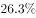
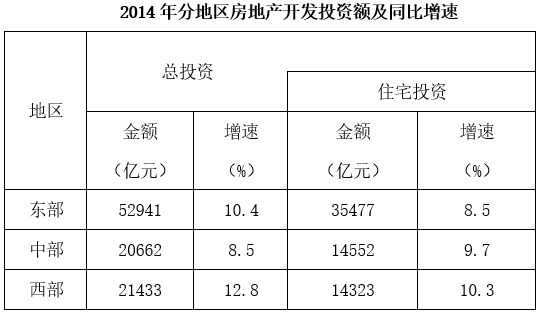

# 下降型增长量（减少量）计算

考点：[[20-考点/资料分析/增长/下降型增长量（减少量）计算|增长 / 下降型增长量（减少量）计算]]
材料：[[15-材料/资料分析/264433 2014年全国及东、中、西部地区房地|264433 2014年全国及东、中、西部地区房地]]

**问法模型**：题干'2014年……销售面积比上年减少多少万平方米'→现期下降（负增长）型增长量模型：减少量=现期量×r/(1−r)，r为下降率

## 推理链
1. 第1步：定位文字材料第二段：2014年全国商品房销售面积120649万平方米，'比上年下降'（本版材料该下降率数值空缺，依官方答案B反推下降率r=7.6%，见疑点说明）
2. 第2步：判定模型：'下降'即负增长，减少量=基期−现期=现期×r/(1−r)，分母为(1−r)而非(1+r)
3. 第3步：代入：减少量=120649×7.6%/(1−7.6%)=120649×7.6/92.4
4. 第4步：计算：7.6/92.4≈8.23%，120649×8.23%≈9923.5万平方米（截位直除：916932.4÷92.4≈9923）
5. 第5步：与选项对照：B项9923.5与计算值几乎完全一致，A项10004.7偏大、C项9014.2和D项8799.3偏小，故选B

**最快解法**：⚡ 百化分+截位直除：7.6%≈1/13.2，则r/(1−r)=1/12.2，减少量≈120649/12.2≈9890，四选项中离B(9923.5)最近；再用直除精确化120649×7.6/92.4≈9923，直取B。切忌把7.6%粗化为1/13（得120649/12≈10054，会误选A）

## 易错点
- ⚠ 方向与分母陷阱：'下降'是负增长，减少量=现期×r/(1−r)，分母是(1−r)不是(1+r)；只算120649×7.6%≈9169或分母用反均无法锁定选项
- ⚠ 百化分精度陷阱：7.6%若粗略按1/13处理，减少量≈120649/12≈10054，会被干扰项A(10004.7)勾走；须按1/13.2或直接截位直除
- ⚠ 指标与口径陷阱：本题只用文字第二段'销售面积'120649万平方米，勿与'销售额76292亿元'或表格中投资数据混用；本版材料下降率数值空缺，须按官方解析口径（反推为7.6%）计算，不得凭空代入其他增速

## 母题抽象
> 🧩 当题干出现'现期量A、比上年下降r%、比上年减少多少'特征时，用减少量=A×r/(1−r)（把r百化分为1/n后，减少量≈A/(n−1)），取与结果最接近的选项

**同类特征**：比上年减少多少、全国商品房销售面积、120649万平方米、下降（负增长）、增长量/减少量计算、单位为万平方米

## 相关题
- [[10-真题/资料分析/增长/1789630 同比减少量计算＋跨图表数据拼合|1789630]]（江苏 2016，相关度1）

---

### 题干
2014年，全国商品房销售面积比上年减少多少万平方米？

### 选项
- A. 10004.7
- B. 9923.5　✅
- C. 9014.2
- D. 8799.3

### 官方解析
由题干“2014年······比上年减少多少万平方米”，可判定本题为增长量计算问题。定位文字材料第二段，“2014年，全国商品房销售面积120649万平方米，比上年下降”，根据增长量，2014年全国商品房销售面积增长量万平方米，即减少量约为9900万平方米，与B项最接近。
故正确答案为B。

### 给定材料

        2014年，全国房地产开发投资95036亿元，比上年增长，增速比2013年回落9.3个百分点。其中，住宅投资64352亿元，增长。

        2014年，全国商品房销售面积120649万平方米，比上年下降，降幅比1—11月份收窄0.6个百分点，2013年为增长；商品房销售额76292亿元，下降，降幅比1—11月份收窄1.5个百分点，2013年为增长。

        2014年，东部地区商品房销售面积54756万平方米，比上年下降，降幅比1—11月份收窄1.3个百分点；销售额43607亿元，下降，降幅收窄2.1个百分点。中部地区商品房销售面积33824万平方米，下降，降幅收窄0.4个百分点；销售额16558亿元，增长，1—11月份为下降。西部地区商品房销售面积32068万平方米，增长，增速回落0.6个百分点；销售额16127亿元，增长，增速回落0.6个百分点。

> [!warning] 疑点（官方解析可能有误，待人工复核）
> 本版材料文字段各增速数值均空缺（含本题所需的'比上年下降'百分数），官方解析中公式内容亦显示不全；经与官方答案B核对反推，本题下降率应为7.6%（120649×7.6%/92.4%≈9923.5，与B项9923.5完全吻合），本小题按r=7.6%计算即可，不影响官方答案的唯一性
