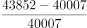
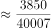
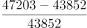
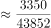
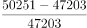
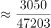
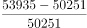
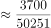

# 一般增长率比较（环比增速逐年比较）

考点：[[20-考点/资料分析/增长/一般增长率比较（环比增速逐年比较）|增长 / 一般增长率比较（环比增速逐年比较）]]
材料：[[15-材料/资料分析/264841 以'改革开放之初五年（1978-19|264841 以'改革开放之初五年（1978-19]]

**问法模型**：题干问'2013-2016年人均GDP增长率最高的一年'→逐年套用增长率=（现期-基期）/基期，化为分数比较大小

## 推理链
1. 第1步：从表1右栏提取2012-2016年人均GDP：40007、43852、47203、50251、53935元；基期2012年位于右栏首行，在所选区间2013-2016之外，须跨行取数
2. 第2步：使用公式 增长率=（现期值-基期值）/基期值，逐年计算环比增速
3. 第3步：2013年=（43852-40007）/40007=3845/40007≈9.6%；2014年=3351/43852≈7.6%；2015年=3048/47203≈6.5%；2016年=3684/50251≈7.3%
4. 第4步：用分数比较技巧'分子大、分母小的分数大'：2013年的分子3845为四年中最大，分母40007为四年中最小，故2013年增长率最高
5. 第5步：对照选项，2013年对应A，故正确答案为A

**最快解法**：⚡ 分数比较法：先求各年增长量3845、3351、3048、3684，发现2013年增长量最大而其基期40007最小，'分子大分母小→分数大'直接锁定2013年，全程无需算出具体百分数

## 易错点
- ⚠ 基期陷阱：2013年的基期是2012年（40007元），2012年在右栏首行、位于所问区间2013-2016之外，漏看会把2013年当基期或算漏2013年
- ⚠ 串栏陷阱：表1为左右双栏（左栏1978-1982、右栏2012-2016），读数易串栏，把385、423等早期数据误代入
- ⚠ 只比增长量陷阱：2016年增长量3684大于2014、2015年的增量，但基期50251也大，若只比增量会误选D，必须同时看基期

## 母题抽象
> 🧩 当题干出现'某时间段内…增长率最高（低）的一年'特征时，逐年列式'（现期-基期）/基期'化为分数，先比较分子（增长量）与分母（基期值）：若某年分子最大且分母最小可直接锁定，否则用截位直除估百分数验证

**同类特征**：增长率最高的一年、一般增长率比较、逐年环比增速、基期在所选年份区间之外（2012年）、相邻年份两两比较、人均GDP（表1右栏）

## 相关题
- [[10-真题/资料分析/增长/10297321 同比增速计算与比较（增长率比较）|10297321]]（浙江 2025，相关度1）
- [[10-真题/资料分析/增长/18643764 分段加总后的一般增长率比较|18643764]]（天津 2026，相关度1）
- [[10-真题/资料分析/增长/5521195 增长率（同比增幅）比较|5521195]]（深圳市考 2023，相关度1）
- [[10-真题/资料分析/增长/19452637 增长率比较（增量-基期型）|19452637]]（上海 2026，相关度1）
- [[10-真题/资料分析/增长/13319340 一般增长率比较（同比增速最快年份判定）|13319340]]（江苏 2025，相关度1）

---

### 题干
2013-2016年，人均GDP增长率最高的一年是：

### 选项
- A. 2013年　✅
- B. 2014年
- C. 2015年
- D. 2016年

### 官方解析

根据题干“·····人均GDP增长率最高的一年是”，可判定本题为一般增长率比较问题。定位表1可得2012~2016年的人均GDP，代入公式“增长率”，则2013年：；2014年：；2015年：；2016年：。根据分数比较技巧：分子大、分母小的分数大，2013年人均GDP增长率的分子最大，分母最小，因此2013年人均GDP增长率最高。

故正确答案为A。

### 给定材料

