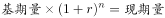
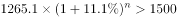
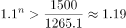
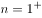
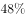
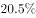
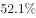

# 现期追赶（增速不变的复利外推求突破年份）

考点：[[20-考点/资料分析/增长/现期追赶（增速不变的复利外推求突破年份）|增长 / 现期追赶（增速不变的复利外推求突破年份）]]
材料：[[15-材料/资料分析/265237 2017年我国文化产品和文化服务进出|265237 2017年我国文化产品和文化服务进出]]

**问法模型**：题干出现'若保持同比增速不变…将在哪年突破1500亿美元'→用现期追赶模型：1265.1×(1+g)^n>1500，解最小整数n，突破年份=2017+n

## 推理链
1. 第1步：材料第一段给出2017年我国文化产品和服务进出口总额1265.1亿美元（本版材料该同比增速数值空缺，记为g）；题干目标值为突破1500亿美元，基准年2017年。
2. 第2步：'增速保持不变'即每年按同一增长率复利累乘：n年后总额=1265.1×(1+g)^n，需求其首次超过1500的最小整数n。
3. 第3步：目标倍数=1500/1265.1≈1.186，即需(1+g)^n>1.186；官方解析代入增速判定n=2——第1年乘积不足1500、第2年乘积突破（隐含g≥约8.9%且g<约18.6%）。
4. 第4步：n=2对应年份=2017+2=2019年，即2019年进出口总额首次突破1500亿美元。
5. 第5步：对照选项，2019年对应B项，故正确答案为B。

**最快解法**：⚡ 现期追赶＋逐次累乘验证：先算目标倍数1500/1265.1≈1.19，再将(1+g)连乘与1.19比较——官方解析判定乘1次未破、乘2次突破，n=2，2017+2=2019，直接锁定B。

## 易错点
- ⚠ 复利vs线性：'增速不变'须逐年乘(1+g)复利外推，不能按每年增加固定绝对额线性累加。
- ⚠ 年份错位：'2年后突破'即2017+2=2019（选B），易误算成1年后2018（A）或3年后2020（C）；且此为题目假设的外推口径，材料本身不含未来年份数据。
- ⚠ 口径与数据缺失：必须用进出口总盘子1265.1亿美元，勿误用文化产品971.2亿或文化服务293.9亿；本版材料'同比增长 。'处增速空缺，且'增长X%'（增速）与'提高/下降X个百分点'（占比变化）勿混用。

## 母题抽象
> 🧩 当题干出现'若保持某期同比增速不变，将在哪年突破/达到目标值'时，用现期追赶（复利）模型：基期值×(1+g)^n>目标值，求最小整数n，突破年份=基期年份+n。

**同类特征**：保持2017年同比增速不变、将在哪年突破、1500亿美元、进出口总额1265.1亿美元、外推未来年份（题目假设口径）、现期追赶

## 相关题
- [[10-真题/资料分析/增长/5894969 现期追赶问题（月均增长量+追赶模型）|5894969]]（国考 2024，相关度1）
- [[10-真题/资料分析/增长/13319341 现期追赶问题（按现期增长率外推，比较达到基期2倍所需年限）|13319341]]（江苏 2025，相关度1）
- [[10-真题/资料分析/增长/2307697 现期追赶（按不变环比增长率等比外推达到目标值所需期数-时间点）|2307697]]（辽宁 2018，相关度1）
- [[10-真题/资料分析/增长/4651954 现期量预测（现期追赶问题）|4651954]]（上海 2022，相关度1）

---

### 题干
若保持2017年同比增速不变，我国文化产业和服务进出口总额将在哪年突破1500亿美元？

### 选项
- A. 2018年
- B. 2019年　✅
- C. 2020年
- D. 2021年

### 官方解析

根据题干“若保持······同比增速不变，······将在······年突破·······”，可判定本题为现期追赶问题。定位文字材料第一段，2017年，我国文化产品和服务进出口总额1265.1亿美元，同比增长。代入公式，，则，即，解得，则文化产业和服务进出口总额将在2年后，即2019年突破1500亿美元。

故正确答案为B。

### 给定材料

        2017年，我国文化产品和服务进出口总额1265.1亿美元，同比增长。其中，文化产品进出口总额971.2亿美元，同比增长。文化服务进出口总额293.9亿美元，同比增长。

        文化产品方面，出口881.9亿美元，同比增长；进口89.3亿美元，同比下降。出口的技术含量有所提升，具有较高附加值的游艺器材和娱乐用品、广播电影电视设备出口同比增长，占比提升2个百分点至。美国、中国香港、荷兰、英国和日本为中国文化产品进出口前五大市场，进出口额合计占比为。这样比较上年下降1.8个百分点。我国与“一带一路”沿线国家进出口额达到176.2亿美元，同比增长，占比提高1.2个百分点至；与金砖国家进出口额43亿美元，同比增长。

        文化服务方面，进口232.2亿美元，同比增长。其中视听及相关产品许可费、著作权等研发成果使用费进口分别同比增长和。出口61.7亿美元，同比下降；其中处于核心层的文化和娱乐服务、研发成果、使用费、视听及相关产品许可费等三项服务出口15.4亿美元，同比增长，占比增提升5.7个百分点至。

> [!warning] 疑点（官方解析可能有误，待人工复核）
> 本版材料原文2017年总额'同比增长 。'处增速数值空缺，官方解析中公式代入的具体数字亦缺失（'代入公式，，则，即，解得'均为断句），无法据所给文本独立复核具体增速；按官方答案B反推，隐含g满足(1+g)^2≥1500/1265.1≈1.186且(1+g)<1.186（约8.9%≤g<18.6%，即一年未破、两年突破），答案B与该条件自洽，此处仅提示数据缺憾，不构成对答案的质疑。
