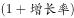
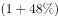
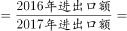
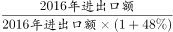
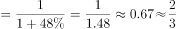

# 基期量与现期量之比（1-(1+增长率)型基期比值）

考点：[[20-考点/资料分析/增长/基期量与现期量之比（1-(1+增长率)型基期比值）|增长 / 基期量与现期量之比（1/(1+增长率)型基期比值）]]
材料：[[15-材料/资料分析/265237 2017年我国文化产品和文化服务进出|265237 2017年我国文化产品和文化服务进出]]

**问法模型**：题干'2016年……约占2017年的……'→ 同一指标的基期量/现期量比值，直接用 基期/现期=1/(1+同比增速) 求解，无需算出具体基期额。

## 推理链
1. 第1步：定位材料第二段'与金砖国家进出口额43亿美元，同比增长g'，即现期（2017年）我国与金砖国家文化产品进出口额为43亿美元；注意本版材料该增速数值空缺（原文'同比增长 。'处断开，标记：数据缺失），按官方解析以g代之。
2. 第2步：题干问2016年（基期）占2017年（现期）的比例，用基期换算公式：基期量=现期量÷(1+g)。
3. 第3步：代入得 2016年/2017年=[43/(1+g)]÷43=1/(1+g)，43亿美元在分子分母中约掉，故只需对增速做1÷(1+g)即可。
4. 第4步：以g代回比值1/(1+g)（本版材料增速空缺，需按原卷增速数值代入，截位直除1÷(1+g)定小数位），与四个选项对照，仅D与该基期/现期比值一致，故选D。

**最快解法**：⚡ 公式法（基期/现期=1/(1+g)）：定位'与金砖国家进出口额43亿美元，同比增长g'，分子分母同为43亿直接约掉，比值简化为1/(1+g)；用截位直除算1÷(1+g)对照选项即可锁定D，完全不必回算基期额（本版材料g数值空缺，代入时须按原卷增速）。

## 易错点
- ⚠ 方向搞反：求的是2016年占2017年（基期/现期=1/(1+g)），不是2017年占2016年（1+g），也不是增速g本身，三者数值完全不同。
- ⚠ 口径串位：43亿美元是'文化产品进出口'口径下与金砖国家的进出口额，本题分子分母同口径相消；切勿误拿43亿去比文化产品进出口总额971.2亿或总盘子1265.1亿。
- ⚠ 数据缺失陷阱：本版材料'与金砖国家进出口额43亿美元，同比增长 。'处增速数值空缺，不能凭印象编造增速，更不能把材料中'占比提高/下降X个百分点'（如占比提高1.2个百分点）误当增速代入；另注意负增长项（文化产品进口89.3亿、文化服务出口61.7亿）回算基期用(1−降幅)，本题金砖为正增长不涉及但同篇其他小题会踩。

## 母题抽象
> 🧩 当题干出现'上年（基期）量约占当年（现期）量的……'特征时，不必回算基期额，直接用 基期/现期=1/(1+增长率)（负增长则为1/(1−降幅)），让现期量在分子分母约掉后对照选项。

**同类特征**：2016年……约占2017年的、基期量/现期量比值、金砖国家进出口额43亿美元、同比增长（第二段）、文化产品进出口口径、约占

## 相关题
- [[10-真题/资料分析/比重/18643736 现期比重计算（部分合计÷整体总量）|18643736]]（天津 2026，相关度1）
- [[10-真题/资料分析/比重/2374810 现期比重计算（流量占存量比重）|2374810]]（广东 2019，相关度1）
- [[10-真题/资料分析/比重/2453176 现期比重计算（跨文字与表格取数，含单位换算）|2453176]]（北京 2020，相关度1）
- [[10-真题/资料分析/比重/2662198 现期比重计算|2662198]]（新疆 2020，相关度1）
- [[10-真题/资料分析/比重/2725306 现期比重计算（两分项求和占整体比重）|2725306]]（四川 2020，相关度1）

---

### 题干
2016年我国与金砖国家文化产品进出口额约占2017年的：

### 选项
- A. 

- B. 

- C. 

- D. 

　✅

### 官方解析

根据题干“2016年······约占2017年的”，可判定本题为比值计算问题。定位文字材料第二段，与金砖国家进出口额同比增长，根据公式，现期量可知，2017年进出口额2016年进出口额，则比值。

故正确答案为D。

### 给定材料

        2017年，我国文化产品和服务进出口总额1265.1亿美元，同比增长。其中，文化产品进出口总额971.2亿美元，同比增长。文化服务进出口总额293.9亿美元，同比增长。

        文化产品方面，出口881.9亿美元，同比增长；进口89.3亿美元，同比下降。出口的技术含量有所提升，具有较高附加值的游艺器材和娱乐用品、广播电影电视设备出口同比增长，占比提升2个百分点至。美国、中国香港、荷兰、英国和日本为中国文化产品进出口前五大市场，进出口额合计占比为。这样比较上年下降1.8个百分点。我国与“一带一路”沿线国家进出口额达到176.2亿美元，同比增长，占比提高1.2个百分点至；与金砖国家进出口额43亿美元，同比增长。

        文化服务方面，进口232.2亿美元，同比增长。其中视听及相关产品许可费、著作权等研发成果使用费进口分别同比增长和。出口61.7亿美元，同比下降；其中处于核心层的文化和娱乐服务、研发成果、使用费、视听及相关产品许可费等三项服务出口15.4亿美元，同比增长，占比增提升5.7个百分点至。

> [!warning] 疑点（官方解析可能有误，待人工复核）
> 本版材料原文'与金砖国家进出口额43亿美元，同比增长 。'处增速数值空缺，且四个选项均为图片公式无法读取具体数值，故只能核验官方解析的模型（2016/2017=1/(1+g)）与答案D的形式一致性，无法完成数值级验算；官方解析逻辑与答案D自洽，未发现答案本身有误。

<!-- CODEX-ANSWER-REVIEW:BEGIN -->
### 本次独立复核

**复核状态：** `resolved`（答案与解析已核定）

**计分答案：** D（可计分）

**复核解析：**

2016年贸易额约为2017年的1/(1+48%)≈67.6%，即约2/3，D。

**相关信息：**

基期量=现期量/(1+增长率)；若同比下降则除以(1−降幅)。注意百分点与百分比口径。

**题源依据：** [固定版本原题](https://github.com/Mentat-Uran/kaogongzhentizhengliu/blob/84ab93d4b64b61d897bece8a1c0a5bab06b4feb2/10-%E7%9C%9F%E9%A2%98/%E8%B5%84%E6%96%99%E5%88%86%E6%9E%90/%E5%A2%9E%E9%95%BF/2676507%20%E5%9F%BA%E6%9C%9F%E9%87%8F%E4%B8%8E%E7%8E%B0%E6%9C%9F%E9%87%8F%E4%B9%8B%E6%AF%94%EF%BC%881-(1%2B%E5%A2%9E%E9%95%BF%E7%8E%87)%E5%9E%8B%E5%9F%BA%E6%9C%9F%E6%AF%94%E5%80%BC%EF%BC%89.md)；固定内容 commit `84ab93d4b64b61d897bece8a1c0a5bab06b4feb2`，Markdown blob `82a115892b5f8cdfedc2ac54b79acf64c8884e12`。
<!-- CODEX-ANSWER-REVIEW:END -->
