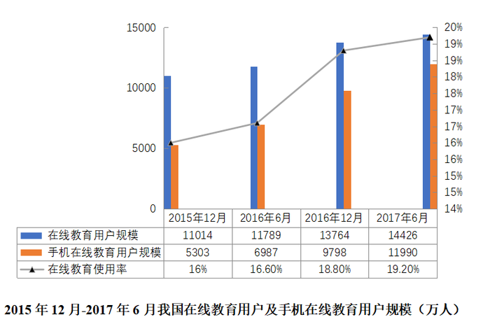
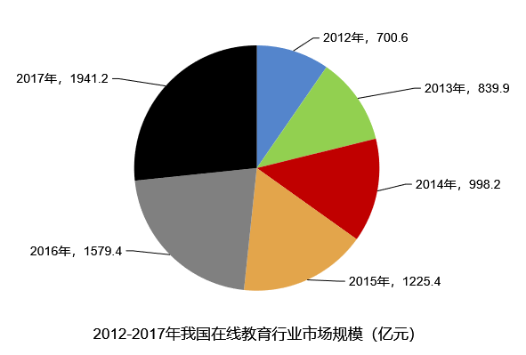
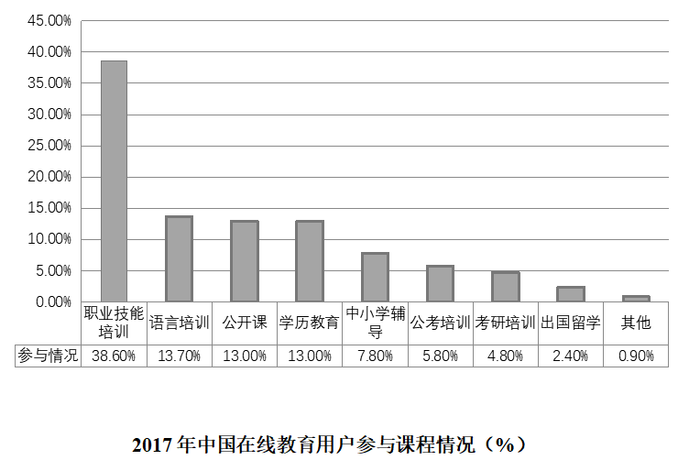

# 一般增长率比较（逐年增速比大小）

考点：[[20-考点/资料分析/增长/一般增长率比较（逐年增速比大小）|增长 / 一般增长率比较（逐年增速比大小）]]
材料：[[15-材料/资料分析/265244 2012—2017年（现期重点为20|265244 2012—2017年（现期重点为20]]

**问法模型**：题干出现'2013—2016年……增速最快的是'→对区间内每一年套增长率=（当年值−上年值）÷上年值，计算后比大小取最大

## 推理链
1. 第1步：从图2饼图读取逐年市场规模（亿元）：2012年700.6、2013年839.9、2014年998.2、2015年1225.4、2016年1579.4（2017年1941.2不在题目区间内，不参与比较）
2. 第2步：增长率公式：增速=（当年值−上年值）÷上年值，各年基期均为其上一年
3. 第3步：逐年列式：2013年(839.9−700.6)/700.6=139.3/700.6≈19.9%；2014年(998.2−839.9)/839.9=158.3/839.9≈18.8%；2015年(1225.4−998.2)/998.2=227.2/998.2≈22.8%；2016年(1579.4−1225.4)/1225.4=354.0/1225.4≈28.9%
4. 第4步：比较四个增速：28.9%＞22.8%＞19.9%＞18.8%，2016年最大
5. 第5步：增速最快为2016年，对应A项，与官方答案一致

**最快解法**：⚡ 截位直除+先比分子：先算各年增长量139.3、158.3、227.2、354.0，2016年分子354.0远超其余且基期1225.4不足其2倍，粗估354/1225≈28.9%已明显高于227/998≈22.8%，直接锁定2016年（A），其余年份可只粗估排除

## 易错点
- ⚠ 时间范围陷阱：题干限定2013—2016年，勿把2017年（1941.2亿元，增速约22.9%）或2012年纳入比较
- ⚠ 基期口径：每一年增速的基期是'上一年'（如2013年的基期是2012年700.6），不能统一用2012年或用当年做基期
- ⚠ 只比增长量不除基期：2016年增长量354.0虽最大，规范做法必须除以各自基期再比较，且饼图读数以标注'年份，数值'为准，勿按扇形目测大小排序（扇区排布不按年份顺时针递增）

## 母题抽象
> 🧩 当题干出现'某几年中……增速最快/最慢'且材料给出逐年总量时，用'当年−上年再除以上年'对区间内各年求增长率（截位直除比较），并严格排除区间外年份

**同类特征**：增速最快的是、限定了年份区间（2013—2016年）、市场规模逐年总量、饼图给出'年份，数值'标注、相邻年份做基期、一般增长率比较

## 相关题
- [[10-真题/资料分析/增长/10297321 同比增速计算与比较（增长率比较）|10297321]]（浙江 2025，相关度1）
- [[10-真题/资料分析/增长/18643764 分段加总后的一般增长率比较|18643764]]（天津 2026，相关度1）
- [[10-真题/资料分析/增长/5521195 增长率（同比增幅）比较|5521195]]（深圳市考 2023，相关度1）
- [[10-真题/资料分析/增长/19452637 增长率比较（增量-基期型）|19452637]]（上海 2026，相关度1）
- [[10-真题/资料分析/增长/19452642 同比增速比较（查找比较型+数据完整性判断）|19452642]]（上海 2026，相关度1）

---

### 题干
2013—2016年我国在线教育市场规模增速最快的是：

### 选项
- A. 2016年　✅
- B. 2015年
- C. 2014年
- D. 2013年

### 官方解析
根据题干“······增速最快的是”，可判定本题为一般增长率的比较问题。定位饼状图可知，2013—2016年各年数据，根据公式可得：
A项，2016年；
B项，2015年；
C项，2014年；
D项，2013年。
所以2013—2016年我国在线教育市场规模增速最快的是2016年，对应A项。
故正确答案为A。

### 给定材料

        2017年6月，我国在线教育用户规模达14426万人，在线教育使用率（占网民比率）达。在线教育用户中，在线教育月花费500元以内、500—1000元、1001—1999元、2000元及以上的用户占比分别为、、和。

