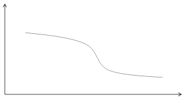
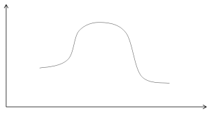
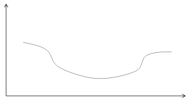
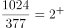
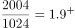
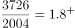
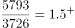
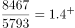
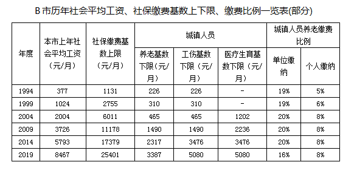

# 增长率比较（定性趋势判断+曲线选项匹配）

考点：[[20-考点/资料分析/增长/增长率比较（定性趋势判断+曲线选项匹配）|增长 / 增长率比较（定性趋势判断+曲线选项匹配）]]
材料：[[15-材料/资料分析/267195 以B市为例介绍社会保险制度背景（缴费|267195 以B市为例介绍社会保险制度背景（缴费]]

**问法模型**：题干给'1998-2018年社会平均工资增长率变化情况'的曲线选项 → 先按'上年社平工资'口径将表格年份错位对齐（1999行=1998年值），再逐段用'现期÷基期'比倍数看增速是否单调，匹配曲线形状

## 推理链
1. 第1步：表名为'(部分)'，每5年一节点，且列名为'本市上年社会平均工资'（滞后一年口径），故行首1999/2004/2009/2014/2019对应实际年份1998/2003/2008/2013/2018，数值依次为1024、2004、3726、5793、8467元/月（起点1993年为377元/月）
2. 第2步：增长率=现期值÷基期值−1；因各段倍数关系明显，只需比较'现期÷基期'倍数即可判趋势
3. 第3步：1998-2003年2004÷1024≈1.96（增速约96%），2003-2008年3726÷2004≈1.86（约86%），2008-2013年5793÷3726≈1.55（约56%），2013-2018年8467÷5793≈1.46（约46%）
4. 第4步：四段倍数/增速逐段变小（1.96→1.86→1.55→1.46），即1998-2018年社会平均工资增长率呈逐渐下降趋势
5. 第5步：对比A/B/C/D四个曲线选项，只有B项为持续下降曲线，故选B

**最快解法**：⚡ 截位直除比倍数：逐段取'现期÷基期'前两位（1.96、1.86、1.55、1.46），倍数单调递减→增速逐段下降，无需算出具体百分数，直接锁定下降曲线B

## 易错点
- ⚠ 年份口径错位：列名是'上年社会平均工资'，行首1999年实为1998年值；若不修正，表格节点是1994-2019年，与题干1998-2018年对不上，易误判无数据可用
- ⚠ 表为每5年一档的抽样'(部分)'数据，非逐年连续，只能用节点间5年段增速近似刻画1998-2018年趋势，切勿试图插值补逐年数据
- ⚠ 只需比趋势不必精算：倍数关系明显时直接比'现期÷基期'倍数；若把倍数当增长率（如1.96当196%）会量级混乱，但趋势判断本身不受影响

## 母题抽象
> 🧩 当题干以'曲线/图形选项'问某时期指标'增长率变化情况'、且材料只给隔年节点数据时，先核对年份口径（如'上年'错位），再用'现期÷基期'截位比倍数看各段增速是否单调，据单调方向匹配曲线形状

**同类特征**：'增长率变化情况'+曲线选项（图形匹配）、时间段1998-2018年、每5年一档非连续节点数据、'上年社会平均工资'错位一年口径、倍数关系明显只需比较、定性趋势判断而非精确计算

## 相关题
（暂无）

---

### 题干
以下最有可能符合B市1998-2018年社会平均工资增长率变化情况的曲线是（    ）。

### 选项
- A. 

- B. 

　✅
- C. 

- D. 

### 官方解析

根据题干“······1998-2018年······社会平均工资增长率变化情况······”，可判定本题为一般增长率比较问题。定位表格可知，B市1993年、1998年、2003年、2008年、2013年、2018年的社会平均工资分别为377元/月、1024元/月、2004元/月、3726元/月、5793元/月、8467元/月。因为倍数关系明显，只需要比较即可。因此1993~1998年：，1998-2003年：，2003-2008年：，2008-2013年：，2013-2018年：，即1998-2018年社会平均工资增长率呈逐渐下降的趋势，对比选项各曲线，只有B项符合。

故正确答案为B。

（备注：本篇第一题提到“社保管理部门会根据当地上一年社会平均工资来确定当年的社保缴费基数上限”，因此表格中的社会平均工资应该对应上一年的数值）

### 给定材料

        社会保险包括了养老保险，工伤保险，医疗生育保险等，是社会保障体系的重要组成部分。其在整个社会保障体系中居于核心地位，社会保险是一种缴费型的社会保障，资金主要由用人单位和劳动者缴纳（一般而言，各类社会保险的缴纳费用缴费基数缴纳比例），政府财政给予补贴并承担最终责任。

        在经历了一段时间的摸索后，我国的社会保障制度在上世纪90年代进入了创新式的改革、发展时期。1995年3月1日，国务院发出《关于深化企业职工养老保险制度改革的通知》，确定了社会统筹与个人账户相结合的养老保险制度，职工基本养老保险制度在全国范围内正式实行统账结合模式。

        近年来，随着我国经济发展出现一系列新形式新情况，企业对进一步降低社保费率的呼声较强，党中央、国务院提出新的要求。2019年《政府工作报告》明确提出，各地可将养老保险单位缴费比例降至。2019年，B市率先降低养老保险单位缴费比例。预计今后每年可减轻该市企业社保费缴费负担超百亿元。

> [!warning] 疑点（官方解析可能有误，待人工复核）
> 官方解析将1993~1998段（1024/377≈2.72，增速约172%）一并列入计算，而题干区间为1998-2018年（以1998年为基期只需后4段：96%→86%→56%→46%）；两种口径均呈逐段下降，结论一致，不影响答案B。另官方解析文本中各段增速数值显示缺失（冒号后为空），按表补算与结论无矛盾。
