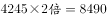

# 一般增长率计算（翻番目标模型：基期×2定目标→（目标−现期）-现期求所需同比增速）

考点：[[20-考点/资料分析/增长/一般增长率计算（翻番目标模型：基期×2定目标→（目标−现期）-现期求所需同比增速）|增长 / 一般增长率计算（翻番目标模型：基期×2定目标→（目标−现期）/现期求所需同比增速）]]
材料：[[15-材料/资料分析/269187 2013～2019年我国LED产业总|269187 2013～2019年我国LED产业总]]

**问法模型**：题干出现'目标年比基期年翻番、现期至少要同比增长'的特征 → 先用十二五末2015年产值×2定出2020年目标值，再用（目标−2019现期）/2019现期求所需同比增长率

## 推理链
1. 第1步：从题干提取口径：'十三五'末=2020年，'十二五'末=2015年，2020年总产值要比2015年'翻番'即×2；现期为2019年（增长率是与上一年2019比）
2. 第2步：定位表格，2015年总产值=4245亿元，2019年总产值=7548亿元
3. 第3步：算目标值：4245×2=8490亿元，即2020年总产值至少为8490亿元（'至少'对应恰好翻番达到8490的情形）
4. 第4步：代入增长率公式：增长率=(8490−7548)/7548=942/7548
5. 第5步：速算：942/7548≈1/8.01≈12.5%
6. 第6步：与选项对照，B项（≈12.5%）满足，故选B

**最快解法**：⚡ 百化分＋截位直除：先定目标8490，差值942；942/7548≈942/7540，因7548÷942≈8.01，故约为1/8≈12.5%，直接锁定B

## 易错点
- ⚠ 基期混淆：'翻番'的基期是十二五末2015年（4245），不是材料首年2013年（2576）；'同比增长'的现期是2019年（7548），2020年数据材料中没有，须自行外推目标值
- ⚠ '翻番'=×2，勿误当×4（翻两番）；分母应是2019年现期7548，勿误用2015年4245或目标值8490作分母
- ⚠ 时间口径：跨年推算时勿把'十三五'(2016~2020)与'十二五'(2011~2015)的末年找错，且所需增速是2019→2020的单年同比，不是年均增速（勿开方）

## 母题抽象
> 🧩 当题干出现'某目标年要比某基期年翻番、现期至少要同比增长'时，用'目标值=基期值×2，所需增速=(目标值−现期值)/现期值'模型，再以百化分（约1/8≈12.5%）截位直除验证选项

**同类特征**：翻番、十三五/十二五最后一年、至少要同比增长、总产值（总量行）、2020年数据需由基期×2外推、单年同比而非年均

## 相关题
- [[10-真题/资料分析/增长/2366023 翻番目标倒推所需增长率（目标值=基期值×2，增速=目标值-现期值-1）|2366023]]（湖北 2019，相关度1）

---

### 题干
“十三五”（2016～2020年）最后一年我国LED产业总产值要实现比“十二五”（2011～2015年）最后一年翻番的目标，总产值至少要同比增长（    ）。

### 选项
- A. 

- B. 

　✅
- C. 

- D. 

### 官方解析

由题干“总产值······同比增长”，结合选项都是百分数，可判定本题为一般增长率问题。定位表格，2015、2019年我国LED产业总产值分别为4245亿元、7548亿元。要实现2020年总产值比2015年翻番的目标，则2020年的总产值至少是亿元。根据公式：增长率，可得2020年总产值至少要比2019年增长，B项满足。

故正确答案为B。

### 给定材料

