# 同比增速比较（多主体逐年筛选取交集）

考点：[[20-考点/资料分析/增长/同比增速比较（多主体逐年筛选取交集）|增长 / 同比增速比较（多主体逐年筛选取交集）]]
材料：[[15-材料/资料分析/269187 2013～2019年我国LED产业总|269187 2013～2019年我国LED产业总]]

**问法模型**：『三个主体同比增速均超过10%的年份有几个』→ 对封装、外延芯片、应用市场三行逐年用（现期−上年）/上年算增速，与10%阈值比对后取三年份交集计数。

## 推理链
1. 第1步：从表格提取封装产值2013~2019年为403、517、615、748、963、1054、959亿元，逐年代入（现期−上年）/上年。
2. 第2步：封装增速2014年114/403≈28.3%、2015年98/517≈19.0%、2016年133/615≈21.6%、2017年215/748≈28.8%均超10%，而2018年91/963≈9.4%、2019年为负增长（−9.0%），直接排除2018、2019年。
3. 第3步：外延芯片2013~2019年为105、138、151、182、232、240、201亿元，2014年33/105≈31.4%、2016年31/151≈20.5%、2017年50/182≈27.5%超10%，但2015年仅13/138≈9.4%不达标，排除2015年（2018、2019已被封装排除，无需再算）。
4. 第4步：应用市场2013~2019年为2068、2852、3479、4286、5343、6080、6388亿元，2014~2017年增速约37.9%、22.0%、23.2%、24.7%，均远超10%。
5. 第5步：取三行均超10%的年份交集为2014、2016、2017，共3个，对照选项选C。

**最快解法**：⚡ 截位直除+『增量>上年÷10』速判：增速超10%等价于增长量超过上年值的1/10，如封装2018年增量91＜963/10≈96故排除，2019年负增长排除；再判外延芯片2015年增量13＜138/10=13.8故排除2015；应用市场2014~2017年增量（784、627、807、1057）均远大于上年/10，无需精算，交集2014、2016、2017共3年。

## 易错点
- ⚠ 须三行同时超阈值才算『均超过』，只验证一两个主体、或漏算外延芯片2015年（13/138≈9.4%临界值）会多计年份
- ⚠ 2015年外延芯片增速9.4%贴近10%，粗略截位易误判为超标，须用『增量13 vs 138/10=13.8』精确界定
- ⚠ 2019年封装（1054→959）、外延芯片（240→201）为负增长，不能默认各年均为正增长；同比增速需以2013年数据作基期，取数时勿漏2013列
- ⚠ 阈值判定标准是『超过』（严格大于），9.4%＜10%须排除

## 母题抽象
> 🧩 当题干出现『多个主体/多个指标同比增速均超过某值（常见10%）的年份有几个』时，先逐主体逐年用『增长量是否大于上年值÷10』快速判定，优先算最易排除的负增长或临界年份以缩小范围，再对其余年份验证其他主体，最后取各主体达标年份的交集计数。

**同类特征**：2014～2019年间、封装、外延芯片和应用市场、同比增速均超过、年份有几个、多主体逐年筛选、需以2013年数据作同比基期

## 相关题
- [[10-真题/资料分析/增长/13504272 一般增长率计算与计数比较（同比增速-5%年份计数）|13504272]]（云南 2025，相关度1）
- [[10-真题/资料分析/增长/16070145 同比增长率比较（逐年增速计算并计数年份）|16070145]]（贵州 2026，相关度1）
- [[10-真题/资料分析/增长/2024184 同比增长率比较（超阈值年份计数）|2024184]]（重庆 2016，相关度1）
- [[10-真题/资料分析/比重/2662229 现期比重比较（占比过半判断）|2662229]]（新疆 2020，相关度1）
- [[10-真题/资料分析/倍数/4673147 现期倍数比较（'多N倍'的转化判断）|4673147]]（广东 2022，相关度1）

---

### 题干

2014～2019年间，我国LED产业封装、外延芯片和应用市场产值同比增速均超过的年份有几个？

### 选项
- A. 1
- B. 2
- C. 3　✅
- D. 4

### 官方解析

由题干“······同比增速均超过的年份······”，可判定本题为一般增长率问题。定位表格，2013~2019年，我国LED产业封装产值分别是403、517、615、748、963、1054、959亿元。根据公式：增长率=，可得2014年增长率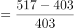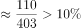，2015年增长率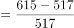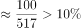，2016年增长率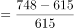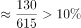，2017年增长率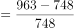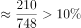，2018年增长率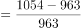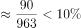，2019年增长率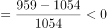。故LED产业封装产值增速超过的年份有2014、2015、2016、2017年，而2018、2019年排除。

2013~2017年，我国外延芯片产值分别是105、138、151、182、232亿元。根据公式：增长率=，可得2014年增长率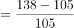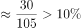，2015年增长率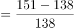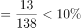，2016年增长率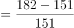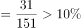，2017年增长率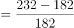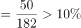，故增速超过的年份有2014、2016、2017年，而2015年排除。

2013~2017年，我国应用市场产值分别是2068、2852、3479、4286、5343亿元。根据公式：增长率=，可得2014年增长率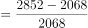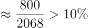，2016年增长率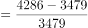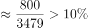，2017年增长率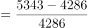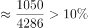。故增速均超过的年份有2014、2016、2017年，共计3年。

故正确答案为C。

### 给定材料

> [!warning] 疑点（官方解析可能有误，待人工复核）
> 官方解析文字中增长率公式与阈值数值显示缺失（据各年份判定结果可反推阈值为10%），且外延芯片、应用市场部分仅罗列2013~2017年数据（2018、2019年已由封装行排除，不影响结论）；以上为解析呈现不全，答案C无误。

<!-- CODEX-ANSWER-REVIEW:BEGIN -->
### 本次独立复核

**复核状态：** `resolved`（答案与解析已核定）

**计分答案：** C（可计分）

**复核解析：**

超过10%的阈值下，各年三类市场按相邻年计算。封装收入2014—2019为403、517、615、748、963、1054、959：2014—17增长率均>10%，2018约9.4%、2019为负；所以交集仅可能在2014—17。外延芯片2013—17为105、138、151、182、232，2014增31.4%、2015增9.4%、2016增20.5%、2017增27.5%；应用市场2013—19为2068、2852、3479、4286、5343、6080、6388，其2014—17均>10%。三者共同超过10%的年份为2014、2016、2017，共3年，C。2018和2019仅封装一项就不合条件。

**相关信息：**

“均超过”是三个领域各自都要严格超过10%；比较的是相邻年份同比，而非2014至2019累计变化。

**题源依据：** [固定版本原题](https://github.com/Mentat-Uran/kaogongzhentizhengliu/blob/84ab93d4b64b61d897bece8a1c0a5bab06b4feb2/10-%E7%9C%9F%E9%A2%98/%E8%B5%84%E6%96%99%E5%88%86%E6%9E%90/%E5%A2%9E%E9%95%BF/2719366%20%E5%90%8C%E6%AF%94%E5%A2%9E%E9%80%9F%E6%AF%94%E8%BE%83%EF%BC%88%E5%A4%9A%E4%B8%BB%E4%BD%93%E9%80%90%E5%B9%B4%E7%AD%9B%E9%80%89%E5%8F%96%E4%BA%A4%E9%9B%86%EF%BC%89.md)；固定内容 commit `84ab93d4b64b61d897bece8a1c0a5bab06b4feb2`，Markdown blob `1b50757a7a015199c7e258769ea9e2bc7d3d951e`。
<!-- CODEX-ANSWER-REVIEW:END -->
