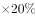
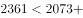
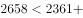
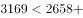
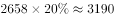
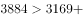
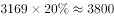
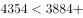
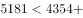

# 同比增长率计数（逐年增速与阈值比较）

考点：[[20-考点/资料分析/增长/同比增长率计数（逐年增速与阈值比较）|增长 / 同比增长率计数（逐年增速与阈值比较）]]
材料：[[15-材料/资料分析/269188 2019年全国地铁（城轨交通）运营规|269188 2019年全国地铁（城轨交通）运营规]]

**问法模型**：题干问'2014～2019年间同比增长20%以上的年份有几个'→增长率计数模型：逐年用(现期-基期)/基期求增速并与20%阈值比对后计数。

## 推理链
1. 第1步：定位图1柱状图，2013—2019年全国地铁运营线路长度依次为2073、2361、2658、3169、3884、4354、5181公里；题干限定2014—2019共6个同比增速，2013年数据仅作2014年增速的基期。
2. 第2步：公式为增长率=(现期量-基期量)/基期量；'同比增长20%以上'等价于现期量>基期量×1.2。
3. 第3步：逐年代入：2014年288/2073≈13.9%；2015年297/2361≈12.6%；2016年511/2658≈19.2%；2017年715/3169≈22.6%；2018年470/3884≈12.1%；2019年827/4354≈19.0%。
4. 第4步：仅2017年增速（≈22.6%）超过20%；2016年（19.2%）与2019年（19.0%）均为临界未达标，其余年份明显不足。
5. 第5步：达标年份共1个（2017年），对照选项选A。

**最快解法**：⚡ 基期×1.2比较法（免做除法）：判断'现期>基期×1.2'——2014年2073×1.2≈2488>2361✗；2015年2361×1.2≈2833>2658✗；2016年2658×1.2≈3190>3169✗（临界）；2017年3169×1.2≈3803<3884✓；2018年3884×1.2≈4661>4354✗；2019年4354×1.2≈5225>5181✗（临界）；仅2017年满足，共1个，选A。

## 易错点
- ⚠ 时间范围陷阱：只统计2014—2019共6个年份的同比增速，2013年仅作基期不计入，勿把2013年计入或漏掉2014年。
- ⚠ 临界年份误判：2016年（3169对3190）与2019年（5181对5225）增速均约19%、差一点点未到20%，眼算粗心易判为'超过'而误选C或D。
- ⚠ 阈值看漏：阈值为20%，若误读成'10%以上'则6个年份全部达标必错选D；题干文本中百分比数字易被忽略，需以官方答案口径（仅2017年达标）锁定为20%。

## 母题抽象
> 🧩 当题干出现'某时间段内同比增长X%以上的年份有几个'特征时，用'现期量与基期量×(1+X%)比较'逐年代入计数，重点精核接近阈值的临界年份（差值在几十以内的须精算）。

**同类特征**：同比增长20%以上、年份有几个、2014～2019时间段、柱状图年度序列、增长率计数模型、首年作基期起点

## 相关题
- [[10-真题/资料分析/增长/13504272 一般增长率计算与计数比较（同比增速-5%年份计数）|13504272]]（云南 2025，相关度1）
- [[10-真题/资料分析/增长/16070145 同比增长率比较（逐年增速计算并计数年份）|16070145]]（贵州 2026，相关度1）
- [[10-真题/资料分析/增长/2024184 同比增长率比较（超阈值年份计数）|2024184]]（重庆 2016，相关度1）
- [[10-真题/资料分析/比重/2662229 现期比重比较（占比过半判断）|2662229]]（新疆 2020，相关度1）
- [[10-真题/资料分析/倍数/4673147 现期倍数比较（'多N倍'的转化判断）|4673147]]（广东 2022，相关度1）

---

### 题干

2014～2019年间，全国地铁运营线路长度同比增长以上的年份有几个？

### 选项
- A. 1　✅
- B. 2
- C. 3
- D. 4

### 官方解析

根据题干“······同比增长以上······”，可判定本题为一般增长率问题。定位柱状图可得2013~2019年间全国地铁运营线路长度。根据公式：增长率，同比增长以上，即现期量基期量基期量。2014年：；2015年：；2016年：；2017年：；2018年：；2019年：，因此2014年~2019年全国地铁运营线路长度同比增长以上的年份为2017年，有1个。

故正确答案为A。

### 给定材料

        2019年全国地铁运营线路长度达5181公里，占城轨交通运营线路总里程的。

        2019年末，我国城轨交通配属地铁列车6178列，全年实现地铁客运量227.76亿人次。

> [!warning] 疑点（官方解析可能有误，待人工复核）
> 给定题干与官方解析文本中百分比数值均有缺失（题干作'同比增长以上'，解析公式亦被吞），按官方答案A（仅2017年达标）反推阈值为20%，官方解析与答案在此口径下自洽，无矛盾。

<!-- CODEX-ANSWER-REVIEW:BEGIN -->
### 本次独立复核

**复核状态：** `resolved`（答案与解析已核定）

**计分答案：** A（可计分）

**复核解析：**

阈值原图为20%。全国地铁运营里程图给2013—2019分别为2073、2361、2658、3169、3884、4354、5181公里。题目统计2014—2019：增速依次为288/2073≈13.89%、297/2361≈12.58%、511/2658≈19.23%、715/3169≈22.56%、470/3884≈12.10%、827/4354≈19.00%。只有2017年超过20%，共1年，选A。

**相关信息：**

2019年预测地铁里程图是后续材料；本题使用2013—2019全国地铁运营里程图。

**题源依据：** [固定版本原题](https://github.com/Mentat-Uran/kaogongzhentizhengliu/blob/84ab93d4b64b61d897bece8a1c0a5bab06b4feb2/10-%E7%9C%9F%E9%A2%98/%E8%B5%84%E6%96%99%E5%88%86%E6%9E%90/%E5%A2%9E%E9%95%BF/2719383%20%E5%90%8C%E6%AF%94%E5%A2%9E%E9%95%BF%E7%8E%87%E8%AE%A1%E6%95%B0%EF%BC%88%E9%80%90%E5%B9%B4%E5%A2%9E%E9%80%9F%E4%B8%8E%E9%98%88%E5%80%BC%E6%AF%94%E8%BE%83%EF%BC%89.md)；固定内容 commit `84ab93d4b64b61d897bece8a1c0a5bab06b4feb2`，Markdown blob `964dec36f9d9527868e72221ad55b595682d2879`。
<!-- CODEX-ANSWER-REVIEW:END -->
