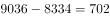

# 增长量比较

考点：[[20-考点/资料分析/增长/增长量比较|增长 / 增长量比较]]
材料：[[15-材料/资料分析/269189 全国残疾人康复事业发展情况：2014|269189 全国残疾人康复事业发展情况：2014]]

**问法模型**：题干问'2016～2019年同比增量最大的年份' → 对各年依次用'同比增量=现期量−基期量'（相邻两年年末数相减）后比较大小

## 推理链
1. 第1步：题干限定比较2016、2017、2018、2019四个年份的同比增量；从图1读取各年末机构数：2015年7111、2016年7858、2017年8334、2018年9036、2019年9775个
2. 第2步：图1为各年末时点存量，某年同比增量=当年年末数−上年年末数
3. 第3步：2016年增量=7858−7111=747个；2017年=8334−7858=476个；2018年=9036−8334=702个；2019年=9775−9036=739个（与文字'比2018年增长739个'互相验证一致）
4. 第4步：比较四个增量：747＞739＞702＞476，最大为2016年的747个
5. 第5步：对应选项A（2016年），与官方答案一致

**最快解法**：⚡ 差值口算法：将图1相邻柱读数两两相减得747、476、702、739（2019年增量可直接取文字'增长739个'），只需比较首位差值大小即知2016年最大，无需精算；柱高差目测可辅助快速锁定2016与2019两年再精验

## 易错点
- ⚠ 时间范围陷阱：题干只比较2016～2019年，2014/2015年不在比较范围（2015年增量仅197个无需计算）
- ⚠ 增量≠增速混淆：若误算同比增长率会偏离题意（本题问增量，直接相减即可）
- ⚠ 基期取错：必须用相邻上一年年末数作基期，图1为时点存量而非累计值，且2019年增量可直接由文字'比2018年增长739个'取用，不必重复相减

## 母题抽象
> 🧩 当题干出现'某时段内同比增量最大（小）的年份'特征时，直接用柱状图/文字相邻年份现期量−基期量逐个相减（末期增量常可由文字'比上年增长X'直接取得），比较大小对照选项，全程无需除法

**同类特征**：2016～2019年、同比增量最大、年份比较、机构数量（时点存量）、柱状图相邻年份、增长量比较

## 相关题
- [[10-真题/资料分析/增长/12536408 增长量比较|12536408]]（四川 2024，相关度4）
- [[10-真题/资料分析/增长/2144598 增长量比较|2144598]]（选调 2018，相关度3）
- [[10-真题/资料分析/增长/465283 增长量比较|465283]]（江苏 2014，相关度3）
- [[10-真题/资料分析/增长/15121335 增长量比较|15121335]]（江苏 2024，相关度3）
- [[10-真题/资料分析/增长/18643862 增长量比较|18643862]]（四川 2026，相关度3）

---

### 题干
2016～2019年，全国残疾人康复机构数量同比增量最大的年份是：

### 选项
- A. 2016年　✅
- B. 2017年
- C. 2018年
- D. 2019年

### 官方解析

根据题干“2016~2019年，······同比增量最大的年份是”，可判定本题为增长量比较问题。定位文字材料第一段可知，2019年全国残疾人康复机构比2018年增长739个；定位图形材料1可得：2015~2018年全国残疾人康复机构数量分别为7111、7858、8334、9036个。根据增长量现期量基期量，各年份的增长量分别为：

2016年，个；

2017年，个；

2018年，个。可知同比增长量最大的年份是2016年。

故正确答案为A。

### 给定材料

        截至2019年末，全国已有残疾人康复机构9775个，比2018年增长739个。2019年，1043.0万残疾儿童及持证残疾人得到基本康复服务，其中包括0～6岁残疾儿童18.1万人。

        截至2019年末，全国已竣工的各级残疾人综合服务设施2341个，总建设规模584.5万平方米，总投资183.1亿元；已竣工各级残疾人康复设施1006个，总建设规模414.2万平方米，总投资132.2亿元。

