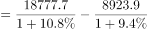
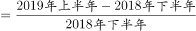

# 环比增长率计算（同比转环比：基期反推+全年减上半年作差）

考点：[[20-考点/资料分析/增长/环比增长率计算（同比转环比：基期反推+全年减上半年作差）|增长 / 环比增长率计算（同比转环比：基期反推+全年减上半年作差）]]
材料：[[15-材料/资料分析/269190 2019年我国服务进出口（上半年与全|269190 2019年我国服务进出口（上半年与全]]

**问法模型**：题干问'2019年上半年某指标环比约上升/下降多少'→ 同比转环比模型：先用'现期÷(1+同比增速)'反推2018年上半年与2018年全年两个基期值，作差得2018年下半年，再以(8923.9−2018年下半年)÷2018年下半年求环比。

## 推理链
1. 第1步：题干'2019年上半年…环比'，环比基期为2018年下半年；定位材料第3段：2019年上半年知识密集型服务进出口额8923.9亿元（同比增速原卷给出、本文本空缺），第4段：2019年全年18777.7亿元（同比增速同前），材料未直接给出2018年下半年数据。
2. 第2步：规则一，全年=上半年+下半年，故2018年下半年=2018年全年−2018年上半年；规则二，基期值=现期量÷(1+同比增速)。
3. 第3步：反推两个基期：2018年上半年=8923.9÷(1+r上半年)，2018年全年=18777.7÷(1+r全年)，其中r上半年、r全年为原卷第3、4段的同比增速（本文本数值空缺，需回原卷补读后代入）。
4. 第4步：作差：2018年下半年=18777.7÷(1+r全年)−8923.9÷(1+r上半年)，按官方解析代入原卷增速计算，所得值小于8923.9亿元（否则不可能为'上升'）。
5. 第5步：求环比=(8923.9−2018年下半年)÷2018年下半年，分子为正→'上升'，幅度对应较小百分点数值。
6. 第6步：对照选项：C、D为'下降'方向不符排除；A、B同为'上升'但数值不同，与计算结果一致的是A项，故正确答案为A。

**最快解法**：⚡ 同比转环比三步法：①用'现期÷(1+同比)'截位直除分别估算2018年上半年（8923.9÷(1+r上半年)）与2018年全年（18777.7÷(1+r全年)）两个基期值（本文本增速空缺，原卷补读后代入）；②'全年−上半年'作差得2018年下半年；③(8923.9−所得基期值)÷所得基期值，差为正即'上升'，幅度量级直接对照A项锁定，无需精算。

## 易错点
- ⚠ 环比与同比混淆：环比基期是2018年下半年（上一期），不是2018年上半年，更不是2018年全年；且2018年下半年材料未直接给出，必须用'2018年全年−2018年上半年'作差，误把18777.7亿元（2019年全年）当基期是典型错误。
- ⚠ 两步基期反推缺一不可：需先用各自同比增速反推2018年上半年与2018年全年，再作差得2018年下半年；本文本两处增速数值均空缺，跳过反推直接拿8923.9与18777.7或8923.9比较必错，原卷须回材料补读百分数。
- ⚠ 方向与数值双校验：A与C数值相同、仅'上升/下降'方向不同，B与D同理；先由分子正负定方向排除C、D，再对数值，只对数值不核方向易误选C。

## 母题抽象
> 🧩 当题干出现'某年上半年/某期…环比约上升(下降)…'、而材料只平行给出'上半年+全年'两组现期值与同比增速时，用'现期÷(1+同比)'反推上一年的两个基期值，'全年−上半年'作差得上一期，再以差值÷基期定环比方向与幅度。

**同类特征**：'2019年上半年…环比约'设问、选项为'上升了/下降了+百分数'组合（两数值×两方向）、知识密集型服务进出口额（对应材料第3、4段）、同比转环比：隐含基期为上一年下半年、全年与上半年平行结构、需作差求隐含期数据、同比增速需回材料补读后代入

## 相关题
（暂无）

---

### 题干
2019年上半年，我国知识密集型服务进出口额环比约：

### 选项
- A. 
上升了
　✅
- B. 
上升了

- C. 
下降了

- D. 
下降了

### 官方解析

根据题干“2019年上半年，······环比约”，结合选项为“上升下降了百分数”，可判定本题为一般增长率计算问题。定位材料第三段，2019年上半年，我国知识密集型服务进出口额8923.9亿元，同比增长；定位材料第四段，2019年全年，我国知识密集型服务进出口额18777.7亿元，同比增长。则2018年下半年进出口额2018年全年2018年上半年亿元。2019年上半年环比增长率，A项满足。

故正确答案为A。

### 给定材料

        2019年上半年，我国服务进出口总额达到26124.6亿元，同比增长。其中，出口总额9333.7亿元，同比增长；进口总额16790.8亿元，同比下降。服务进出口总额占对外贸易总额的比重达到，比2018年全年高出0.5个百分点。

        2019年全年，我国服务进出口总额54152.9亿元，同比增长。其中，出口总额19564.0亿元，同比增长；进口总额34588.9亿元，同比减少。

        2019年上半年，我国知识密集型服务进出口额8923.9亿元，同比增长，其中，知识密集型服务出口额4674.1亿元，同比增长；进口额4249.8亿元，同比增长。从具体领域看，知识产权使用费出口同比增长；电信、计算机和信息服务出口同比增长，进口同比增长；其他商业服务（含技术、专业和管理咨询服务、研发成果转让费及委托研发等）出口同比增长；金融服务出口同比增长，进口同比增长。

        2019年全年，我国知识密集型服务进出口额18777.7亿元，同比增长，其中，知识密集型服务出口额9916.8亿元，同比增长；进口额8860.9亿元，同比增长。从具体领域看，个人文化娱乐服务，电信、计算机和信息服务，金融服务进出口总额分别同比增长、、。

> [!warning] 疑点（官方解析可能有误，待人工复核）
> 本文本中所有同比增速数值及官方解析代入的数值均被置空（原卷为完整百分数），故本题的基期反推与环比具体数值无法在现有文本内逐步复算；此为材料文本缺失问题而非解析错误，解析的'基期反推+全年减上半年作差'思路与官方答案A完全一致，答案A作为唯一事实保留不改。

<!-- CODEX-ANSWER-REVIEW:BEGIN -->
### 本次独立复核

**复核状态：** `confirmed`（独立复算确认答案）

**计分答案：** A（可计分）

**复核解析：**

公式图给出知识密集型服务2019H1增长9.4%、全年增长10.8%；回推2018H1≈8157.5、2018全年≈16947.4、2018H2≈8789.9。2019H1比2018H2约增1.5%，选A。

**相关信息：**

环比跨半年比较须先由同比增速还原两个基期区间量。

**题源依据：** [固定版本原题](https://github.com/Mentat-Uran/kaogongzhentizhengliu/blob/84ab93d4b64b61d897bece8a1c0a5bab06b4feb2/10-%E7%9C%9F%E9%A2%98/%E8%B5%84%E6%96%99%E5%88%86%E6%9E%90/%E5%A2%9E%E9%95%BF/2719411%20%E7%8E%AF%E6%AF%94%E5%A2%9E%E9%95%BF%E7%8E%87%E8%AE%A1%E7%AE%97%EF%BC%88%E5%90%8C%E6%AF%94%E8%BD%AC%E7%8E%AF%E6%AF%94%EF%BC%9A%E5%9F%BA%E6%9C%9F%E5%8F%8D%E6%8E%A8%2B%E5%85%A8%E5%B9%B4%E5%87%8F%E4%B8%8A%E5%8D%8A%E5%B9%B4%E4%BD%9C%E5%B7%AE%EF%BC%89.md)；固定内容 commit `84ab93d4b64b61d897bece8a1c0a5bab06b4feb2`，Markdown blob `bc544e21dc92030528da1360ab20a21cd3296d07`。
<!-- CODEX-ANSWER-REVIEW:END -->
