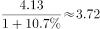
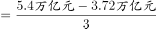
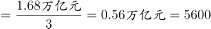

# 年均增长量（同比增量均值）+基期量反推

考点：[[20-考点/资料分析/增长/年均增长量（同比增量均值）+基期量反推|增长 / 年均增长量（同比增量均值）+基期量反推]]
材料：[[15-材料/资料分析/269905 2015-2017年我国旅游业核心指|269905 2015-2017年我国旅游业核心指]]

**问法模型**：题干出现'3年同比增量均值'→ 用年均增长量模型（末期总量−基期总量)÷3，其中2014年基期须由2015年总量÷(1+2015年增速)反推

## 推理链
1. 第1步：定位表中'全年实现旅游业总收入'行（注意不是GDP综合贡献行）：2015年4.13万亿元、增速10.7%；2016年4.69万亿元；2017年5.4万亿元；2014年数值表中未给出
2. 第2步：基期反推规则：2014年总量 = 2015年总量 ÷ (1+2015年增速) = 4.13 ÷ 1.107
3. 第3步：截位直除得 4.13 ÷ 1.107 ≈ 3.73万亿元（2014年旅游总收入）
4. 第4步：3年同比增量之和等于末期减基期：5.4 − 3.73 = 1.67万亿元（逐年验证：2015年增量≈0.40、2016年0.56、2017年0.71万亿元，合计1.67万亿元）
5. 第5步：增量均值 = 1.67 ÷ 3 ≈ 0.556万亿元 = 5560余亿元（万亿元×10⁴=亿元）
6. 第6步：对照选项，5560余亿元落在4000-6000亿区间，故选B

**最快解法**：⚡ 公式法+截位直除：先反推基期 4.13÷1.107≈3.73（把1.107截位为1.11，4.13/1.11≈3.72~3.73即可），年均增量=(5.4−3.73)÷3≈0.56万亿元≈5600亿元，直接锁定B，无需逐年算三个增量

## 易错点
- ⚠ 基期反推陷阱：表中无2014年数据，2015年的同比增速10.7%对应基期是2014年，必须用4.13÷1.107反推；若误把2015年总量4.13当基期，均值会错算为约4200亿元
- ⚠ 看串行陷阱：'全年实现旅游业总收入'(4.13/4.69/5.4万亿元)与'全国旅游业对GDP的综合贡献'(7.34/8.19/9.13万亿元)相邻且口径不同，看错行会得到完全不同的增量
- ⚠ 单位换算陷阱：表中单位为万亿元，选项单位为'亿(元)'，1万亿元=10⁴亿元，0.56万亿元=5600亿元，漏乘10⁴会把5560亿误判为不足4000亿；此外除数应为3（2015/2016/2017三个增量）而非4，也不能把增速10.7%、13.6%、15.1%误当增量

## 母题抽象
> 🧩 当题干出现'N年同比增量均值/年均增长量'且首年基期数据未直接给出时，先用'首年总量÷(1+首年同比增速)'反推基期，再用'(末年总量−基期总量)÷N'一步求均值，最后按选项单位换算量级（万亿元↔亿元）对照区间作答

**同类特征**：3年同比增量均值、年均增长量、基期年份未在表中出现、区间式选项（不到/超过/数值范围）、旅游总收入、万亿元换算为亿元

## 相关题
- [[10-真题/资料分析/增长/15419190 年均增长量计算|15419190]]（湖北 2025，相关度1）
- [[10-真题/资料分析/增长/1752596 年均增长量计算（五年规划期口径）|1752596]]（北京 2016，相关度1）
- [[10-真题/资料分析/增长/19452634 年均增长量与现期量外推|19452634]]（上海 2026，相关度1）
- [[10-真题/资料分析/增长/2742310 年均增长量计算|2742310]]（北京 2021，相关度1）
- [[10-真题/资料分析/增长/16592941 同比增量与年均增长量的比值计算|16592941]]（青海 2024，相关度1）

---

### 题干
2015、2016、2017年，3年旅游总收入同比增量均值：

### 选项
- A. 不到4000亿
- B. 4000-6000亿　✅
- C. 6000-8000亿
- D. 超过8000亿

### 官方解析

根据题干“3年······同比增量均值”，可判定本题为年均增长量问题。定位表格材料可知，2015年旅游总收入为4.13万亿元，增速为，2017年旅游总收入为5.4万亿元，可知2014年旅游总收入为万亿元。根据年均增长量，故3年旅游总收入同比增量均值亿元，结合选项在4000-6000亿元之间。

故正确答案为B。

### 给定材料

