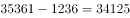
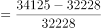
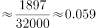

# 增长率计算（基期需由增量倒推，2014年同比增速）

考点：[[20-考点/资料分析/增长/增长率计算（基期需由增量倒推，2014年同比增速）|增长 / 增长率计算（基期需由增量倒推，2014年同比增速）]]
材料：[[15-材料/资料分析/269911 2015年国民经济和社会发展统计公报|269911 2015年国民经济和社会发展统计公报]]

**问法模型**：题干求'2014年比上年同期增长'且选项为无单位小数 → 一般增长率模型：2014年增量 ÷ 2013年基数，其中2014、2013年基数均需用'现期−增量'倒推，2014年增量=两个累计增量之差

## 推理链
1. 第1步：从材料第2段提取数据：2015年末参加城镇职工基本养老保险35361万人，比上年末（2014年末）增加1236万人，比2013年末增加3133万人
2. 第2步：题干问2014年相对2013年的增长率，需先倒推两个基期：2014年=35361−1236=34125万人，2013年=35361−3133=32228万人
3. 第3步：求2014年同比增量：34125−32228=1897万人（等价于3133−1236=1897万人）
4. 第4步：代入增长率公式：1897÷32228≈0.0589，即约5.9%
5. 第5步：与选项对照：A.0.044、B.0.049、C.0.054均偏离，D.0.059与计算结果一致，故选D

**最快解法**：⚡ 增量相减+截位直除：2014年增量=3133−1236=1897万人，基数截位取32228≈32000，则1897/32228≈19/322≈0.059，直接锁定D；全程只需一次减法一次除法

## 易错点
- ⚠ 增量错配：误把2015年增量1236万人当2014年增长量作分子（1236/32228≈3.8%，与四个选项均不符，易慌乱重算），2014年增量应为3133−1236=1897万人
- ⚠ 基期倒推方向搞反：误用加法35361+1236、35361+3133当2014/2013年数据，正确是用减法35361−1236=34125、35361−3133=32228
- ⚠ 时间口径与时点表述：'比上年末增加'对应2014年末时点数，'增加'省略主语仍指与上年比；且此题问的是2014年当年增速，不是2015年增速，注意隔年错位

## 母题抽象
> 🧩 当题干出现'上年比上年前年增长'且材料只给现期值+比上年末增量+比前年末增量时，用'两个增量相减得该年增长量、现期减增量倒推前年基数'，增长率=增量之差÷倒推基数，最后验证选项数值（小数即百分数去%）

**同类特征**：'2014年……比上年同期增长了'（隔一年同比增速）、选项为无单位小数0.044/0.049/0.054/0.059、材料只给现期35361与两个累计增量1236、3133、基期均需减法倒推、时点数（年末参保人数）、考增长率而非增长量

## 相关题
（暂无）

---

### 题干
2014年，参加城镇职工基本养老保险人数比上年同期增长了：

### 选项
- A. 0.044
- B. 0.049
- C. 0.054
- D. 0.059　✅

### 官方解析

根据题干“2014年······比上年同期增长了”，结合选项都没有单位，可判定本题为一般增长率计算问题。定位材料可得，2015年，全国参加城镇职工基本养老保险人数35361万人，比上年末增加1236万人，比2013年末增加3133万人。则2014年全国参加城镇职工基本养老保险人数为万人，2013年为万人。所求增长率。

故正确答案为D。

### 给定材料

        2015年国民经济和社会发展统计公报。公报显示，全年全国居民人均可支配收入21966元，比上年增长，增长率下降1.2个百分点。按常住地分，2015年城镇居民人均可支配收入31195元，比上年增长，增长率比2014年下降0.8个百分点；农村居民人均可支配收入11422元，比上年增长，增长率比2014年下降2.3个百分点。全年农村居民人均纯收入为10772元。全国农民工人均月收入3072元，比上年增长。全国居民人均消费支出15712元，比上年增长。按常住地分，城镇居民人均消费支出21392元，增长，农村居民人均消费支出9223元，增长。2015年，全国参加城镇职工基本养老保险人数35361万人，比上年末增加1236万人，比2013年末增加3133万人；参加城乡居民基本养老保险人数50472万人，增加365万人，比2013年末增加772万人；参加城镇基本医疗保险人数66570万人，增加6823万人，比2013年末增加9525万人。其中，参加职工基本医疗保险人数28894万人，增加598万人；参加城镇居民基本医疗保险人数37675万人，增加6225万人。参加失业保险人数17326万人。参加工伤保险人数21404万人，增加765万人，其中参加工伤保险的农民工7489万人，增加127万人。参加生育保险人数17769万人，增加730万人。

