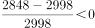
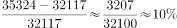

# 同比增长率计算与多指标排序比较

考点：[[20-考点/资料分析/增长/同比增长率计算与多指标排序比较|增长 / 同比增长率计算与多指标排序比较]]
材料：[[15-材料/资料分析/270127 2011—2018年我国部分财政指标|270127 2011—2018年我国部分财政指标]]

**问法模型**：题干问'2018年…税种…按同比增速从高到低排序' → 对5个税种分别套用 r=(现期−基期)/基期 算出2018年增速并排序对照选项

## 推理链
1. 第1步：定位表中5个税种行，提取2017→2018年数值：国内增值税56378→61531、国内消费税10225→10632、关税2998→2848、个人所得税11966→13872、企业所得税32117→35324（单位亿元）
2. 第2步：套用增长率公式 r=(2018年值−2017年值)/2017年值
3. 第3步：代入计算：个税1906/11966≈15.9%；企业所得税3207/32117≈10.0%；增值税5153/56378≈9.1%；消费税407/10225≈4.0%；关税−150/2998≈−5.0%（负增长）
4. 第4步：排序为 个税(15.9%)＞企业所得税(10.0%)＞增值税(9.1%)＞消费税(4.0%)＞关税(−5.0%)，与选项B完全一致

**最快解法**：⚡ 截位直除+符号排除法：先看增量符号，关税2848<2998为负增长直接排末位；再对剩余4项粗比'增量/基期'首位：个税1906/11966≈16%、企业所得税3207/32117≈10%、增值税5153/56378≈9%、消费税407/10225≈4%，其中仅企业所得税与增值税量级接近需细除一位（10.0% vs 9.1%），即可锁定B

## 易错点
- ⚠ 企业所得税与增值税增速十分接近（约10.0% vs 9.1%），截位过粗易将二者排反，误选C/A类干扰项
- ⚠ 关税2018年为负增长（2848<2998），易忽略符号将其按正增速参与比较，或误认为'增量小增速就低'而不看正负
- ⚠ 只比增量不比基期：增值税增量5153亿元为五税种最大，但其增速并非最高；增长率=增量/基期，分子大不等于增速高；此外11行8列的表格易串行串列取错数据

## 母题抽象
> 🧩 当题干出现'某年多个指标的同比增速从高到低排序'时，先用'现期<基期即负增长'快速钉死末位，再对剩余项用增量/基期截位直除比首位，只需精确区分最接近的1—2项即可锁定选项

**同类特征**：同比增速从高到低排序、多个税种（多指标）横向比较、现期2018年与基期2017年相邻两年、增长率=（现期−基期）/基期、选项为完整排列需逐项核对、数据来源为多行统计表

## 相关题
（暂无）

---

### 题干
2018年，上表所列国家税收收入的税种中，按税收收入同比增速从高到低排序，正确的是：

### 选项
- A. 
企业所得税国内增值税个人所得税国内消费税关税

- B. 
个人所得税企业所得税国内增值税国内消费税关税
　✅
- C. 
企业所得税个人所得税国内增值税关税国内消费税

- D. 
个人所得税国内消费税企业所得税国内增值税关税

### 官方解析

根据题干“2018年······同比增速从高到低排序······”，可判定本题为一般增长率计算问题。定位统计表材料，可知2017年及2018年选项各税种的税收收入。根据公式：增长率，表中各税种的增长率如下：

国内增值税：；

国内消费税：；

关税：；

个人所得税：；

企业所得税：。

则按税收收入同比增速从高到低排序为：个人所得税企业所得税国内增值税国内消费税关税。

故正确答案为B。

### 给定材料

