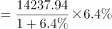
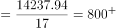
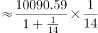
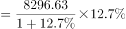
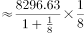
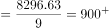

# 增长贡献率比较（转化为增长量比较）

考点：[[20-考点/资料分析/增长/增长贡献率比较（转化为增长量比较）|增长 / 增长贡献率比较（转化为增长量比较）]]
材料：[[15-材料/资料分析/270131 某市2018年国民经济和社会发展运行|270131 某市2018年国民经济和社会发展运行]]

**问法模型**：题干问'对GDP增长的贡献率最大'→贡献率=分项同比增量÷GDP同比增量，四个选项共用同一分母（GDP总增量），退化为直接比较各分项同比增量Δ=现期×r/(1+r)的大小

## 推理链
1. 第1步：提取四选项2018年增加值——第三产业14237.94亿元、现代服务业10090.59亿元、文化及相关产业（规模以上）1560.52亿元、高新技术产业8296.63亿元，各自同比增速以试卷标注百分数为准
2. 第2步：公式：贡献率=分项同比增量÷GDP同比增量；GDP总增量24221.98×r/(1+r)对四个选项是同一个分母，故只需比较分子（各分项增量）
3. 第3步：增量公式Δ=现期×r/(1+r)；先用'大大则大'定性排除：文化及相关产业现期值1560.52亿元与增速均为四项中最小，其增量必最小，排除C
4. 第4步：对A、B、D代入试卷标注增速实算：ΔA=14237.94×r₃/(1+r₃)、ΔB=10090.59×r服/(1+r服)、ΔD=8296.63×r高/(1+r高)
5. 第5步：比较结果：高新技术产业基数在三者中最小（8296.63<10090.59<14237.94），但试卷标注其增速远高于另两项，增速优势足以弥补约1.7倍的基数劣势，ΔD最大
6. 第6步：分项增量最大→对GDP增长的贡献率最大，对照选项确定答案为D（高新技术产业）

**最快解法**：⚡ 增长量比较'大大则大'+百化分速算：C项现期与增速双小先排除；A、B、D用Δ=现期×r/(1+r)，将各自增速百化分为1/n后Δ≈现期÷(n+1)口算比大小，全程无需计算GDP总增量，高新技术产业（8296.63亿元、高增速）增量最大，锁定D

## 易错点
- ⚠ 只比现期规模会误选A：第三产业14237.94亿元基数最大，但贡献率比的是增量Δ=现期×r/(1+r)，大基数低增速会被小基数高增速反超；'大大则大'仅适用于现期与增速同大的排除（本题仅C项符合）
- ⚠ 口径混淆：高新技术产业8296.63亿元（四大支柱产业口径）≠高技术制造业6131.20亿元（现代产业口径），名称相近数字不同，取错数结论即错
- ⚠ 材料文本中百分数全部空缺，各产业增速必须以试卷标注值代入，不可凭记忆补数；分子算增量勿漏÷(1+r)的基期换算，且分母是GDP同比增量而非GDP总量（同分母不影响排名但口径须清楚）

## 母题抽象
> 🧩 当题干出现'对总体（GDP等）增长的贡献率最大'且各选项共用同一总体时，用'贡献率=分项增量÷总增量、分母相同→只比分项增量Δ=现期×r/(1+r)'：先用'大大则大'排除现期与增速双小的项，其余实算（百化分≈现期÷(1+n)），警惕大基数低增速项的迷惑

**同类特征**：贡献率最大、对地区生产总值增长的贡献、产业增加值与同比增速、同分母转化为增量比较、增长量比较'大大则大'、现期（2018年）数据

## 相关题
（暂无）

---

### 题干
2018年，下列产业对该市地区生产总值增长的贡献率最大的是：

### 选项
- A. 第三产业
- B. 现代服务业
- C. 文化及相关产业（规模以上）
- D. 高新技术产业　✅

### 官方解析

根据题干“2018年，······对······贡献率最大的是”，结合材料时间为2018年，可判定本题为现期比重问题。根据公式：增长贡献率，总体增长量均为该市地区生产总值增长量，则本题只需比较部分增长量的大小即可。定位文字材料第一段可知，第三产业增加值14237.94亿元，增长；现代服务业增加值10090.59亿元，增长；文化及相关产业（规模以上）增加值1560.52亿元，增长；高新技术产业增加值8296.63亿元，增长。根据增长量比较“大大则大”原则，文化及相关产业（规模以上）增加值及同比增速均为最小，则其增长量最小，排除C项。根据公式：增长量，则第三产业增加值的增长量亿元；现代服务业增加值的增长量亿元；高新技术产业增加值的增长量亿元。故高新技术产业增加值的增长量最大，对该市地区生产总值增长的贡献率最大。

故正确答案为D。

### 给定材料

        2018年，某市实现地区生产总值24221.98亿元，比上年增长。其中，第一产业增加值22.09亿元，增长；第二产业增加值9961.95亿元，增长；第三产业增加值14237.94亿元，增长。现代产业中，现代服务业增加值10090.59亿元，增长；先进制造业增加值6564.83亿元，增长；高技术制造业增加值6131.20亿元，增长。四大支柱产业中，金融业增加值3067.21亿元，增长；物流业增加值2541.58亿元，增长；文化及相关产业（规模以上）增加值1560.52亿元，增长；高新技术产业增加值8296.63亿元，增长。七大战略性新兴产业增加值合计9155.18亿元，比上年增长，占地区生产总值比重。其中，新一代信息技术产业增加值4772.02亿元，增长；数字经济产业增加值1240.73亿元，增长；高端装备制造产业增加值1065.82亿元，增长；绿色低碳产业增加值990.73亿元，增长；海洋经济产业增加值421.69亿元，下降；新材料产业增加值365.61亿元，增长；生物医药产业增加值298.58亿元，增长。

        全市年末常住人口1302.66万人，其中常住户籍人口454.70万人，增长，占常住人口比重；常住非户籍人口847.97万人，增长，占比重。年末城镇登记失业率为。全年居民消费价格比上年上涨。全年完成一般公共预算收入3538.41亿元，比上年增长。其中税收收入2899.60亿元，增长。一般公共预算支出4282.54亿元，下降。

> [!warning] 疑点（官方解析可能有误，待人工复核）
> 材料文本中各产业增速全部空缺，官方解析中三个增量的具体数值随之留空；'高新技术产业增量最大'的结论依赖试卷实际标注增速——因8296.63<14237.94（基数差约1.7倍），高新技术产业增速须明显高于第三产业与现代服务业方能反超，实际作答应以卷面百分数代入验证，不影响官方答案D
